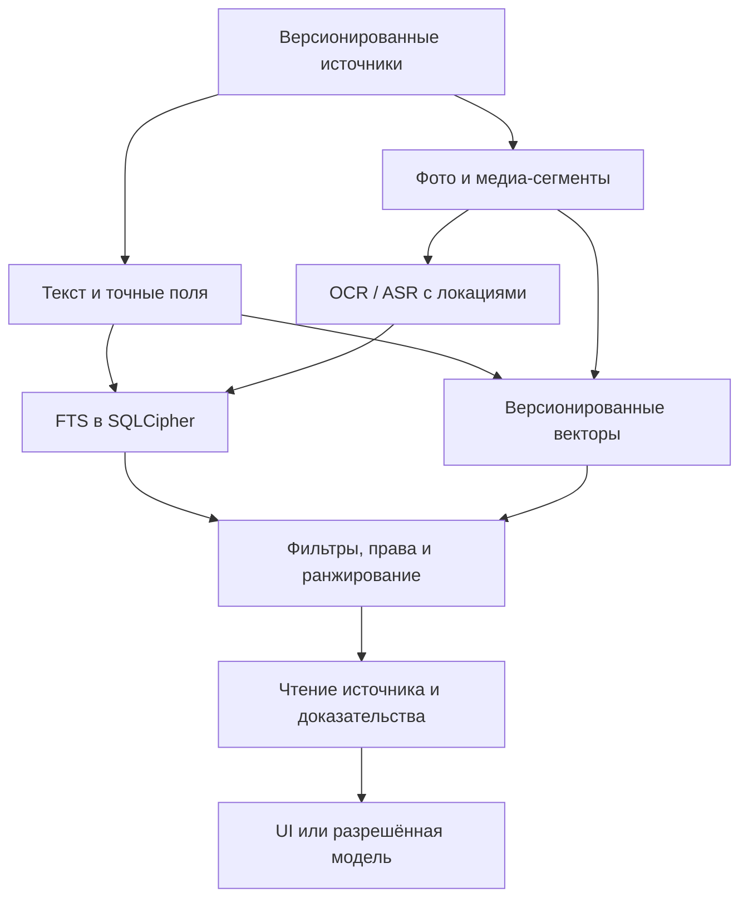

# PersAI — единая локальная мультимодальная память и локальный ИИ

**Дата:** 22.10.2026; актуализация подплана 26.10.2026 (ред. 75)
**Статус 30.10.2026 (после физической приёмки):** №83.0 #247 — DONE; №83.1 — **базовые text→image и image→image ранжирования на трёх фотографиях PASS на Vivo X200 Pro / Android 16** в отдельном офлайн Vision Lab 0.1.5 (#258 merged; main CI #41113858004 PASS). **Оценка качества на реальной большой библиотеке, same-object, peak RAM, батарея и production Expo-интеграция NOT VERIFIED.** №83.2 — инженерные PR #260/#261, без production-поиска до exact-head CI и полного Android acceptance. №83.3–83.6 ещё не внедрены.
**Связь с [основным планом](../PLAN.md):** п. 83 «поиск по фото» — основной исполнительный пункт; п. 66 — существующая семантическая память; п. 84 — несколько медиа в заметке; п. 56/60б — развитие памяти и обработка медиа; будущие пункты локальной LLM, ресурсов и бюджетов. Основные UI/вложения/Share уже в main; непройденные Android-проверки отмечаются отдельно и не блокируют публикацию независимых PR. Очередь обновлена после аудита памяти; воспроизведённые поломки исправляются приоритетно.

> **Целевое решение:** Local AI First. Максимум обработки и поиска происходит **на самом телефоне**, без собственного сервера PersAI. Для **индексации/поиска** исследуем единую мультимодальную EmbeddingGemma 2; для **ответов, рассуждений и действий** — отдельную локальную генеративную Gemma 4 E2B/E4B. «Единая локальная модель для всего» — пожелание по удобству и ресурсам, **не обещание**, что один embedding-чекпойнт будет генерировать ответы или что один генеративный чекпойнт даст качественный поисковый индекс. На первом этапе предпочтительна **единая модель эмбеддингов** для нескольких модальностей + совместимый локальный inference-стек, а не принудительная замена всех моделей.

## Аудит основания №83 — 26.10.2026

[Постоянный журнал №66](../docs/architecture/MEMORY_RETRIEVAL_AUDIT_2026-10-26.md) фиксирует 19 находок и подтверждённые probes. Перед расширением индекса учитывать source/extraction revisions и located chunks, durable queue вместо полного сканирования каждой пачкой, model/index manifest, общий search→read с ACL, backup ceilings. Пакеты и критерии — [MEMORY_RELIABILITY.md](MEMORY_RELIABILITY.md). Это подготовка существующих 83.0–83.6, а не уже реализованный runtime. 83.0 и изолированный 83.1 не ждут всей долгосрочной программы; production 83.2 требует согласованных source versions, очереди, manifest и restore. [Время](TEMPORAL_MEMORY.md) и [связи](RELATIONAL_MEMORY.md) работают и с нынешними текстами/оригиналами, без ожидания мультимодальной модели. Выбор EmbeddingGemma 2 остаётся гипотезой с native eval; общий порядок определяет PLAN.md.

## Контроль №83.0 — 30.10.2026

**Фактическая текущая реализация:** `mobile/src/local-memory/search-index.ts` индексирует текст записи, выбранные структурные поля, вручную введённые алиасы/слова и **имена** оригиналов, но не пиксели. `mobile/src/media/embedder.ts` использует `react-native-executorch` MiniLM 384d для текста; он **не** универсальный vision encoder. Зашифрованный источник изображения уже хранится в `memory_attachments`/`memory_attachment_parts` с проверкой SHA-256 при открытии; векторный индекс производный, а не новый факт.

**Автоматический baseline:** `mobile/src/local-memory/__tests__/photo-baseline.test.ts` на настоящем SQLite проверяет: фото с `IMG_0001.jpg` без подписи не находится по слову «велосипед», подписанный текст находится, пользовательский тег добавляет **текстовое**, но не визуальное совпадение, `reindexAll` не выдумывает подпись; сохранённые байты оригинала не анализируются; личные и архивные записи не возвращаются в разрешённой выдаче. Это не model quality и не измерение Recall@K. Точные границы и go/no-go — [OpenSpec 83.0](../openspec/changes/photo-search-83-baseline/proposal.md).

**Проверены официальные API 30.10.2026:** [MediaPipe Universal Embedder Android](https://developers.google.com/edge/mediapipe/solutions/retrieval/universal_embedder/android) поддерживает `embedText` и `embedImage` через `com.google.mediapipe:tasks-retrieval`/LiteRT-LM. Документация использует `latest.release` лишь в примере; в PersAI версия должна быть закреплена после проверки Maven/ABI. Для Expo 57 нужен собственный native bridge; текущий ExecuTorch не принимает `.litertlm` по умолчанию. Рабочая Android-совместимость, 440M memory budget, SHA весов и русское качество — **не подтверждены**, не утверждать, что поиск по фото готов.

**Фактическое состояние 83.0/83.1:** baseline #247 слит в main с CI PASS. Android spike #248 обнаружил проверенную несовместимость: MediaPipe `tasks-retrieval:1.1.0` транзитивно требует LiteRT-LM `0.17.0-alpha1` с Kotlin metadata 2.4, а Expo/RN проект компилируется Kotlin 2.1. Проба #249 независимо подтвердила компиляцию с Kotlin 2.4; offline Android 16 Vision Lab #250, исправление размеров фото #251, диагностика класса #252 и закрепление совместимого для теста LiteRT-LM 0.18.0 #253 **не вносили изменений в основной PersAI**. **Модуль в production по-прежнему отключён через `expo-module.config.json: platforms=[]`.** На реальном Vivo X200 Pro / Android 16 пользователь подтвердил два успешных вызова text→image (детали ниже). Результат снимает блокировку **только native inference**, но не подтверждает качество поиска, photo→photo, peak RAM, задержку пакетной индексации, интеграцию Expo Kotlin 2.1 или 83.2. Не обновлять Kotlin всего PersAI только ради spike.

## Контроль №83.1 — физический Vivo X200 Pro, Android 16 (30.10.2026)

**Доказательство именно настоящего запуска, а не теста сборки:** два снимка экрана пользователя `PersAI Vision Lab`, отдельный Android applicationId `com.persai.visionlab`, одинаковый SHA-256-префикс выбранной модели `92dcbea108899e5d`, вызов `UniversalEmbedder.embedText + embedImage + cosineSimilarity` в одном процессе без INTERNET permission. Предшествующие device failures `ArithmeticException` (декодер) и `NoClassDefFoundError` (`ActivationDataType`, `embedder-create`) устранены в лаборатории, после чего скриншоты показывают `Готово` вместо ошибки.

| Параметр | Вызов A | Вызов B |
| --- | ---: | ---: |
| Текст запроса (на экране) | `красный велосипед возле дерева` | `красный велосипед возле дерева` |
| Cosine text↔image | **0,7686** | **0,5397** |
| Время **всего** создания модели + векторизации + сравнения, не warm/скорость индексации | **2386 мс** | **1882 мс** |
| PSS процесса до→после (не RAM peak!) | **93→295 МиБ** | **124→275 МиБ** |

**Статус:** text→image локальный инференс **PROVEN ON PHYSICAL DEVICE**; число успешно обработанных вызовов = **2**. **Разметка подтверждена пользователем:** вызов A = фотография красного велосипеда у дерева (**relevant**); вызов B = фотография совершенно не по теме (**irrelevant**). Соответственно, в одном первом положительно-отрицательном сравнении модель правильно поставила relevant выше irrelevant: 0,7686 > 0,5397, разница **0,2289**. Значения cosine сами по себе не дают Precision, Recall, hit-rate и не определяют универсальный порог. **Нельзя объявлять retrieval quality или идентичность объекта проверенной.** PSS измерен только до/после вызова и может не отражать пик, буферы GPU/NNAPI и потребление исходного процесса; не публиковать его как полный бюджет модели. Батарея, нагрев, долговременная стабильность, 10–20 репрезентативных снимков и фото→фото **NOT_RUN**.

**Очередной gate перед 83.2:** маркировка этих двух снимков relevant/irrelevant **получена** (1 положительно-отрицательная пара, не полноценный Recall/Precision); прогнать небольшой **заранее размеченный** набор домашних, авто, документов/предметов и близких «двойников»; добавить возможность сравнить 2–5 выбранных локальных фотографий с одним текстовым запросом и (отдельно) image→image, показать **ранжирование**, а не абсолютный порог. Не включать недоказанный SDK в основной Expo APK и не создавать второй механизм хранения/поиска. Отдельный тест с согласованными исходниками и понятным откатом перед производственным 83.2.

**Следующий ограниченный тест (#83.1, APK v0.1.4):** отдельный `com.persai.visionlab` использует существующий `UniversalEmbedder` и Kotlin 2.4/LiteRT-LM 0.18.0, добавляя поштучный SAF-выбор 2–5 фотографий и ранжирование по **одному** текстовому запросу. Text embedding вычисляется один раз за запуск, фотографии последовательно декодируются/освобождаются, модель закрывается после набора. Никакие фото/векторы не сохраняются, облачных запросов, нового search writer и подключения в основное Expo-приложение нет. JUnit проверяет стабильную сортировку, равные/отрицательные оценки, NaN, ограничения 2–5 и зафиксированную размеченную пользователем пару. **Реальный результат нового сценария на Vivo ещё NOT_RUN.** Image→image, peak RAM и production индекс остаются следующими отдельными gate; этот PR нельзя объявлять завершением №83.1/83.2.

**Следующий отдельный эксперимент (#83.1, Vision Lab v0.1.5, результат устройства ещё НЕ ПРОВЕРЕН):** к уже работающему text→image ранжированию добавлено **image→image** по одному выбранному образцу и 2–5 кандидатам. Один экземпляр прежнего `UniversalEmbedder` с тем же checkpoint строит embedding образца и последовательно кандидатов; не создаётся ни вторая поисковая система, ни пользовательский индекс/хранилище. Изображения выбираются вручную, декодируются и освобождаются по одному, не сохраняются; повторный выбор образца как кандидата по одинаковому URI блокируется во избежание тривиального самосовпадения. **Примитивный синтетический набор и генератор исключены из проекта как непригодные для оценки визуального качества.** Для дальнейшей приёмки нужны отдельные фотореалистичные изображения без текстовых подписей и вручную подтверждённая разметка. На Vivo требуется реальный тест photo→photo до 83.2.

### Результат физических испытаний Vision Lab 0.1.5 (30.10.2026)

Пользователь выполнил **четыре ранжирования** на Vivo X200 Pro (Android 16), трёх отдельно выбранных фотореалистичных JPG и модели EmbeddingGemma 2 Text-Vision 440M. Это **проверка правильного порядка только среди 3 кандидатов**, не ground-truth 10–1000 изображений. Данные сохранены по присланным скриншотам в истории проекта; фотографии не находятся в репозитории и не должны подменяться примитивными рисунками.

| Поиск | Ожидалось на первом месте | Фактическое ранжирование по косинусному сходству | Итог |
| --- | --- | --- | --- |
| Фото красного велосипеда → похожие фото | №1 красный велосипед | №1 0,9572 · №2 синий велосипед 0,8587 · №3 автомобиль 0,6902 | PASS |
| «красный велосипед возле дерева» → фото | №1 красный велосипед | №1 0,7522 · №2 0,6682 · №3 0,5881 | PASS |
| «синий велосипед у озера» → фото | №2 синий велосипед | №2 0,7121 · №1 0,6765 · №3 0,6244 | PASS |
| «синий автомобиль на улице» → фото | №3 автомобиль | №3 0,7157 · №2 0,6078 · №1 0,5814 | PASS |

Время двух первых рейтингов по 3 фото ~6,3 и ~5,0 с соответственно, PSS процесса после ~279 и ~282 МиБ (**не пик RAM**). Малый запас 0,0356 при запросе синего велосипеда и высокое сходство даже с автомобилем: **ни порог совпадения, ни идентичность конкретного предмета не доказаны**. Нельзя делать из 4/4 оценку general accuracy / Recall@K для настоящей памяти. Дальше — native Expo compatibility, единый SQLCipher retrieval с source revisions/ACL, профили/lock/restore и тестирование 10–20 сложных снимков. Недоказанный движок не подключать автоматически.

**После device QA:** #258 (отдельный Vision Lab) слит в main; [CI #41113858004](https://github.com/panasenkof/PersonalAI/actions/runs/41113858004) SUCCESS. Попытка глобального Kotlin 2.4 в #259 закрыта unmerged после реального native CI: Expo Pika `0.3.2-2.4.21` отсутствует. #260 проверяет отдельно собранный Kotlin 2.4 AAR/Java ABI в Kotlin 2.1 consumer (не Expo); #261 содержит отдельный менеджер загрузки моделей с честной пометкой о неподключённом поиске. Пока CI/Expo acceptance не подтверждены, оба PR **PARTIAL / NOT PRODUCTION**.

## 1. Почему пересматриваем п. 83

В ручной проверке PersAI фото находилось только после текстового распознавания. Это не «плохой поиск», а отсутствие самостоятельного индекса изображений. По состоянию на 21.10.2026 в плане предлагались CLIP + парный текстовый индекс, OCR и объединение с FTS; поиск по тексту основан на `paraphrase-multilingual-MiniLM-L12-v2`, индекс FTS5 и векторный поиск в SQLCipher.

**Новая гипотеза:** EmbeddingGemma 2 строит текстовые, визуальные, аудио- и видео-представления в **общем 768-мерном пространстве**, поэтому один и тот же текстовый запрос может находить и заметку, и изображение, и фрагмент аудио/видео. Она поддерживает более 100 языков, но **качество русскоязычного поиска на наших данных необходимо проверить**; нельзя переносить общие бенчмарки на PersAI без измерений.

**Не путать модели:**

| Компонент | Назначение | Роль |
| --- | --- | --- |
| EmbeddingGemma 2 (Google DeepMind) | **Эмбеддинги/поиск:** текст, изображения, звук, кадры/фрагменты видео | Основной кандидат для п. 83; **не генерирует ответ** |
| Gemma 4 E2B/E4B (Google DeepMind) | **Генеративная LLM:** ответ, анализ, выделение фактов, инструменты, мультимодальный ввод | Отдельный кандидат для режима локального ассистента; не подменяет retrieval без оценки |
| MiniLM (текущая) | Семантический текстовый поиск | Сохраняется как контрольная группа/откат до подтверждённой миграции |
| CLIP / совместимый компактный vision embedder | Поиск изображений по тексту | Резервный кандидат для сравнения, если EmbeddingGemma 2 не запускается/проигрывает |
| OCR, Whisper/ASR, FTS5 | Точные надписи, расшифровки, точные совпадения | Сохраняются как специализированные функции, пока новая альтернатива не доказала их заменяемость |

**Размеры официальных LiteRT-LM сборок:** 270M Text — примерно **165 MB**; 440M Text-Vision — **388 MB**; 740M Omnimodal — **485 MB** скачивания. Это **не** оценки пикового RAM, VRAM или места для индексов. У всех вариантов общий поисковый формат, но смена модельной сборки/версии без проверки совместимости индекса недопустима. Отдельный Text+Audio 570M упоминается в модельной документации; наличие готовой совместимой сборки и API для выбранного телефона подтвердить в spike.

## 2. Ограничения продукта (обязательный контракт)

1. **Данные принадлежат пользователю.** Исходные заметки, медиа, связи и история остаются на телефоне в соответствии с существующим контрактом SQLCipher и уровней доступа. Векторы, OCR и технические метаданные также являются чувствительными производными; хранить их под той же защитой, не складывать в открытый кэш/лог.
2. **Локальное индексирование допустимо для всех уровней приватности**, но локальное обнаружение не даёт права передавать найденный фрагмент облачной LLM. Существующую политику «обычные разделы — в LLM; личные/секретные — не отправлять» применять **после retrieval и перед любым внешним запросом**. Защита не ограничивается фильтрацией UI.
3. Нельзя передавать файлы на сторонние API без отдельного явного пользовательского действия и понятного провайдера. Загрузка весов модели — отдельное добровольное сетевое действие без передачи файлов пользователя.
4. Нельзя ломать экспорт, восстановление, редактирование, удаление, undo, версии заметок, действующий поиск, голос/Whisper и текущие сетевые подключения. **Индексы производны, записи — источник истины.**
5. Пока сохраняем **опциональную** загрузку моделей; без скачивания и при нехватке RAM/памяти приложение работает через FTS, MiniLM (если установлен) и существующие ручные операции. Ошибки загрузки/инициализации не должны блокировать запуск приложения.
6. **Не зависим от собственного backend**: runtime и данные — Android; пользовательские OpenAI/Anthropic-совместимые API остаются выбором. iOS не объявлять поддерживаемой без отдельной нативной приёмки.
7. Каждая реализация — небольшой PR с OpenSpec, применимыми тестами и честным статусом native-проверок. Ручной U5 sign-off владельцем не блокирует PR. Перед переключением модели по умолчанию требуются реальные native результаты качества/ресурсов; публикация изолированного прототипа не равна production rollout.

## 3. Архитектура: единый поиск, а не единая «магическая LLM»

**Главный принцип:** искать по визуальным/звуковым признакам можно **без заранее созданной расшифровки и без текстового описания**. При этом «найти фотографию с красным велосипедом» и «найти на фото номер 12345» — разные типы запросов. Для второго требуются OCR/точный текстовый индекс; embedding nearest-neighbor не гарантирует идентичности номера, даты, ФИО или цитаты.

**Видео:** на Android в первом приближении индексируем кадры со временем и, позже, отдельные аудиосегменты; не обещаем нативное кодирование произвольного MP4 через Android Universal Embedder без проверки поддержки. В пользовательском примере модель может кодировать видео; фактические возможности выбранного мобильного API проверяются отдельно. Поиск возвращает заметку **и таймкод/кадр**, а не бессодержательное название всего файла.

**PDF:** индексируем извлечённый текст и, когда разрешено, изображения страниц; обработка сложных таблиц и сканов через OCR/визуальный канал. Не выдаём поиск по документу за полноценное извлечение его полей.

### E2E-83-CAR — фото из чата ищет фото в локальной памяти (предлагаемый обязательный тест, 25.10.2026)

**Связи:** №83.1/83.2 и настоящий мультимодальный транспорт чата,
а также [импорт из Telegram/MAX без n8n](MESSENGER_IMPORT_NO_N8N.md).
Это критерий будущей функции, **не уже реализованное поведение**.

1. Создать заметку с одним сохранённым фото автомобиля, **без описания,
   OCR и транскрипта**; индексировать **само изображение** локально.
2. В обычный чат PersAI приложить другое фото **того же автомобиля**
   с другого ракурса и написать «Найди этот автомобиль в моей памяти».
   Агент вызывает локальный image-to-image retrieval, показывает
   найденную заметку и конкретное вложение, не передаёт приватные фото облаку.
3. Негативный набор: другое авто той же модели/цвета; похожая модель;
   один и тот же кадр с обрезкой/ресайзом; другой ракурс/фон/освещение;
   два авто с различимыми номерами/наклейками. Разделять
   «визуально похоже» и «установлена идентичность объекта».
4. При запросе **«именно тот же экземпляр»** использовать OCR
   госномера и дополнительные уникальные признаки при доступности;
   при недостатке доказательств говорить «похожее, идентичность
   не подтверждена». Embedding cosine similarity **не** является
   подтверждением уникальной идентичности.
5. Проверять разрешения: личная/секретная память недоступна внешней
   модели; удалённый/непроиндексированный источник не создаёт
   ложного найденного результата; offline и отсутствие весов
   объясняются в интерфейсе.
6. Gate: настоящий Android APK, визуально подтверждённые ссылки
   на заметку и фото; Recall@1/5 на фикстурах и ложные совпадения
   в отрицательных парах измерены, целевые пороги выбираются
   по baseline 83.0. Никакого изображения «из чата» в фикстуре
   не подменять заранее написанным caption.

### 3.1. Слой хранилища (проектная схема, не готовая SQL-миграция)

- `embedding_index_items` (концептуальное название): `item_id`, `memory_entity_id`/ `note_id`, `attachment_id`, `modality`, `source_type`, `source_hash`, `start_ms/end_ms` или `page/frame`, `embedding_model_id`, `model_revision`, `embedding_dim`, `normalization_version`, `privacy_scope`, `index_status`, `updated_at`; удаление каскадно или транзакционно связано с удалением источника.
- Векторы — в **зашифрованной SQLCipher**; представление и ANN/точный kNN алгоритм подобрать отдельно на реальной нагрузке. Нельзя тайно создавать незашифрованный индекс SQLite, unencrypted debug-dump или файлы с персональными векторами.
- Для каждого типа данных/модели — понятное состояние: `not_indexed`, `indexing`, `ready`, `failed`, `source_unavailable`, `stale`. UI честно показывает, какие данные действительно доступны семантическому поиску.
- **Нельзя сравнивать** MiniLM, CLIP и EmbeddingGemma 2 векторы прямой cosine distance в одной таблице ранжирования: пространства разные. Во время миграции сравнивать **ранги отдельно**, затем объединять результаты поздней fusion-стадией. Смена версии модели создаёт отдельное пространство/переиндексацию.
- Формат EmbeddingGemma 2 — **768d**, поддерживает Matryoshka **512d/256d/128d**. При усечении выполнять L2-нормализацию заново; размерность и модель должны совпадать у query и stored vectors. В spike сравнить 256d против 768d на качестве и диске.
- При сохранении/редактировании/замене/перемещении/удалении заметок и вложений атомарно обновлять связь с индексом; исходные пользовательские данные всегда важнее индекса. Фоновый rebuild должен прерываться, продолжаться и не создавать дубликатов.
- **Уже реализовано:** схема v5 хранит несколько оригиналов в SQLCipher, backup экспортирует базу с частями вложений; #125 дополняет заметку, #126 поддерживает базовые файлы чата. Прежнее предположение «оригиналы ещё не резервируются» снято по M08/M09. Реальная оставшаяся задача — согласованные объёмы/место/restore, manifest новых производных и receipts (№63а.1), а не повторный выбор хранить ли оригиналы. Legacy-запись без оригинала честно остаётся непереиндексируемой.
- Учитывать транзакции SQLCipher, смену профиля, блокировку приложения, удаление кеша, восстановление и устаревший индекс; никогда не «потерять» исходную запись при миграции.

### 3.2. Поиск и ранжирование

- Запрос пользователя одновременно идёт в **FTS5** (точные слова, фразы, числа, имена, OCR, транскрипты) и **векторный retrieval** (семантика, изображения, аудио, видео). На переходном этапе не выключать MiniLM.
- Объединить каналы ранговой fusion (например RRF) + поправками за точное совпадение, свежесть/тип и связь вложения с заметкой; реальные веса — **только по eval**, не произвольные догадки.
- Возвращать ссылку на заметку/вложение/страницу/таймкод и понятное основание совпадения («совпадение по изображению», «слово на фото», «фрагмент аудио»). Не генерировать ложные OCR и таймкоды.
- Приватность фильтруется на запросе и **повторно** при формировании контекста выбранной модели. Локальный UI может видеть разрешённые пользователю разделы, облачной модели нельзя автоматически раскрывать чувствительные разделы.
- Уметь объяснить пустой результат: действительно нет совпадений / ещё не индексировано / модель выключена / ошибка OCR / вложение удалено.

## 4. Пошаговая реализация (подзадачи №83)

| Этап | Приоритет и зависимости | Результат / обязательная приёмка |
| --- | --- | --- |
| **83.0 — baseline и спецификация** | До внедрения модели; использует №66.2/66.3, может начаться раньше их полного завершения | Зафиксированы текущие FTS/MiniLM-кейсы, формат индекса, свойства SQLCipher/backup, аппаратные возможности, перечень тестовых данных и границы приватности. OpenSpec для изменения. |
| **83.1 — Android spike EmbeddingGemma 2** | P1, отдельный PR; можно параллельно UI | Изолированный запуск **Text-Vision 440M** на реальном Android через MediaPipe Universal Embedder / LiteRT-LM; текст→фото, фото→фото, русский запрос; документированы зависимости, вес, холодный запуск, RAM, CPU/GPU/NNAPI при наличии, нагрев, батарея, краши. Основной чат/SQLCipher не переключать. |
| **83.2 — текст + фото** | После успешного 83.1 и основы source/queue/manifest/restore №66.3/63а.1; №84 originals уже есть | Локальная индексация заметок и сохранённых фото, обратная совместимость с MiniLM, защита производных в SQLCipher, расширенные результаты поиска и безопасный rebuild. |
| **83.3 — OCR и гибридное ранжирование** | Параллельно 83.2 или раньше: точный OCR не зависит от vision embeddings | Точный русский OCR + FTS для надписей/номеров; слияние семантических и точных результатов; объяснимые результаты с превью. |
| **83.4 — видео по кадрам** | Позднее фото-MVP; после located segments №66.3/60б | Таймкоды, кадры, ограниченный индекс, выборочный пересчёт, открытие нужного фрагмента. Нет утверждений о полной видеомодели до device-проверки. |
| **83.5 — аудио** | P1/P2, отдельный PR после выбора 740M и тестов | Проверена полная **740M Omnimodal** для поиска по звуковым событиям/речи без транскрипта; сегменты с отметками времени; альтернативное ASR остаётся доступным. |
| **83.6 — обязательное решение: ОДНА или ДВЕ embedding-модели** | После работоспособных 83.2–83.3, **до** изменения текстового поиска по умолчанию; не ждать 83.4–83.5 | Сравнить **A: MiniLM для текста + EmbeddingGemma 2 для фото** и **B: одна EmbeddingGemma 2 для текста и фото**, с неизменным FTS/OCR; решить и зафиксировать один из двух вариантов по русскоязычному eval, качеству поиска фото, скорости, RAM, батарее, объёму моделей и индекса. Миграция/удаление MiniLM только после доказанного отсутствия регрессии, с откатом и переиндексацией. |
| **После 83.6 — умный подбор модели эмбеддинга под телефон (ОТЛОЖЕНО, P2)** | После работоспособного поиска фото и выбора совместимых моделей; не блокирует №83.2–83.3, OCR и текущую загрузку моделей | При первом выборе/скачивании рекомендовать подходящую модель по производителю **и конкретной модели телефона**, SoC/ускорителям, Android/ABI, доступной RAM и памяти, совместимости runtime и измеренному быстродействию/нагреву. Показывать доступные варианты «экономный / сбалансированный / максимальное качество» с объёмом загрузки, ожидаемыми ограничениями и причиной рекомендации. Ручной выбор, отказ от загрузки и fallback на действующий поиск обязательны; ничего не скачивать автоматически. Проверить выбор и качество/ресурсы на нескольких классах Android-устройств. Не вводить вторую систему индекса/загрузки: использовать уже принятый manifest, менеджер моделей и безопасную переиндексацию при смене модели. |
| **LOCAL-1 — локальная генеративная LLM** | P2, общий эксперимент №59/80; успешный 83.1 не обязательное условие генеративного runtime | Spike **Gemma 4 E2B**, затем E4B на подходящих устройствах: диалог, русский, RAG, структурированные tools, локальная обработка фото/аудио, надёжные ограничения действий. Никакой зависимости основного чата от скачивания модели. |
| **LOCAL-2 — unified runtime/UX** | P2 после проверенной LOCAL-1 | Общая инфраструктура загрузки/хранения/выбора локальных моделей, безопасный запуск по очереди для RAM, понятные настройки качества/скорости/приватности, fallback на текущие API. **Общие веса или одна универсальная модель — лишь проверяемая оптимизация, не предпосылка.** |

### 4.0. Решение 83.6 — одна или две модели эмбеддингов (обязательная приёмка)

**Вопрос владельца:** после подтверждения фотоиндекса сравнить и **окончательно выбрать**, нужны ли две разные embedding-модели или достаточно одной. Это самостоятельное решение **83.6**, не автоматическая замена MiniLM при внедрении фото. До завершения сравнения действует **A: MiniLM + EmbeddingGemma 2**.

| Кандидат | Как работает | Что проверяем |
| --- | --- | --- |
| **A — две модели** | MiniLM-L12-v2 для русских текстовых заметок, EmbeddingGemma 2 Text-Vision 440M для фото (и текст→фото), общий FTS/OCR | Выигрыш на русском тексте/скорости против затрат на две загрузки, два веса и две очереди inference, но с одним `searchMemory` и одной SQLCipher-памятью |
| **B — одна модель** | EmbeddingGemma 2 для текста и фото, FTS/OCR остаются для точных совпадений; MiniLM выключается **только после успешной приёмки** | Сохранит ли качество русских текстовых запросов, скорость, батарею и RAM; избавит ли от скачивания и хранения MiniLM без деградации |

**Порядок эксперимента:** одинаковые локальные корпуса и запросы на одном и том же APK, версиях весов и режиме индексации; обе конфигурации должны прогонять и **обычные тексты без фотографий**, и текст→фото, фото→фото, смешанные записи, точные имена/даты/номера. Использовать существующие естественные бытовые сценарии памяти, а не только «велосипед». На Vivo X200 Pro и хотя бы одном менее производительном Android измерить **Recall@1/5/10, MRR/nDCG, ложные совпадения, p50/p95 поиска, скорость первого и фонового индексирования, RAM peak, батарею/нагрев, место под весами+векторами и устойчивость после блокировки/restore**. Сравнивать ранги/результаты, а не косинус между разными пространствами. Отдельно проверить, что OCR+FTS остаётся обязательным для дословных сведений.

**Правило решения:** выбрать **B**, только если **нет значимой регрессии по русским текстовым тестам**, качество фото не хуже, а упрощение и ресурсный выигрыш подтверждены измерениями (критерии и численные допуски зафиксировать до бенчмарка). Иначе оставить **A**. Если на разных классах устройств выигрывают разные стратегии, явно обосновать автоматическую рекомендацию из отложенного P2, не скачивая модели без согласия. После измерений подготовить **короткое ADR/итоговую матрицу с однозначным выбором «одна» или «две»**, ссылкой на воспроизводимые замеры и планом безопасной миграции/возврата. Не превращать это в бесконечный поиск идеальной модели.

**Безопасность миграции:** не смешивать 384d MiniLM и 768d EmbeddingGemma; атомарная активация новой версии пространства только после проверенного пересчёта в SQLCipher; оригиналы/заметки не удалять. Старую модель и индексы удалять только после контрольной проверки и подтверждения пользователем, оставив FTS и откат. Приложение обязано работать при отсутствии скачанной мультимодальной модели.

### 4.1. Детализация spike 83.1

- Исходный стек: Expo SDK 57, React Native 0.86, Android APK, `react-native-executorch` для текущих моделей, SQLCipher через `expo-sqlite`. **Не считать**, что существующий ExecuTorch backend принимает файл `.litertlm`; предварительно проверить поддержку API/ABI и конфликты нативных библиотек.
- Основной кандидат Android SDK — **`com.google.mediapipe:tasks-retrieval` Universal Embedder**, внутри использующий LiteRT-LM. Для Java/Kotlin → TypeScript потребуется **собственный Expo native module/React Native bridge** и custom dev/native APK; Expo Go недостаточно.
- Прототип с моделью `embeddinggemma-2-text-vision-440m.litertlm`: `embedText`, `embedImage`, `cosineSimilarity`, `close()`; без хранения персональных демонстрационных данных в публичных логах.
- На первых этапах GPU/CPU delegate проверять независимо; если системная реализация недоступна, не блокировать приложение. В производственном Gradle **фиксировать проверенную версию** библиотеки, не применять `latest.release`.
- Скачивание модели пользователем по кнопке (согласие и оценка места), checksum/версия, атомарная установка, отмена, retry, удаление модели отдельно от заметок/индекса, индикация состояния. Проверить условия лицензии и сохранность модели при обновлении APK.
- Минимум устройства: проверить **целевой Android-телефон пользователя**, затем один менее производительный профиль. Оценить физический RAM и ограничение Android background; избегать параллельной загрузки Whisper, EmbeddingGemma и генеративной LLM при нехватке RAM.

### 4.2. Подробности 83.2–83.5

**Фото:** оригинальный файл или защищённая копия остаётся доступной для повторной индексации; hash определяет изменившийся контент; одна заметка может ссылаться на много фото. Поддержать фото из камеры и Android Share. Удаление фото из заметки немедленно убирает его из search, не затрагивая другие вложения.

**OCR:** отдельный offline OCR с кириллицей и распознаванием строк; для длинных изображений/мелких надписей предусмотреть rescale/crop. Поиск серийного номера/адреса обязан работать по **точному извлечённому тексту**; ложные совпадения embeddings не должны выдаваться как точные. Если OCR не смог прочитать изображение, показывать статус вместо выдуманной транскрипции.

**Видео:** выбирать кадры по длине и изменению сцен с верхними пределами количества/стоимости по батарее; в UI открывать исходное видео по таймкоду. При восстановлении или удалении вложения проверить консистентность кадров/индекса. Для звука в видео — ASR-сегменты №75 независимо от 83.5; семантический audio embedding добавляется позже с теми же ограничениями приватности.

**Аудио:** EmbeddingGemma 2 может находить звуковые события и смысловое соответствие текстовому запросу **без обязательного ASR**, однако **не обеспечивает дословную стенограмму**. Whisper / системный STT / будущая Gemma 4 сохраняются для задач точного текста, поиска по имени, цитате и пословной привязке. Воспроизводимые тесты на русском языке обязательны.

## 5. Идея «одной современной локальной модели для всего» — отдельно от п. 83

**Что реально унифицировать сейчас:**
- **Одна embedding-модель** вместо разных независимых текстовых/визуальных/аудиопоисковиков: EmbeddingGemma 2, с вариантами модулей под возможности устройства.
- **Одна локальная генеративная модель** для чата, инструментария и мультимодального анализа: проверить Gemma 4 E2B/E4B вместо отдельного набора классификаторов и сетевых извлекателей, если качество/стоимость достаточны.
- **Один менеджер моделей и общая политика данных** (загрузка/квоты/инференс/отмена/приоритеты), возможно одна нативная инфраструктура LiteRT-LM, но не обязательно одни физические веса или общий runtime-процесс.

**Что НЕ объединять автоматически:** embedding-vectors, LLM generation, OCR для точных символов, STT для дословной речи. Даже если Gemma 4 умеет видеть документ и транскрибировать речь, её качество в этих задачах должно пройти те же тесты; embedding-модель не отвечает на вопрос и не исполняет инструменты.

**LOCAL-1 исследование:**
1. Проверить инструкции и инструментальные вызовы в Gemma 4 E2B на русском, качество ответа с retrieved контекстом и необходимость подтверждений для действий. Инструменты исполняет приложение после проверки, не модель самовольно.
2. Проверить мультимодальный ввод в нативном Android: изображение, аудио, видео/кадры, ограничения размера и latency; функциональность модельной карточки **не гарантирует** работоспособности выбранного RN моста.
3. Сравнить локальный ответ с текущим выбранным пользователем API: частота правильных ответов, hallucinations, tool precision, время до первого токена, токены/сек, пик памяти, нагрев.
4. Проверить E4B только при достаточных ресурсах; сохранить возможность использовать внешнюю модель вместо локальной. Установка и переключение в UI не сбрасывает учётные данные подключений.
5. Поток: search/index → отобранные фрагменты → локальная LLM → подтверждённые изменения памяти. И cloud-модель, и локальная модель получают данные через **одну и ту же проверенную политику доступа**, а не два расходящихся кодовых пути.
6. Расход памяти при одновременном embedding + generation: планировать последовательную/порционную работу с unload/LRU, запрещать незаметный memory pressure/OOM; допускается автоматический выбор облегчённой конфигурации **с информированием пользователя**.
7. Идею общего tokenizer/audio encoder Gemma 4 и EmbeddingGemma 2 проверить измерением: родственная архитектура сама по себе **не означает общей памяти, совпадения чекпойнтов или совместимого формата весов**.

## 6. Набор измерений и критерии решения

Данные для eval — **искусственные** плюс добровольно выбранные пользователем **локальные** тестовые заметки. Тестовые файлы с персональными данными никуда автоматически не выгружать. В фикстурах нужны:

- Русские тексты с перефразированием и морфологией; короткие/длинные заметки, одинаковые названия и нерелевантные отвлекающие записи.
- «Фото велосипеда возле дерева» → поиск по тексту без описания; обратный поиск похожих изображений; группы из трёх фотографий в одной заметке.
- Фото ценника, чека и документа со строкой/номером; два визуально похожих снимка с **разными номерами** для проверки OCR против семантического поиска.
- Видео со сменой 2–3 сцен: запрос возвращает **правильный таймкод**, не только общий файл; длинное видео проверяется с ограниченной выборкой.
- Аудио «лай собаки», шум воды, русская речь со словом/именем; поиск без ASR и **дословный** поиск после ASR — разные проверки.
- Секретная заметка, удалённая заметка, архив, замена вложения, rebuild, отмена импорта, файл с отсутствующим оригиналом, восстановление копии, смена модели/версионности.
- Аномальные случаи: недостаток диска/RAM, нет интернета при уже скачанной модели, сбой декодера, остановка пользователем, приложение заблокировано, повторный запуск в середине пересчёта.

**Меряем:** Recall@1/5/10, MRR/nDCG@10 по типам запросов; долю ложноположительных точных совпадений; p50/p95 query latency; скорость индексирования 100/1000 заметок и 100 фото; первый запуск/загрузка модели; пиковый RAM (с учётом delegate), CPU/GPU, потребление и температуру на устройстве, дополнительное место на диске и размер backup, crash/ANR/OOM. Замеры для 128/256/768 размерностей — отдельно.

**Gate перед переключением по умолчанию:**
1. Нет регрессии по выбранным **текстовым русским** кейсам относительно MiniLM+FTS; ключевые новые фото-кейсы проходят на реальном APK.
2. Точные номера/строки ищутся OCR+FTS и не подменяются семантической догадкой.
3. Удалённое не находится; секретное не передаётся облаку; backup/restore не теряют данные пользователя; при отсутствии модели поиск деградирует безопасно.
4. Модель работает на целевых устройствах без неприемлемых OOM, нагрева и батарейной нагрузки; численные лимиты утвердить **после** baseline. Если gate не пройден — MiniLM+FTS остаётся по умолчанию; CLIP/другая модель как альтернативный прототип.
5. Подтверждены версия runtime, лицензия, хеш весов и возможность удалить модель; сборка APK и нативная ручная приёмка. Зелёный Jest сам по себе **не** подтверждает native inference.
6. Проверены совместимость существующих SQLCipher-originals, новых derivatives и backup/restore №63а.1; переиндексация после restore либо честный missing-source для legacy. Не требуется заново согласовывать уже реализованное хранение оригиналов.

**CI:** lint/typecheck/Jest на фикстурах, SQLCipher миграции/удаление/приватность, проверка версий/подписей модели, Android native build. **Не скачивать сотни МБ весов на каждом стандартном PR без особой необходимости:** выделить отдельный повторяемый аппаратный benchmark; отчёт и версия бинарников прикладываются к техническому PR.

## 7. Риски и решения

| Риск | Мера |
| --- | --- |
| Разработка под новую MediaPipe API сломает Expo/Android билд | Отдельный нативный spike и изолированный модуль, откат без затрагивания памяти; Gradle зависимости зафиксированы |
| Слишком много RAM/диска при Whisper + embeddings + Gemma 4 | Модульные Text / Text-Vision / Omnimodal варианты, последовательная загрузка, лимиты очередей, unload, режим слабого устройства |
| Общее embedding-пространство может хуже искать русские тексты, чем MiniLM | Строгий русскоязычный eval до migration; FTS/MiniLM как fallback |
| Embedding ищет «похожее», но путает числа и личности | OCR+FTS и строгое точное совпадение, отображение уверенности/основания |
| Утечка секретов через embeddings, temp-файлы, логи или cloud-RAG | Шифрование индексов, clean temp, нет содержимого в debug, проверка доступа до передачи LLM |
| Объём/несовместимые версии делают архив невосстановимым | №63а.1: preflight/manifest/границы/старые схемы и rebuild, сохранность уже резервируемых originals |
| Несовместимость версий модели/размерностей | Версионированные параллельные индексы, re-normalize Matryoshka, rebuild, атомарная замена и rollback |
| Сложность увеличит затраты и ухудшит UX | Пункты 86–90 задают визуальные элементы; без новых вкладок и длинных форм, с progressive disclosure |
| «Одна модель на всё» окажется медленнее и хуже нескольких | Сначала отдельные тесты, затем shared-runtime оптимизации; специализированные OCR/STT при необходимости не убирать |

## 8. Источники и отправные точки (проверены 22.10.2026)

- [Google DeepMind — EmbeddingGemma 2](https://deepmind.google/models/gemma/embeddinggemma/)
- [EmbeddingGemma 2 model card: состав, 768d, MRL, видео/аудио, Apache 2.0](https://ai.google.dev/gemma/docs/embeddinggemma/model_card_2)
- [Google Developers: EmbeddingGemma 2 Developer Guide (06.10.2026)](https://developers.googleblog.com/embeddinggemma-2-the-developer-guide/)
- [MediaPipe Universal Embedder — общий обзор](https://developers.google.com/edge/mediapipe/solutions/retrieval/universal_embedder)
- [MediaPipe Universal Embedder — Android: dependency, API, example](https://developers.google.com/edge/mediapipe/solutions/retrieval/universal_embedder/android)
- [MediaPipe Universal Embedder — Android example](https://github.com/google-ai-edge/mediapipe-samples/tree/main/examples/universal_embedder/android)
- [LiteRT-LM overview и размеры .litertlm-сборок](https://developers.google.com/edge/litert-lm/overview)
- [Gemma 4 model card — E2B/E4B, функции и модальности](https://ai.google.dev/gemma/docs/core/model_card_4)
- [Gemma 4 on-device size/requirements](https://gemma.ai/models/gemma-4/)
- **Наш проект:** [п. 83 и очередность](../PLAN.md), [архитектура ассистента](../docs/ASSISTANT.md), [модель защиты данных](../docs/MEMORY_AND_SECURITY.md), [APK QA](../docs/DEVICE_QA.md), [UI план](../docs/UI_UX_REDESIGN.md).

---

**Правило сопровождения:** этот документ — **детальный подплан**, а не второй независимый порядок работ. Приоритет и статус PR определяет только [PLAN.md](../PLAN.md). После каждого технического PR обновлять здесь результаты замеров, решения и известные ограничения. Никаких утверждений «работает на Android» без реального APK.

## Уточнение ревизии 75: критерий выбора и остановки

Один spike отвечает на конкретный вопрос о совместимости/качестве/ресурсах. В отчёте фиксировать model artifact/hash, tokenizer/preprocessing, размерность, runtime/ABI/device, набор запросов и trade-off. Нет убедительного выигрыша — сохранить текущую основу и записать причину; не продолжать бесконечный перебор моделей. Глобальная инфраструктура performance P3 не требуется для небольшого измерения нового native runtime. Приватные данные не выгружаются ради benchmark.

Модель может найти похожее фото/голос, но не доказать личность человека или конкретного автомобиля. Выдача показывает доказательства и степень неопределённости; подтверждённая связь хранится по RELATIONAL_MEMORY, дата события — по TEMPORAL_MEMORY. Распознавание личности по голосу не добавляется этой ревизией.

### Согласованный UX поиска из чата — 31.10.2026

Шаг 7 PLAN, №83.2: два последовательных PR поверх #270. Первый — явная кнопка локального поиска у каждого изображения в черновике, сохранение черновика для повтора, открытие точного вложения существующим AttachmentView и отдельное открытие записи. При выборе образца из нескольких вложений остальные остаются в черновике. Ошибки локального поиска не запускают облачную LLM. Настройки используют существующую вкладку и менеджер моделей. Второй — бытовые формулировки, подпись камеры, различимые заголовки выдачи и раскрываемые превью. Сетка — гипотеза до проверки на Vivo, первая реализация адаптивна к крупному шрифту.

Архитектурная сверка первого PR C0-A PASS: EXTEND чат/AttachmentView, REUSE searchPhotosLocally → searchLocalPhotosFromChat83 → SqliteMemoryRepository.searchMemory → SQLCipher memory_attachments/parts/vectors. Writer оригиналов, ACL, source CAS, backup/restore и производный индекс принадлежат прежним модулям. Новый параметр навигации выбирает ID, не выдаёт право доступа. Галерейные вложения остаются в существующем зашифрованном черновике, разовый кадр камеры не записывается в историю. Риск — ошибочное открытие первого вложения или fallback в сеть после ошибки. Проверки — точное/удалённое вложение, ошибка модели/lock/cancel и отсутствие вызова runner.

C3-B первого PR PASS / NO CHANGE NEEDED по diff: та же цепочка и те же владельцы данных; новых таблиц, очередей, downloader или reader нет. AttachmentView заново получает доступные вложения и materializeAttachment проверяет доступ. При отсутствующем ID показывается ошибка. Исходник показывается вверху записи с выключенной подстановкой обложки. TypeScript PASS, четыре целевых Jest suite — 28/28 PASS. Android/TalkBack/физическая точность NOT RUN. План MATCH для явного выбора/точного оригинала/повтора; общая классификация пустого индекса и полнота индекса NOT VERIFIED — достоверного счётчика в текущем контракте нет, пустая выдача не объявляет индекс полным.

References reused from owner-approved UX review 31.10: Google Lens camera/upload (https://support.google.com/websearch/answer/1325808), Google Photos natural-language search (https://support.google.com/photos/answer/15318661), Apple Photos descriptions (https://support.apple.com/en-mide/guide/iphone/iph392d77d5f/ios). Adopt explicit image action, adapt to local encrypted memory and Android Back; visual/native evidence pending. Домены регрессии — домашние вещи/фото и автомобиль/документы, без изменения статусов 96-сценарной приёмки.
