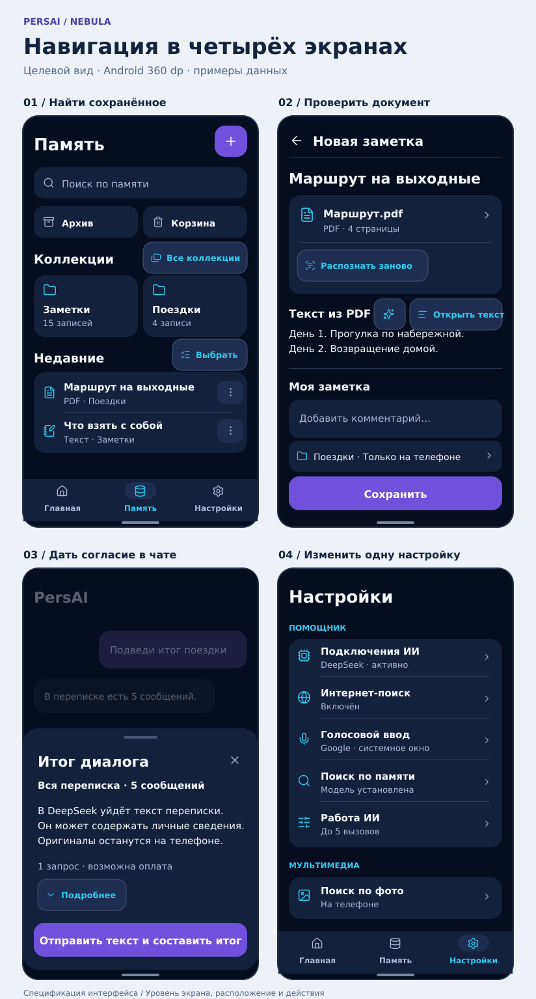
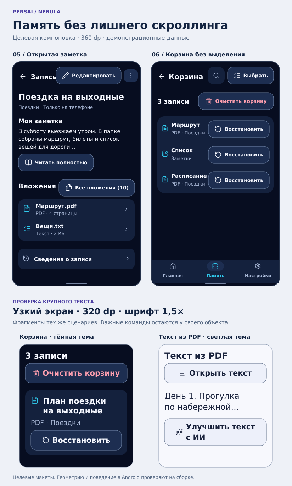

# PersAI · Навигация и интерфейс на Android

Исполнительный подплан для 6.1 Sol Medium. База ревизии — `main@1a91fd8`, 3 ноября 2026 года. Стек приложения — React Native / Expo. Исходные материалы — 11 записей Vivo X200 Pro и два снимка одного сценария. Личные фотографии, переписка и оригиналы файлов в публичный репозиторий не входят.

[Карта экранов](#карта-интерфейса-где-искать-действие-и-куда-возвращает-назад) · [Команды](#ui-act) · [Внешний вид кнопок](#button-visual) · [Карточки и прокрутка](#ui-dens) · [Очистка корзины](#trash-all) · [Проверка понятности](#ui-find) · [Визуальный эталон](../docs/design/PERSAI_NAV_TARGETS.svg) · [Порядок реализации и проверки](#приоритеты-зависимости-и-передача-исполнителю)

## Дополнение по фактической проверке Vivo · 05.11.2026 (№89 / U5)

Владелец прислал снимок и видео реального Android-экрана «Запись». Это адресная обратная связь, **не** новый общий этап редизайна. Оставить существующие Nebula-компоненты, локальный SQLCipher и единственный writer. Фотографии владельца в GitHub не публиковать.

- **Список:** плитка/строка фото содержит настоящее локальное превью, не одну иконку; распознавать фото и в старых метаданных source_file/source_files, не читать байты каждой записи при фильтрации. При lock/background очищать временное превью, не трогать зашифрованный оригинал. Неизвестное содержимое не подписывать выдуманным предметом.
- **Один шаг на редактирование:** пункт «Редактировать» у записи открывает редактор, обычный тап по плитке остаётся просмотром; отдельная малая кнопка карандаша в шапке просмотра вместо второй широкой кнопки. Корзина остаётся только просмотром/восстановлением.
- **Просмотр:** фото не дублируется одновременно большой обложкой и развёрнутой карточкой того же JPG; оригиналы/повторное распознавание доступны через «Оригиналы» у фото. Заголовок без осмысленной подписи — компактное «Фото», а не огромная «Фото без подписи»; авторское название не заменять.
- **Редактор:** заголовок и основной текст сначала, диктовка/ИИ — компактные действия в одной области, тип/псевдонимы/поисковые слова — необязательный «Дополнительно». Скрытие поля не удаляет пользовательские значения, индекс или историю. Никакого автоматического LLM для переименования фото.
- **Доступность:** «Добавить файлы» находится рядом с материалом, а не после всех технических блоков; в прокрутке учитывать нижний Android safe area + минимальный запас. В режиме редактирования Save закреплён; Back/не сохранено и выбор модели не меняются.
- **Приёмка:** Jest для direct-edit/trashed, подписи и фото-метаданных, раскрытия оригиналов без предварительной дешифровки; required CI на точном SHA. C2 на Vivo X200 Pro / Android 16: 320/360/390/430dp, 1.5×, Gboard и жесты/3-кнопки — только после фактического прогона, не по макету. Протокол №89/U5; без запуска нового backlog.

Сопоставление уже собранных референсов для этих задач: Android/Material — доступные действия и системные insets; Google Keep и Apple Notes — содержимое прежде технических свойств (адаптировать, не копировать); существующий утверждённый [Nebula контракт](../docs/design/NEBULA_VISUAL_CONTRACT.md) — цвета/размеры/Back. Отдельный новый визуальный референс не требуется: изменения адресуют подтверждённые дефекты утверждённого экрана.

## Как продолжить работу

### Ограниченная доработка UX 3–6 от 04.11.2026

После интеграционного UI PR #349 (main, CI SUCCESS) владелец разрешил только четыре улучшения перед общей APK. Прежние предложения **1 — сохранение черновика и панели при системных прерываниях** и **2 — универсальное возобновление LLM/сетевых ошибок** перенесены в поздний шаг 13 основного [PLAN.md](../PLAN.md); они не блокируют проверку Vivo. Доказанные потери данных и ошибки безопасности всегда исправляются немедленно.

| Разрешённый срез | Реализация/существующий владелец | Точный критерий завершения |
| --- | --- | --- |
| 3 · №65/79, безопасность действий с памятью | Предпросмотр объединения показывает **основную** запись первой, выбранные остальные, смысл сохранения заголовка/вложений/истории и отмены. Единственный writer `changeNotes("merge")`, CAS/undo неизменны | До подтверждения нет записи. Выбранные ID и порядок передаются writer без перестановки; переполнение 60 000 символов блокирует подтверждение; ошибка не скрывается |
| 4 · №85/87, меньше переходов | У законченного ответа в Home — узнаваемая иконка **«Сохранить ответ»**, сразу открывающая редактируемый черновик MemoryNote после локальной проверки источника, без промежуточной одноэлементной панели | Сохранение только по отдельной кнопке в редакторе; без сетевого запроса, дублирующей записи или нового SQL writer; недоступный источник объясняется, долгий тап остаётся альтернативой |
| 5 · №89, реальные стадии ИИ | `resolveNebulaStatus` распознаёт только фактически переданный `progress`: подготовку итога, чтение/обработку частей, проверку источников. Счётчики исключительно из валидного `(n/m)` | Без сигналов — нейтральное «Обрабатываю», без придуманной деятельности, таймера и ложного процента; работающий Stop не блокируется статусом |
| 6 · №89, плотность | Предпросмотр объединяемого текста компактный; полный доступен отдельным действием в той же панели. Существующая NoteReadPreview для заметок не дублируется | На 320–430dp основной выбор/отмена остаются заметными, полный текст читается по запросу без изменения данных |

**Стоп:** одна адресная Jest/браузерная/native CI проверка для этого пакета и один телефонный проход без расширения макетов. Если обнаружен дефект — исправлять конкретный сценарий. Не запускать новую глобальную полировку UI и не помечать C2 физически PASS до фактической проверки.

Порядок функциональных этапов задаёт [PLAN.md §2](../PLAN.md). Этот документ уточняет навигацию U0–U4 и работу перед итоговой проверкой шага 8. Результаты тестирования APK фиксируются отдельно в [U5](UI_U5_ACCEPTANCE.md). Ни один пункт спецификации сам по себе не означает исправления или физической приёмки.

Стартовые ограничения: сохранить три корневые вкладки «Главная», «Память», «Настройки», утверждённую графику Nebula B+C и единственных владельцев заметок, вложений, прав и запросов. Соединять повторяющиеся пути в общей операции. Различать локальное вложение в черновик, отправку провайдеру и сохранение в память.

| Контроль перед PR | Решение |
|---|---|
| База проектирования | [Контракт Nebula](../docs/design/NEBULA_VISUAL_CONTRACT.md), [мобильные правила](../skills/mobile-ui-ux/SKILL.md), [поставка интерфейса](UI_DELIVERY.md) |
| Контракт данных | Повторно использовать существующие writer, ACL, проверку версии, undo, индексы и резервные копии. Документация не меняет хранилище и схему |
| Как подхватить незаконченную ревизию | Читать последний коммит этой ветки. Сохранённые разделы проверяются независимо. Первое действие при реализации — сверить текущий main и доказательства по затронутой задаче |

## Повторная сверка всех материалов

Номера сохранены для связи со старым подпланом. Время отсчитывается от начала исходника. «Видно» относится к записи экрана, «проверить» — к причине, которую можно установить только на устройстве или тестом.

| ID / исходник | Как шёл пользователь | Что сохраняем и что меняем |
|---|---|---|
| 01 · 1000039662.mp4 | 00:06–00:37 Настройки → подключение → голос → модели и лимиты; 00:40–00:54 копии и диагностика | Значения уже видны в списке. Крупные аккордеоны сдвигают соседние настройки; дочерний экран должен возвращать на ту же строку. В 00:51 удаление журналов открывает ещё один белый диалог. |
| 02 · 1000039664.mp4 | 00:07–00:24 Память → плюс → Галерея → форма; 00:37–01:18 выбор OCR и длинный текст; 01:22 библиотека | Закреплённое сохранение полезно. Настройки модели и комментарий вытесняют работу с текстом. Нужны отдельные краткие представления оригинала, извлечения и авторского текста. |
| 03 · 1000039666.mp4 | 00:05–00:16 меню записи → корзина → другое меню для её открытия; 00:41–00:53 выбор двух → удаление → пусто | Подтверждение перед необратимой операцией сохранить. Глобальный плюс, поиск и «Отменить удаление» на экране корзины размывают область действия. Успешное восстановление на этом видео не показано. |
| 04 · 1000039665.mp4 | 00:20–01:18 выбор PDF → чтение/OCR → повтор → подтверждение; 01:27–02:19 карточка, редактор, повтор, сравнение | На 01:18 есть отдельное белое подтверждение замены ещё в импорте. Есть и предпросмотр нового результата после сохранения. Обоим нужен один контракт защиты ручных правок. Заголовок «Страница 1:» непригоден для поиска глазами. |
| 05 · 1000039667.mp4 | 00:00–00:03 рабочий стол → кадр чата → разблокировка → рабочий стол; следующий запуск успешен | Проверить как завершение процесса, так и закрытие Activity/экран задачи; по кадру диагноз поставить нельзя. До аутентификации предыдущий кадр чата не должен появляться. |
| 06 · 1000039668.mp4 | 00:08–00:20 ручной текст + Google → заметка; 00:32–00:55 ИИ → ожидание → отмена; 01:03 выход | Диктовка работает для текста. Кнопка ИИ уже есть и в новой записи. Требуется сделать её заметной у поля и убрать необходимость вручную вводить «исправь». Причина ожидания не установлена. |
| 07 · 1000039669.mp4 | 00:07–00:57 TXT/PDF, удаление одного файла, замена; 01:04 согласие; 01:08–01:26 HTTP 503 и повтор текста | Контроль передачи оставить. В ответе сервера виден 503. Нужен повтор команды с исходными файлами; повторная диктовка создаёт отдельную реплику. |
| 08 · 1000039670.jpg / 1000039671.jpg | Выбор диапазона → второе подтверждение | При пяти сообщениях два варианта равнозначны. Одна панель с активным получателем, объёмом, стоимостью и действием; итог и копирование готового ответа — разные задачи. |
| 09 · 1000039672.mp4 | 00:02–00:07 редактор итога → «Изменить с ИИ» → надиктовать команду; 00:07–00:09 возврат в основной редактор | Исчезает панель команды. Падение процесса не видно. Сохранять адрес поля и черновик, проверять поздний ответ и отмену Google. |
| 10 · 1000039673.mp4 | 00:06–00:17 запрос в интернете без темы → статус памяти → ответ о поисковых операторах | Источник задан, тема отсутствует. Уточнить тему в чате. Видна устаревшая подсказка отправки при уже активной остановке. |
| 11 · 1000039674.mp4 | 00:02–00:08 съёмка → четыре плитки; 00:14–00:16 просмотр; 00:20–00:27 выбор/возврат к чату | Снимок переживает просмотр. В конце видимого результата поиска нет. На записи 00:20 выделен и элемент просмотра; точное намерение, причина закрытия и запуск поиска требуют трассировки. |
| 12 · 1000039675.mp4 | 00:11–00:40 пустая корзина → импорт → возврат; 00:56–01:30 ревизия, ошибка, объединённая запись; 02:10–03:03 действия в коллекции | Ошибка операции и «Отменить объединение» относятся к неясным для пользователя стадиям. Не считать потерю или сохранность обоих оригиналов доказанной. Проверять каждую стадию по ID, счётчикам и открытию оригинала после перезапуска. |

Сильные стороны исходного интерфейса: узнаваемая сфера в пустом чате, явное согласие перед передачей файлов, отдельная отмена, сохранение внизу редактора, видимый выбор нескольких записей. Это регрессионные критерии. Версия APK на записях достоверно не установлена. Восстановление из копии, внешний Share с холодного запуска, поток аудиофайла, TalkBack и поведение после уничтожения процесса охвачены ниже как обязательные проверки, а не как наблюдаемые успехи.

## Карта интерфейса: где искать действие и куда возвращает «Назад»

Вкладки отвечают на три вопроса: «Что я хочу спросить?», «Где то, что я сохранил?», «Как работает приложение?». Названия вкладок сохраняются. Вкладки видны у корневых разделов и при просмотре коллекций. В полноэкранных редакторах, системных окнах и настройках отдельной функции нижнее место занимает действие текущего экрана. Возврат восстанавливает место входа.

| Экран / вход | Верх и основное содержимое | Основное действие и возврат |
|---|---|---|
| Главная, пустой чат | PersAI, компактный реальный статус, история и новый диалог. Сфера B+C в свободном пространстве | Внизу поле, скрепка, камера, микрофон, справа отправка. При клавиатуре убрать пустое декоративное пространство первым |
| Главная, переписка | Сообщения в одной ленте, для готового ответа доступное меню «Действия с ответом». История открывается прежней панелью | Во время работы отправка меняется на остановку; смена вкладки сохраняет диалог и операцию. Возврат из истории сохраняет черновик и позицию |
| Память | Заголовок и «+» → поиск → компактные подписанные «Архив», «Корзина» → «Коллекции / Все коллекции» → «Недавние». Миниатюра, название и дата; короткий текст там, где он помогает различать записи | Тап по карточке открывает чтение, ⋮ открывает команды карточки, «Выбрать» включает режим выбора. Долгое нажатие — ускоритель выбора. При выходе восстанавливать ID и смещение первой видимой карточки |
| Коллекция / архив / корзина | Одна шапка с настоящим названием, стрелкой и «Выбрать». В коллекции плюс создаёт именно здесь. В архиве и корзине создание скрыто. Для длинного списка поиск по значку с явной областью «Искать в корзине» | Возврат закрывает поле поиска с активным запросом, затем возвращает в прежнюю область. При открытии из корня сохраняется позиция корня. Архив и корзина — состояния того же списка и репозитория |
| Просмотр заметки | Название, доступ, материал, оригиналы, вторичные сведения. «Редактировать» в шапке. Управление конкретным файлом рядом с ним | Тап по оригиналу — отдельный просмотр; возврат к тому же файлу. Из поиска по фото/чата возвращаться в исходную выдачу. Архивная запись имеет «Вернуть из архива», удалённая — «Восстановить» |
| Создание и редактирование | Одна шапка «Новая заметка» либо «Редактирование». Авторский текст, вложения и результаты различимы. Коллекция/доступ доступны до сохранения. Клавиатура не перекрывает действие | Один закреплённый «Сохранить». Из библиотеки вернуть в исходный список, из чата — в чат. После успеха «Заметка сохранена · Открыть». При ошибке форма остаётся открытой |
| Скрепка / камера в чате | Скрепка выбирает источник. Камера запускается одним тапом. Файл прикрепляется к текущему черновику; для отдельного снимка есть панель выбора назначения | Отмена системного выбора сохраняет исходное сообщение и прежние вложения. Различать отмену просмотра, выбора и сетевой операции |
| Android «Поделиться» | Только у внешнего входа выбор «В чат» / «В память» с превью. Для ссылки и медиа показать тип, количество, назначение. По умолчанию существующее правило входящей коллекции | «В чат» открывает черновик до явной отправки. «В память» — редактор до явного сохранения. Получение intent, повторный возврат из picker и пересоздание экрана не создают копий |
| Настройки | Группы «Помощник», «Мультимедиа», «Данные», «Обслуживание». Строка содержит название и текущее значение | Каждый раздел открывается одинаковым тапом. Возврат из настройки, вызванной из чата или импорта, возвращает к ожидающему материалу; операция продолжится по явному нажатию |
| Проверка фактов / история / диагностика | «На проверке» относится к коллекции и ведёт в существующий экран сверки источников. История записи принадлежит записи. Лаборатория доступна из диагностики | Возврат из оригинала — к факту и записи, из ревизии — к выбранным карточкам. Резервные копии имеют один экран в настройках; убрать дубль из меню памяти после появления постоянного пути |

**Порядок Back.** Дать Android закрыть клавиатуру; если есть внешний экран или открытая панель — вернуться к её владельцу; затем снять выделение; затем покинуть детали. На выходе из изменённой формы предложить «Сохранить и выйти», «Продолжить редактирование», «Выйти без сохранения». Отмена запроса и уход со вкладки — разные события. Не хранить личный текст в параметрах навигатора или журнале. Незавершённое действие принадлежит профилю и ID черновика/сообщения. При настоящей смене профиля или отзыве доступа закрыть содержимое и отвергнуть поздний ответ. Для публичных отчётов использовать только синтетические заметки.

**Основание в коде.** [navigation.tsx](../mobile/src/navigation.tsx) содержит три Tab.Screen и существующие стековые маршруты MemoryNote, MemoryImport, ShareDestination, PhotoSearchSettings, ModelConnections, MemoryBackup, MemoryTemporalReview, DiagnosticLogs, NebulaLab. [LocalMemoryScreen](../mobile/src/screens/LocalMemoryScreen.tsx) уже запрашивает записи с collectionId и status. Архив и корзину оформлять как дочерние экраны для пользователя, переиспользуя существующий запрос; менять только заголовок и доступные команды по области. Для новых настроек допустим один типизированный маршрут раздела, использующий текущие карточки и настройки. Не создавать параллельные навигаторы чата/заметок.

## Команды должны быть узнаваемы до первого нажатия · UI-ACT

У прежнего макета были те же слабые места, что у сборки: «Все», «Выбрать» и «Распознать заново» читались как обычные подписи. Правило распространяется на карточки, вкладки, формы, панели и пустые состояния. Простая окрашенная надпись среди содержимого не служит единственным входом в команду.

| Что перед человеком | Как выглядит и работает | Пример и место |
|---|---|---|
| Основное действие текущей задачи | Один заполненный акцентный элемент с глаголом. Нажатие сразу меняет состояние; при ожидании подпись и индикатор остаются в том же месте | «Сохранить» у нижней границы редактора; «Отправить» в композере; при готовности к распознаванию приоритет у команды соответствующего файла |
| Вторичное действие над объектом | Спокойная тональная или контурная кнопка с иконкой и глаголом; отступ от соседнего текста. Использовать существующий NebulaAction quiet. Та же зона нажатия у иконки, текста и свободного места внутри | «Распознать заново» в карточке конкретного PDF, «Открыть текст» в блоке распознавания, «Выбрать» в заголовке списка |
| Переход в раздел | Вся строка или компактная плитка образует одну поверхность. Название, короткое значение и шеврон. Раскрытие на месте — шеврон вниз/вверх и соответствующее состояние для TalkBack | «Коллекция · Поездки», «Все коллекции», «История и связи», «Подробнее» у сводки передачи |
| Часто используемая команда-иконка | Общепонятный символ, устойчивое положение, ≥48×48 dp включая компактную видимую форму, отдельное доступное имя. Редкие или двусмысленные команды получают подпись | Стрелка назад, камера, микрофон, ⋮ конкретной карточки. Имя для диктора — «Действия с заметкой [название]» |
| Значение, статус или ссылка | Неинтерактивный текст остаётся спокойным, статус имеет словесное значение. Внешняя ссылка подчёркнута либо помечена знаком перехода. Только интерактивным элементам назначать роль кнопки/ссылки | «4 страницы», «Только на телефоне», «Выбрано 2». Если значение можно изменить, вся строка имеет вид и поведение перехода |
| Деструктивное действие | Иконка и явный глагол; до подтверждения вторичный контур, при окончательном подтверждении — отдельная кнопка опасного действия. Рядом видимая «Отмена» | «В корзину» у записи, «Удалить навсегда» у выбранных записей, «Очистить корзину» у самой корзины |

Для кнопок проверить состояния покоя, нажатия, фокуса, недоступности и выполнения. Смена поверхности даёт немедленный отклик. Образцы кнопок и проверка реализации приведены в разделе [внешнего вида](#button-visual). Цвет текста и подсказка после долгого удержания сами по себе не объясняют назначение. Не превращать всю карточку в набор равноправных кнопок: основная область открывает объект, у ⋮ отдельная непересекающаяся зона. Простые вторичные действия визуально тише основного. Повторно использовать [NebulaAction и NebulaSettingRow](../mobile/src/design/nebula/components.tsx) и [IconAction](../mobile/src/components/IconAction.tsx). Ориентиры по иерархии и структуре — [кнопки Material в Android](https://developer.android.com/develop/ui/compose/components/button) и [строки списка Material](https://github.com/material-components/material-components-android/blob/master/docs/components/List.md).

### Как принимать вид и расположение кнопки

В ролике 03 на 00:41 «Отменить удаление» выглядит отдельной бирюзовой надписью над плитками. В ролике 04 на 01:52 у «Распознать заново» и «Открыть PDF» нет собственного видимого контура, а «Изменить с ИИ» вынесено ниже «Сохранить запись». У предварительного SVG из коммита `26e6b47` поверхность появилась, но граница обычной кнопки на карточке давала лишь 2,13:1. Надписи у всех вторичных команд были бирюзовыми, тогда как действующий NebulaAction quiet использует основной цвет текста. Целевой вид зафиксирован на [экране PDF](../docs/design/PERSAI_NAV_TARGETS.svg) и [экране корзины с двумя примерами крупного шрифта](../docs/design/PERSAI_MEMORY_TARGETS.svg).

| Команда | Расположение и вид в обычном состоянии | При недостатке места |
|---|---|---|
| «Восстановить» | В одной строке с конкретной записью. Слева название, миниатюра и коллекция, справа одна спокойная кнопка с возвратной стрелкой. Несколько кнопок выровнены по правому краю. Тап по названию открывает просмотр | Если название, зазор 8 dp и кнопка с полной подписью не помещаются, перенести кнопку под данные **внутри той же строки**. Разместить в порядке чтения после названия. Между записями оставить разделитель |
| «Очистить корзину» | В отдельной строке сводки «N записей» выше списка. Нейтральная поверхность, символ корзины и текст цвета danger. При выделении есть только панель выбранных. В финальном подтверждении акцент переходит на «Удалить N записей», рядом остаётся «Отмена» | Сначала счётчик отдельной строкой, затем кнопка во всю доступную ширину. Перед последним нажатием видны фактическое число и необратимость |
| PDF и извлечённый текст | «Распознать заново» внутри карточки оригинала под именем файла. «Открыть текст» у заголовка результата. «Улучшить текст с ИИ» сразу после отрывка, до заголовка «Моя заметка». Внизу одна акцентная «Сохранить» | Кнопка чтения переносится под заголовок. Кнопка улучшения растёт по высоте вместе с подписью, включая вариант в две строки. Комментарий остаётся отдельным полем, сохранение видно над клавиатурой |

**Как собрать в React Native.** Расширять существующий [NebulaAction](../mobile/src/design/nebula/components.tsx) и [токены Nebula](../mobile/src/design/nebula/tokens.ts). Для обычной команды взять `surfaceElevated` и `text` для иконки и подписи. Для обратимого восстановления использовать quiet. Для кнопки входа в очистку использовать danger с той же поверхностью и `danger` для подписи и иконки. Для окончательного удаления дать существующему компоненту отдельное оформление заполненной опасной кнопки. В тёмной теме её фон `danger`, текст `canvas`, в светлой — фон `danger`, текст `textOnAccent`. Основное сохранение остаётся `accent / textOnAccent`. Иконки брать из уже подключённого Feather. Для восстановления подходит rotate-ccw, для очистки trash-2. Смена начертания или цвета подписи сама по себе не обозначает область нажатия.

Общие параметры вторичной кнопки — minWidth/minHeight 48 dp, радиус 16 dp, горизонтальные поля 16 dp, промежуток между иконкой и надписью 8 dp, иконка 20 dp. Ввести роль `actionLabel` 14/20 sp с насыщенностью 600. Центрировать внутри кнопки всю группу иконки и текста. Минимум 8 dp между соседними зонами действий. Дать подписи переноситься без уменьшения шрифта и многоточия. Это правила только для команд. Счётчики, свойства и пояснения сохраняют свою типографику. На узком экране сначала переносить группу кнопок или отдельную кнопку на следующую строку. Порядок для TalkBack совпадает с видимым.

Для границы кнопки ввести один семантический `actionOutline` в обеих палитрах — тёмная `#7186A8`, светлая `#62718B`. Для панелей и разделителей сохраняется обычный `border`. У тёмного контура на карточке контраст **4,32:1**, на собственной поверхности — **3,64:1**. Светлый контур на собственной поверхности — **4,34:1**. Обычный текст на этой поверхности — **12,67:1** в тёмной и **13,98:1** в светлой. При нажатии применять `surfaceMuted`, без общего снижения opacity у доступной кнопки. При клавиатурном фокусе рисовать кольцо `focus` толщиной 2 dp с отступом 2 dp. В недоступном состоянии исключить активацию и передать disabled. Во время выполнения занять ту же позицию индикатором, сохранить название операции и исключить повторное нажатие. Тёмная тема приложения задана провайдером. Для светлой проверки передавать палитру через тот же тематический контекст или тестовую обёртку. Учитывать, что сегодня useNebulaColors() в компоненте возвращает только dark.

**Что приложить к PR.** На синтетических данных открыть затронутый экран штатным путём. Снять один и тот же объект и состояние до/после с полным экраном и фрагментом в натуральном масштабе. Записать SHA, ширину в dp, масштаб системного шрифта и тему. Сверить обе картинки глазами с указанным SVG. Для первого PR с общей кнопкой проверить 360 dp при 1,0× и 320 dp при 1,5×, тёмную и светлую палитры, фон экрана и фон карточки. Для последующих PR повторять затронутые варианты. Положить рядом состояния в покое, фокусе и нажатии, а для асинхронной команды также выполнение и восстановление после ошибки. Удаление дополнительно показать до подтверждения и после отмены. Нажатием на соседние области проверить, какая запись открывается и какая восстанавливается.

Рецензент видит границу, целую подпись и свободное место вокруг неё, знает, какой объект изменится, и может назвать главное действие. Наложение заголовка, обрезка, взгляд от файла к общему подвалу ради повтора или срабатывание соседней строки требуют исправления. Для этой ревизии отрисованы макеты, сверены состояния покоя и перенос на узкой ширине. Результаты живого нажатия, фокуса, TalkBack и скриншоты Android с новым дизайном исполнитель вносит по мере реализации. Для измерений использовать [контраст текста](https://www.w3.org/WAI/WCAG22/Understanding/contrast-minimum.html), [контраст элементов управления](https://www.w3.org/WAI/WCAG22/Understanding/non-text-contrast.html) и [зоны касания Android](https://support.google.com/accessibility/android/answer/7101858?hl=en).

### Где находится команда и какие дубли убрать

| Объект | Видимый вход и прямое действие | Что уходит из соседних меню / куда вернуться |
|---|---|---|
| Вложение в заметке | Тап по миниатюре/имени открывает оригинал; кнопка чтения или повтора находится в его строке. При 2+ файлах действие привязано к уже указанному файлу | Убрать параллельный вход для повтора через общие настройки записи и повторный выбор того же файла. Назад возвращает к его строке |
| Редактируемый текст | В блоке соответствующего поля кнопка «Улучшить текст с ИИ» с видимой подписью. До запроса видно, какой текст изменится | Убрать глобальную «Изменить с ИИ» в подвале того же режима. Не объединять авторский комментарий с текстом оригинала |
| Ответ / весь чат | Видимая кнопка действий конкретного ответа; итог всей переписки находится в меню текущего чата | Оба открывают общий редактор заметки, но имеют разные область и стоимость. При закрытии вернуть фокус на исходный ответ или шапку |
| Запись / выделение / библиотека | В библиотеке ⋮ строки действует на одну запись. В корзине его место занимает «Восстановить». Режим выбора заменяет индивидуальные ⋮ одной панелью с числом выбранных. Кнопка раздела относится ко всему текущему разделу | В режиме выбора скрыть глобальные команды создания и очистки. «Действия» без понятной области не оставлять одновременно сверху и снизу |
| Способ распознавания | Краткая строка способа у текущего вложения. Постоянное значение и управление моделями — в «Настройках» | Тот же редактор настройки может открываться из ошибки «Модель не установлена». Вернуться к тому же файлу и черновику; скачивание не должно автоматически отправлять файл |
| Обратимая операция | Сразу после выполнения — сообщение «… · Отменить». Позже восстановление доступно в корзине | Не оставлять «Отменить удаление» постоянной строкой между заголовком и карточками. Сквозные ярлыки допустимы только для другой точки входа или другого момента времени и используют тот же обработчик |

## Мировые референсы и решения для PersAI

Сопоставление официальной документации на 03.11.2026. Продукты сравнивались по конкретным задачам; интерфейс конкурентов на Vivo отдельно не тестировался.

| Задача | Референсы и наблюдаемое правило | Выбор для PersAI |
|---|---|---|
| Записать мысль, разобрать библиотеку | [OneNote Android](https://support.microsoft.com/en-us/onenote/home-page-for-onenote-android) даёт быстрый захват в разных форматах; [Google Keep Android](https://support.google.com/keep/answer/6262765?co=GENIE.Platform%3DAndroid&hl=en) различает архивирование, удаление и восстановление | Принять близость захвата к месту работы и понятную область корзины. Адаптировать долгое нажатие: тот же выбор доступен видимой кнопкой. Чужую политику автоудаления не переносить |
| Получить текст из документа | [Apple Notes](https://support.apple.com/en-euro/guide/iphone/iph653f28965/ios) разделяет вставку текста и скан документа; [Acrobat Android](https://helpx.adobe.com/acrobat/mobile/edit-text-images/edit-scanned-files.html) привязывает OCR к открытому PDF | Оригинал и текст у одного вложения; подтверждённые правки сохраняются раздельно. Android Back возвращает к файлу; платная модель Acrobat и оформление iOS не требуются |
| Спросить по файлу или снимку | [Gemini Apps](https://support.google.com/gemini/answer/14903178?co=GENIE.Platform%3DAndroid&hl=en) объединяет вложение и вопрос; [Google Lens](https://support.google.com/websearch/answer/1325808?co=GENIE.Platform%3DAndroid&hl=en) начинает поиск с самого изображения | Вопрос остаётся в композере, источник виден там же. Для фото отдельно дать локальный поиск и интернет с подтверждением передачи; случайная загрузка недопустима |
| Управлять направлением и возвратом | [Android Back](https://developer.android.com/design/ui/mobile/guides/patterns/predictive-back), [Android Settings](https://developer.android.com/develop/ui/views/components/settings/organize-your-settings), [Google Conversation Design](https://developers.google.com/assistant/conversation-design/questions) | Стрелка и системный Back ведут по одной истории; настройки сгруппированы по задаче; в запросе без темы задаётся один уточняющий вопрос |

## Визуальный контракт и полный охват диалогов

Пустая «Главная» сохраняет REF-ORB-B и палитру Home. При появлении переписки место занимает лента, мини-сфера остаётся в шапке. На рабочих экранах фон `canvas`, одна `surface` на логическую группу. Не строить карточку внутри карточки ради заголовка. Использовать [tokens.ts](../mobile/src/design/nebula/tokens.ts) и [общие компоненты](../mobile/src/design/nebula/components.tsx). Основной текст 16/24, заголовок экрана 24/32, подпись 13/20. 11/16 только для необязательных метаданных. Поля экрана 16, между группами 24, внутри строки 12, между иконкой и подписью 8 dp. Радиусы из контракта: поле 16, карточка 20, панель 26. Акцентная заливка выделяет главное действие. Вторичные команды получают видимую форму кнопки или строки по UI-ACT; ошибка содержит объяснение и действие. Активность/выбор дублируются значком, подписью и состоянием для TalkBack. На больших шрифтах высота строк растёт, вторичные метаданные переносятся. Рамку фокуса не использовать как постоянное оформление невыбранной карточки.

**Существенное уточнение по main.** В [PhotoContextActions](../mobile/src/media/PhotoContextActions.tsx) у пункта memory всегда бирюзовая граница. Поэтому рамка «В моей памяти» в видео 11 не доказывает выбранное состояние. В [NoteAiEditor](../mobile/src/components/NoteAiEditor.tsx) инструкция хранится в состоянии компонента, а потеря visible/focused вызывает stop и onClose. Это воспроизводимая по коду точка диагностики 09.1; фактическую последовательность событий на Vivo надо записать. В [BottomSheet](../mobile/src/components/BottomSheet.tsx) тело уже снимается при потере видимости. Следует отдельно сохранить владельца незавершённой инструкции и по-прежнему скрывать личное содержимое. Никогда не выключать AppLock ради удержания панели.

**UI-DLG — все окна PersAI.** На указанном SHA статический поиск прямого `Alert.alert(` в production `mobile/src` дал 33 места в девяти файлах. Это число вызовов, не уникальных окон и не итоговый объём миграции.

| Владелец сейчас | Прямые вызовы | Целевое представление |
|---|---:|---|
| HomeScreen | 11 | Согласие на фото и документы, итог — панель с получателем и кнопкой действия. Отсутствующая настройка/лимит — сообщение у вложения со следующим шагом. Команды ответа — контекстное меню; удаление диалога — подтверждение |
| MemoryImportScreen / MemoryNoteScreen | 6 / 3 | Черновик при выходе, перезапись ручной правки, пропуск файла, сетевой доступ. Не складывать подтверждения. Ошибки индекса после успешного сохранения показывать отдельно от статуса записи |
| DirectAgentSettingsScreen / DiagnosticLogsScreen | 3 / 1 | Несохранённый черновик подключения и разрушительные команды — общие подтверждения. «Сохранение…» в строке кнопки. Очистка журналов показывает количество и последствия |
| VoiceModelCard / SmartSearchCard / VisionModelCard | 4 / 2 / 2 | Согласие на внешний ввод, объём перед скачиванием, удаление модели и ошибка в строке текущей настройки |
| AndroidFileAsrProbe | 1 | Пояснение/согласие до реальной проверки файла; сам OS-запрос сохраняется |

Переиспользовать RN BottomSheet. Расширить компактным режимом центрального подтверждения на той же теме/политике видимости и необязательным закреплённым подвалом. Обычный выбор — строки в нижней панели. Необратимое действие — короткий заголовок, предмет и число, «Отмена», «Удалить навсегда». Предварительная отправка — кому, какие данные, сколько вызовов и возможная оплата; подробности по раскрытию. Слой затемнения брать из текущих токенов, не вводить локальные варианты. При адаптации к 320 dp действия становятся вертикальными. Android Back, касание фона и закрытие означают безопасный выход; операция записи не стартует от закрытия.

**Панели и полноэкранные окна в базе проверки.** Помимо 33 alert-вызовов, в production TSX найдены 17 мест использования BottomSheet: LocalMemoryScreen — 9, MemoryNoteScreen — 3, MemoryImportScreen, VerifiedRelativeConversations, AppendNoteAttachments, NoteAiEditor и ConversationHistorySheet — по 1. Два прямых RN Modal находятся в реализации BottomSheet и в HomeScreen для фото. Это разные уровни вложенности, суммировать их как 52 независимых диалога неверно.

| Контекст | Правило после миграции |
|---|---|
| Девять панелей библиотеки | Добавление, выбор области, выбор/создание коллекции, перенос, действия группы, предложения ревизии, сама ревизия, объединение имеют свои владельцы. Неактуальная панель демонтирована. Переход «действия → перенос/объединение» сохраняет выделение до принятия, повторный Back возвращает ровно на один уровень |
| Редактор / добавление файлов | Каждая панель привязана к заметке и конкретному оригиналу. Закрытие просмотра закрывает только просмотр. По завершении добавления фокус возвращается к появившемуся вложению |
| История чатов / поиск связей | Выбранный диалог/подтверждённый источник открываются одним нажатием. Закрытие без выбора сохраняет прежний экран. Проверить пустую выдачу и отзыв доступа при просмотре |
| Полноэкранное фото в чате | Настоящий просмотр с крупным изображением, доступным закрытием и возвратом в панель выбора. Один активный модальный слой; фотография не пропадает после Back |
| Нативные обёртки и редкие ветви | Проверить вызовы по всему приложению при обновлении базовой ветки; каждый вызов классифицировать как принадлежащий PersAI или системному владельцу. Независимые стили и неучтённые пути блокируют завершение UI-DLG |

**Полнота.** На текущей ветке заново собрать `rg -n 'Alert[.]alert|<Modal|<BottomSheet|ActionSheet|DialogFragment|AlertDialog' mobile/src mobile/modules`, исключить тесты, проверить обёртки и условные панели вручную. В реестре для каждого входа указать маршрут, триггер, получателя события, отмену/возврат, финальное представление и тест. Помимо таблицы включить историю чата, просмотр вложений, выбор коллекции, ревизию/слияние, временную шкалу и просмотр исходной записи. Окно системного picker, Google, разрешения и биометрии маркировать «ОС» с владельцем результата. Приёмка — ноль необъяснённых прямых вызовов, никакой второй модалки поверх первой, сквозной сценарий возврата для каждого типа.

**Доступность и зрительная проверка.** 48 × 48 dp для каждого нажатия, включая ⋮, крестик, плюс/минус, флаг и действия ответа. Измерять фактические hit areas и контраст по итоговой поверхности: обычный текст ≥4,5:1, крупный и значимые нетекстовые границы ≥3:1. Проверить 320/360/390/430 dp, шрифт 1,0/1,3/1,5, короткий экран, Gboard, жесты и три кнопки Android. Заголовок панели получает фокус, фон недоступен TalkBack, закрытие возвращает фокус к источнику. Ошибку озвучить один раз. Reduce Motion оставляет информацию о стадии текстом. Делать только относящиеся к изменению прогоны, полную матрицу — на финальном APK. Основания: [Android accessibility](https://developer.android.com/guide/topics/ui/accessibility/principles), [React Native accessibility](https://reactnative.dev/docs/accessibility), [WCAG 2.2](https://www.w3.org/TR/WCAG22/).

## Исполнение A · доступ к приложению, голос и черновик

**05.1 · P0 · Защищённый вход.** Воспроизвести холодный старт, возврат из лаунчера и из недавних до/после таймаута. Сопоставить время перехода из видео с PID, ActivityTaskManager, AndroidRuntime и причиной выхода процесса. В [AppLock](../mobile/src/security/AppLock.tsx) видны разные пути cover, lock, проверки текущего AppState и возврата из разрешённого native interaction. Проверять их раздельно. При живом процессе найти переход Activity/задачи; при исключении исправлять первый кадр стека приложения. Если видимая «Главная» была системной миниатюрой, проверить защиту снимка задачи отдельно от слоя RN. Вход — один запрос аутентификации за попытку. При отмене остаётся «Разблокировать», при успехе восстанавливается разрешённый экран. Независимо от расцветки ОС поверхность перехода PersAI нейтральная и тёмная. Реальная блокировка отзывает сессию памяти. Закрытие — после десяти повторов на исходной конфигурации и негативной проверки отмены/повтора.

**09.1 · P1 · Команда после Google.** Маршрут воспроизведения: итог чата → «Изменить с ИИ» → «Своя команда» → микрофон → результат Google. Зафиксировать порядок blur/visibility/lock и callback. Родитель редактора держит ID профиля, черновика, назначения поля и поколения запроса. Для ожидаемого перехода с активным native interaction спрятать содержимое панели, вернуть её с распознанным текстом после разрешённого возврата. Настоящие lock, отзыв ACL, смена профиля или уход со страницы обесценивают запрос; отложенный результат не открывает закрытый черновик. Отмена Google оставляет прежнюю команду. Пустой результат даёт «Речь не распознана · Повторить». Сеть — только после «Выполнить». Автотест с временной потерей видимости и отдельный тест с настоящей блокировкой; проверка на Vivo именно из итоговой заметки. Владельцы: [VoiceInput](../mobile/src/components/VoiceInput.tsx), [адаптер Google](../mobile/src/media/android-voice-activity.ts), [native-interaction](../mobile/src/security/native-interaction.ts), NoteAiEditor. Системный микрофон по-прежнему запускается одним касанием.

**06.1–06.3 · P1 · ИИ-правка и выход.** Диктовка добавляет фразу в текущее поле, оставляя ручной текст. У непустого «Моя заметка» и «Текст из файла» — компактное действие с именем «Улучшить текст с ИИ», область 48 dp. Для фото/PDF показывать действие у того текста, который будет изменён. В панели: «Исправить ошибки» и «Своя команда». Перед вызовом видны получатель и поля. Передавать только предусмотренные конкретной операцией данные. Для закрытого внешнему ИИ текста сохранять ручное редактирование; объяснить недоступность облачной правки. Контекстная кнопка улучшения результата Whisper в голосовом вводе и явная правка текста заметки — разные действия. Не показывать Whisper-улучшение внутри окна Google.

Вместо одиночного спиннера показать «Готовим запрос…» → «Ждём ответ от [модель]». Фиксировать ID и длительность этапов без содержания заметки. Повтор запрещён, пока действует запрос. Отмена прерывает вызов; поздний результат игнорируется. Использовать существующий конечный срок, при его отсутствии лимит всей операции 60 секунд. Это предел для правки, не оценка времени модели. Ошибка даёт «Повторить» и «Вернуться к заметке». Сравнение «Исходный» / «Предложение» → «Применить к черновику». При смене версии исходного текста требуется повтор для актуального текста. «Применить» не записывает заметку. Кнопка выхода 06.3 пользуется общим диалогом; ошибка записи оставляет текст доступным. Тест: ввести, надиктовать, отменить правку, повторить, применить, сохранить один раз, открыть вновь.

## Исполнение B · единый редактор и вложения

**02.1–02.3 · P1 · Фото, комментарий и извлечение.** «Память» → «+» → «Фото из галереи» сразу открывает системный выбор. При отказе, отмене или недоступном URI вернуться к владельцу; при ошибке чтения показать строку вложения с «Выбрать заново». Пустой промежуточный экран с повторной кнопкой выбора убрать. После выбора: лента миниатюр высотой 96 dp, имя/номер активного вложения, «Моя заметка», ряд «Распознать фото», коллекция и доступ. Параметры хранения оригиналов в «Дополнительно». Внутри карточки обработки фиксированный порядок «Прочитать текст на телефоне», «Прочитать текст с ИИ», «Описать фото с ИИ». Локальная модель отсутствует → размер и явное «Скачать»; удаление модели только в настройках. Выбор локального OCR не показывает облачное подключение.

**Уточнение старого подплана:** результат распознавания даже при пустом авторском поле относится к вложению. Основное видимое поле с результатом — «Текст с фото». В нём до шести строк, «Открыть текст» и ИИ-правка. Перенос в авторский текст — явная команда «Добавить в мою заметку». У исходника сохраняется своя версия и происхождение. Комментарий пользователя не подменяется результатом повторного OCR. Сохранение фото без распознавания доступно. После записи показывать «Заметка сохранена»; сбой производного фотоиндекса даёт отдельный статус «Фото ещё не доступно для поиска» и повтор индексации. В main уже есть autoIndexNotePhotos83 после saveMediaNote; не добавлять второй индексатор. Проверить сохранённое фото поиском из чата без ручной индексации. Перезапуск и повтор кнопки не создают вторую заметку.

**04.1–04.3 · P1 · PDF, повтор и длинный текст.** На месте фото — строка «PDF · имя · размер», тап открывает оригинал, ⋮ меняет или убирает вложение из черновика. Под ним «Извлечь текст»: «Прочитать текст PDF» или «Распознать сканы» локально на страницах без текстового слоя. Если метод недоступен, назвать причину и разрешить сохранение оригинала. Показать фактическое покрытие страниц и пропуски. Заголовок записи — введённое имя, иначе имя одиночного PDF без расширения. Старые записи не переименовывать автоматически. Текст из PDF свёрнут до четырёх строк; полная версия со страницами и возвратом к тому же файлу.

После извлечения рядом с этим файлом одно «Распознать заново». В сохранённой записи доступно из чтения, если есть оригинал и доступ. В новом черновике — пока доступен тот же временный файл. Показать метод и предупреждение о ручной правке до запуска, если она есть; результат отдельно до явного применения. Во время работы «Читаем PDF…», доступна отмена. При двух файлах связывать повтор с ID и версией конкретного оригинала, а не с его позицией в списке. При принятии в черновике — только изменение черновика; в сохранённой записи задействовать существующий applyRecognitionCandidate и его проверки версии оригинала/заметки. При закрытии/ошибке/устаревшей версии ручная правка и второй файл остаются. Проверка: PDF со слоем, скан, частичный документ, два PDF и отказ от нового результата; открыть вложение и исправленный текст после перезапуска.

**Аудио, видео, ссылка, пакет и Share — ветви того же пути.** Для аудио показать проигрыватель, длительность, «Расшифровать», текущий способ; для видео различать речь и описание изображения. Whisper, поддерживаемый онлайн-ASR и системная обработка файла — только при подтверждённой возможности устройства. Диктовка микрофоном не служит доказательством file-ASR. Переключение способа для одного файла не переписывает настройку пользователя. При онлайн-обработке до передачи указать получателя, что уйдёт исходное аудио, возможную плату. В личном режиме внешние варианты недоступны. Плеер ищет по таймкоду только при наличии реальных меток. Для URL — адрес, «Загрузить», понятная ошибка и возможность оставить ссылку; для TXT — «Прочитать». Для нескольких файлов — список статусов «Готов», «Ошибка», «Ожидает», реальный счётчик N из M, «Повторить неудачные» и «Сохранить доступное» с перечнем пропусков. Не повторять успешные платные операции из-за одного отказа. Share и внутренний picker используют те же правила, сохраняя исходное назначение.

Код: [импорт](../mobile/src/screens/MemoryImportScreen.tsx), [редактор](../mobile/src/screens/MemoryNoteScreen.tsx), [оригиналы и применение кандидата](../mobile/src/media/attachments.ts), [пакет](../mobile/src/media/batch-recognition.ts), [автоиндекс](../mobile/src/media/auto-index-note-photos.ts), [Share](../mobile/src/screens/ShareDestinationScreen.tsx). Разные экраны могут использовать одну карточку источника. Сохранять семантику saveMediaNote, разделения body/extractedText/sourceRecognitions и SQLCipher writer. Подробности ограничений — [единый контракт медиа](../docs/design/STEP8_UNIFIED_MEDIA_UX_2026-11-02.md).

## Исполнение C · чат, файлы, поиск и камера

**07.1–07.3 · Документы.** Внутренняя скрепка выбирает «Документ», «Фото», «Аудио». В чат предлагать только реально поддержанные типы; до появления проверенного пути для видео из чата направлять видео через импорт в память с пояснением. В main [pickChatAttachments](../mobile/src/media/pickChatAttachments.ts) уже использует DocumentPicker с несколькими MIME; экран галереи на Vivo сам по себе не доказывает вызов неправильного API. Для «Документ» сузить типы, сохранить лимит числа файлов, ошибки на конкретный файл, готовые материалы и введённый вопрос. Вложения над композером: различимое имя с расширением, тип, «Убрать [имя]», полные имя и объём по тапу; поле «Что сделать с файлами?» и заготовка «Кратко пересказать», которую можно отредактировать. Отправка — отдельное действие.

[document-synthesis](../mobile/src/direct-agent/document-synthesis.ts) уже считает объём, части и ключ согласия; порог 24 000 относится к переключению режима прямого текста, а не к предельной ёмкости модели. Для материала с видео 07 сводка «2 файла · 33 471 символ · до 5 вызовов». Панель «Отправить текст документов в [провайдер]?» показывает источник данных и возможную стоимость до действия «Отправить текст». Лимит недостаточен → показать требуемое число и путь к настройке с сохранением черновика. После отправки реальный прогресс частей и итог. При HTTP 503 — «[Провайдер] временно перегружен», «Повторить», «Подробнее». Повтор относится к исходному сообщению, исходным версиям текста и модели; согласие переоценить на оставшийся бюджет, сетевые вызовы не повторять автоматически. Повторно использовать только действительно доступные результаты успешных частей с прежним ключом. При их отсутствии честно запросить согласие на полную обработку. При удалении исходника назвать конкретный недоступный материал. При отмене или смене чата не применять запоздалый результат к другой беседе.

**08.1 · Два смысла сохранения.** После завершённого ответа видимое ⋮ (долгое нажатие остаётся ускорителем) → «Сохранить ответ в заметки» → редактируемый черновик. Без сети и без немедленной записи. У всего разговора: меню текущего чата → «Составить итог с ИИ». При 0 пригодных реплик команда скрыта. При 1–10 вместо двух вариантов одна строка с фактическим числом. При >10 радиовыбор «Последние 10» по умолчанию / «Вся переписка (N)». Одна панель показывает, что уйдёт выбранному провайдеру, возможную плату, число вызовов; если передаётся извлечённый текст, указать это отдельно от оригиналов. «Отправить текст и составить итог» → «Составляем итог…» → редактор, где заметку создаёт только «Сохранить». Техническую сводку отделить от текста; Markdown отображать в чтении, исходную разметку сохранить в редакторе. Защиты по усечению и смене источника сохранить, не превращать результат ИИ автоматически в факт. В [chat-response-note](../mobile/src/direct-agent/chat-response-note.ts) уже есть stable locator, признак dialogueSummary, provenance и проверка длины. Использовать их. Приёмка: отдельный ответ, диапазоны 0/5/10/11, ошибка/отмена и повтор, ноль новых заметок до Save, одна после него.

**10.1–10.2 · Намерение и статус.** «Поищи что-нибудь в интернете» без темы и контекста → «Что поискать в интернете?». Помнить источник в рамках текущего диалога. При наличии темы сразу искать; при явном «выбери тему сам» выбрать тему. Явный интернет не инициирует локальный поиск. При явном сравнении записей и интернета сохранить обе ветви с раздельным указанием источника. Выключенная сеть поиска → «Открыть настройки поиска» и возврат к вопросу. Статус у сферы отражает фактическую стадию, счётчик — использованные/разрешённые вызовы с пояснением. Не засорять историю служебными сообщениями. Переход «Отправить» → «Остановить» одновременно заменяет иконку, обработчик, озвучиваемую подпись и снимает старый tooltip. Соблюдать ручную прокрутку и существующий элемент «К последнему»; отдельный редизайн этой кнопки отложен. [HomeScreen](../mobile/src/screens/HomeScreen.tsx), [chat-store](../mobile/src/direct-agent/chat-store.ts), [task-state](../mobile/src/direct-agent/task-state.ts), [IconAction](../mobile/src/components/IconAction.tsx). Проверить артефакты реального поиска: число обращений к каждому источнику, ссылки, нулевая выдача, остановка и смена вкладки.

**11.1–11.2 · Снимок.** Системная камера → подтверждённый снимок → одна панель поверх чата. Сверху миниатюра 88 dp с действием «Открыть снимок», заголовок и закрытие. Далее полноширинные строки ≥56 dp: «Найти похожее в памяти» / «На телефоне», «Найти в интернете» / «Потребуется отправка фото», «Создать заметку» / «Открыть черновик». Нет предвыбора. Тап в любом месте строки выполняет одно действие. Просмотр → Back возвращает именно к выбранному фото. При открытой панели композер не перехватывает нажатия. Отмена выбрасывает только этот снимок. Если фото было добавлено обычной скрепкой, сохранить возможность передать его с вопросом через исходный композер: «Назад» с необязательных действий не удаляет уже принятое вложение, удаление — явное «Убрать». Право на временный оригинал передавать ровно одному потребителю. Не освобождать оригинал до возврата из просмотра или завершения принятой операции.

Локальный поиск закрывает панель и сразу показывает статус в чате. По умолчанию — один лучший результат и до пяти релевантных в свёрнутом списке; явная настройка количества сохраняется (1–20, по умолчанию 6). При пустой выдаче показать «Похожих фото в памяти не найдено»; отсутствие модели, незавершённый индекс и сбой различать, давать связанное действие. Интернет — согласие перед передачей, при отказе возврат к панели без запроса. Заметка — тот же MemoryImport и тот же снимок, без дублирования. Приёмка: центр и край строки после крупного просмотра, локальный поиск при выключенной сети, фото из галереи, возврат из настроек установки, отмена, веб-поиск и сохранение оригинала в одном экземпляре.

## Исполнение D · библиотека, групповые действия и настройки

**03.1–03.3 · Архив и корзина.** На первом экране памяти две компактные подписанные строки-кнопки рядом; число в корзине показывать только при ненулевом значении. В узкой ширине/крупном шрифте переносить целые кнопки. Убрать их дубли из глобального ⋮. Выбор «В корзину» из меню записи использует один существующий writer. При подтверждённом успехе над нижней навигацией «Запись в корзине · Отменить» с ID именно этой операции. Быстрая отмена относится к последней операции; позднее всегда доступна корзина. Внутри корзины каждая вертикальная строка показывает миниатюру, название, исходную коллекцию и отдельную тональную кнопку «Восстановить». Нажатие кнопки сразу восстанавливает одну запись через действующую операцию, нажатие названия открывает защищённый просмотр. В просмотре доступно то же восстановление для тех, кто проверяет содержимое. Кнопка строки и просмотр имеют раздельные зоны касания и фокуса. TalkBack озвучивает «Восстановить, [название]» только для доступной записи. В режиме выбора кнопки строк уступают место флажкам и общей панели. Окончательное удаление одной записи доступно через «Выбрать» → запись → «Удалить навсегда» с подтверждением. На 320 dp с крупным текстом кнопку восстановления переносить под название целиком. После восстановления фокус переходит к соседней строке, для последней записи — к заголовку пустой корзины. По успеху «Запись восстановлена · Открыть». При ошибке сохранить строку и показать следующий шаг.

«Выбрать» или удержание → «Выбрано: N» и видимый выход. Тап по выбранной/невыбранной строке меняет выбор. Внизу подписанные «Восстановить» и «Удалить навсегда»; при нуле действий нет. Для необратимого удаления открыть одно подтверждение с точным числом и понятными последствиями для оригиналов и истории с учётом действующего ref-count/политики хранения. Отмена оставляет флажки; при отказе транзакции ничего не выдавать за частичный успех. Пустое состояние — иконка корзины, «Корзина пуста», «Вернуться в память». Не предлагать «Выбрать всё». Проверить возврат файла и фото в разные коллекции, физическое открытие оригиналов, повтор и отказ без дублей, отсутствие удалённого в поиске агента.

### 03.4 · Очистить всю корзину · отдельная команда раздела

**Путь.** «Память» → «Корзина» → «Очистить корзину» → «Удалить N записей». В непустой корзине без фильтра и без выделения рядом со счётчиком сверху видна контурная кнопка с иконкой корзины. До подтверждения она открывает только предпросмотр. Пользователь не обязан ставить галочки, входить в ⋮ записи или вызывать «Выбрать всё». На пустом экране кнопка отсутствует. В поиске и режиме выбора убрать глобальную очистку: «Удалить выбранные» относится только к отмеченным. Закрытие поиска возвращает глобальную команду. Отдельное «Восстановить» на строке либо в просмотре возвращает в прежний статус (активная запись или архив).

**Подтверждение.** Заголовок «Очистить корзину?», сводка для примера «Будут удалены 24 записи из корзины этого профиля. Восстановить их в приложении нельзя». Кнопки «Отмена» и «Удалить 24 записи». Количество и формы слов вычислять по факту. Если допустима лишь часть, до подтверждения написать «Можно удалить 22 из 24», назвать понятную причину исключений без раскрытия закрытых источников и изменить число на кнопке. При отсутствии допустимых записей показать причину и только безопасный возврат. Историю, связанные объекты и оригиналы учитывать по существующему контракту ссылок; заранее показать существенные последствия. Существующие экспортированные копии остаются. Отмена, системный Back и закрытие фона оставляют всё на месте. После окончательного удаления не показывать Undo.

**Охват и повтор.** На базе аудита библиотека получает страницы по 50, а purgeNotes принимает максимум 100 выбранных записей. Длина загруженного массива, счётчик активных коллекций и текущие флажки не определяют размер корзины. На стороне репозитория открыть read-only предпросмотр всех доступных заметок со статусом trashed текущего разблокированного профиля. Определить подходящие id + record_version и существенные зависимости в согласованном снимке. Для старта использовать именно подтверждённый снимок. Не пересчитывать живой набор с добавлением новых записей между экраном подтверждения и удалением.

Переиспользовать [purgeNotes](../mobile/src/local-memory/note-actions.ts) и контракт [финального удаления](MEMORY_HYGIENE.md). При необходимости расширить **этот же** обработчик проверкой контекста, защит исходников и операций; готовность этих проверок не предполагать. Обрабатывать список исходных ID порциями не более 100, без OFFSET по уменьшаемой корзине. Для каждой порции повторно проверить профиль/разблокировку, права, статусы, версии и ссылки в транзакции. При конфликте откатить текущую порцию, прекратить дальнейшую обработку; ранее завершённые не повторять. Блокировать второй запуск по двойному тапу. Новая запись вне снимка остаётся в корзине. Восстановленная запись не может попасть в удаление. При смене профиля/истечении сеанса остановиться на безопасной границе, скрыть информацию. Повтор после прерывания — свежий предпросмотр остатка и новое явное подтверждение. Использовать реестр операций из контракта №79 для идемпотентности; если покрытия для purge ещё нет, расширить существующий путь и протестировать его до включения кнопки. Фоновая автоочистка этому сценарию не требуется.

**Что показать после.** Перечитать авторитетный остаток. «Корзина пуста» только при подтверждённом нуле. При частичном результате — «Удалено 100 из 124» и безопасная кнопка «Проверить оставшиеся». При неизвестном исходе или сбое обновления списка — «Проверить состояние» без нового удаления. Новые записи не считать ошибкой выполненной операции. Проверить наборы 0/1/50/51/100/101/205, отмену, истёкший сеанс, появление новой записи, восстановление между preview и apply, общий оригинал, недоступное свидетельство, сбой на второй порции и перезапуск. В каждом тесте сверить оставшиеся ID, оригиналы, историю и доступность активной записи; размер SQLCipher-файла не служит критерием успеха. Ориентир для расположения и области действия — [очистка корзины Google Keep на Android](https://support.google.com/keep/answer/6262765?co=GENIE.Platform%3DAndroid&hl=en).

**12.1–12.2 · Выбор, объединение и правила хранения.** Доступные действия активных записей: перенести, архивировать, в корзину, объединить (от двух), проверить правила. Сначала в [LocalMemoryScreen](../mobile/src/screens/LocalMemoryScreen.tsx) отделить ошибку чтения списка от ошибок предпросмотра ревизии, сохранения правил и выполнения changeNotes. Сейчас разные ветви используют setError. Вести диагностику ID/фазы и результата без частного содержимого. Сбой проверки правил блокирует зависимую запись, рядом «Повторить проверку». Сбой отрисовки списка после успешной записи → «Изменения сохранены · Обновить список». Не повторять writer. При неизвестном результате перечитать журнал/состояние операции до повтора. При закрытии панели её ошибка не переходит на новую группу.

Объединение: превью обеих записей с миниатюрой, именем и коллекцией; число вложений после операции. Явно выделить, какая запись становится основной, согласно существующему порядку writer; первую основную запись показывать первой и помечать «Основная»; изменение порядка до подтверждения применить к тому же упорядоченному набору ID. Если есть пользовательское название, сохранить его; для безымянных фото — «Подборка из N фото» с редактируемым названием. Имя файла и служебные разделители не образуют заголовок. У штатного changeNotes(merge) нет параметра нового заголовка. Поэтому на этапе подтверждения показать исходное название основной записи или предложенное имя для отображения. Дать явное «Переименовать» через штатный редактор после успешного объединения. Не заявлять об изменении хранимого заголовка до фактического сохранения. «Объединить» → «Записи объединены · Отменить». Оба оригинала доступны по отдельности. Проверка хранения — другой экран: сколько доступно/исключено, персональная причина, выбор исключений, политика закрепления/отложить/не предлагать, затем предпросмотр и подтверждение. Восстановление/перенос/архив не удаляют оригинал. Поддерживать действующие транзакционные ACL, версии и исключения. Проверить сбой и успешный повтор, 0/1/2 записи, отмену и повторное чтение после перезапуска; порядок карточек и положение прокрутки стабильны.

**01.1–01.4 · Настройки.** В корне каждая строка 64 dp или выше при масштабировании, иконка, название, текущее значение до двух строк, единый шеврон. Нажатие открывает только настройки выбранной задачи. Навигация к одному параметру из разных экранов ведёт к одному редактору. Для единичного переключателя, выбора и +/− применять сразу. При ошибке записи вернуть предыдущее сохранённое значение и объяснить причину. Серии быстрых нажатий сериализовать, показывать итог после подтверждения записи. При прямом вводе числа разрешать пустой промежуточный текст, проверять диапазон при завершении редактирования. Связанные поля подключения сохранять явной кнопкой. По Back с изменениями применять общее правило черновика.

| Группа | Строки и текущие значения | Содержимое дочернего экрана |
|---|---|---|
| Помощник | «Подключения ИИ» / активное имя; «Интернет-поиск» / сервис или выключен; «Голосовой ввод» / Google или Whisper; «Поиск по памяти» / готовность; «Работа ИИ» / лимит | Для подключения сначала список и «Добавить», затем шаблон, адрес, модель, скрытый ключ, «Проверить связь», «Сохранить». Параметры интернет-поиска принадлежат выбранному подключению. Для голоса — две радиостроки и место обработки. В лимите вызовов сохранить текущие границы 1–20 и умолчание 5 |
| Мультимедиа | «Поиск по фото» / модель и статус; «Выдача фото» / количество; «Распознавание файлов» / фактические способы | Для каждой модели показывать размер, «Скачать»/прогресс/«Установлена · Выбрать»/«Выбрана» и действия после сбоя. Удаление в меню модели; повтор индексации в «Обслуживании индекса». Без автоматической загрузки. Видеть отдельно источник для изображений и для аудиофайлов. Диктовка и ASR файлов не переключают друг друга |
| Данные | «Резервные копии» | Две строки «Создать копию» / «Восстановить из копии». Создание последовательно ведёт через код, отметку «Код сохранён отдельно» и выгрузку. Восстановление показывает условия пустой памяти, ввод кода, системный выбор и результат. При неверном коде не записывать данные. Никаких кодов в диагностике |
| Обслуживание | «Диагностика» | Сначала запись событий, зависимое разрешение на тексты, число журналов. Ниже просмотр / экспорт / очистка с подтверждением в пределах текущих доступных функций. Политика хранения в «Подробнее». Анимация и Лаборатория Nebula — одна группа «Для разработчика». Пустое состояние «Журналов пока нет» |

В [DeviceSettingsScreen](../mobile/src/screens/DeviceSettingsScreen.tsx) маршрутизация и хранение параметра — разные обязанности. Переиспользовать NumericStepper, AgentLimitsCard, PhotoResultsSettings, VisionModelCard и тот же SecureStore. Диагностика остаётся в [DiagnosticLogsScreen](../mobile/src/screens/DiagnosticLogsScreen.tsx), копии в [MemoryBackupScreen](../mobile/src/screens/MemoryBackupScreen.tsx). Проверка — изменить значение, выйти, снова открыть, перезапустить и проверить реальное поведение; отдельно два подключения, невалидный ключ, отмену, удаление последнего журнала и увеличение шрифта. Сравнение одной и двух embedding-моделей №83.6 остаётся отдельной поздней задачей.

## Плотность и прокрутка · UI-DENS

**Почему меняем.** В ролике 12 на 02:35 у двух фотокарточек повторяются тип, коллекция и дата, а служебная подпись занимает несколько строк. В коде MemoryNoteCard перед обложкой резервирует отдельную полосу от 48 dp; стандартная высота MemoryCover — 132 dp. Затем идут до трёх строк заголовка в сетке, до трёх строк отрывка и отдельные строки типа, коллекции и даты. Для несопоставимых данных высота карточек различается. В 04 на 01:32 распознанный PDF занимает весь видимый экран; около 01:52 действие повтора появляется у конца текста. В текущем режиме чтения кнопки редактирования находятся после тела, вложений и извлечённого текста. Экран легко прочитать сверху вниз, но типовое действие может требовать пролистать документ целиком. Количество свайпов в старой APK по редким кадрам не измерялось.

**Первое открытие и смена вида.** Для корня памяти и активных коллекций сохранить [утверждённый режим с плитками](../docs/design/MEMORY_VISUAL_LIBRARY_2026-10-24.md). При первом входе без сохранённого выбора использовать сетку, если ширина ≥350 dp и системный масштаб шрифта <1,4. Рядом с «Недавние» или названием списка в коллекции поставить одну тональную кнопку переключения. В сетке на ней иконка списка и «Список», в списке — иконка сетки и «Плитки». Подпись называет результат нажатия. После выбора запомнить вид для текущего профиля и вернуть ту же верхнюю запись. На более узком экране или при крупном шрифте принудительно показывать доступный одноколоночный список, скрыть недействующий переключатель, сохранить предыдущий выбор для возврата к обычному размеру. Не переключать вид автоматически по составу выдачи. Если в шапке тесно, перенести всю группу кнопок на следующую строку. Архив и корзина используют строки с приоритетом действий раздела. В этой ревизии входы «Архив» и «Корзина» перенесены из старого меню M2 на первый экран памяти.

| Поверхность | Что видно сразу | Что открывается по желанию |
|---|---|---|
| Корень памяти | Однострочный поиск, компактные входы в архив/корзину, один горизонтальный ряд коллекций, начало «Недавних». Заголовок списка и управление видом и выбором образуют одну группу. Если все элементы с полными подписями не помещаются в строку, обе кнопки переходят в ряд сразу под заголовком. При вертикальной прокрутке вводные блоки уходят вместе со списком | «Все коллекции» открывает отдельный перечень, не удлиняет первый экран. Не показывать пустой обучающий баннер над записями при повторном входе |
| Карточка в списке | Медиа — миниатюра 56×56 dp **слева**, название до двух строк, справа ⋮. Нижняя строка — наиболее полезные тип/дата или коллекция/дата. Внутри одной коллекции её имя в каждой строке опустить. Без обложки — компактная иконка типа. У текстовой записи одна строка отрывка, только если добавляет смысл | Полный текст, служебные имена файлов, правила и история принадлежат записи. Существующий переключатель сетки/списка сохранить и запоминать выбранный вид для профиля |
| Фотоплитка в сетке | Резервировать одинаковое место под превью при загрузке, результате и сбое. На превью — защищённая контрастной подложкой кнопка ⋮ или флажок в режиме выбора. Под ним до двух строк названия и одна строка метаданных. Убрать отдельную верхнюю полосу и дублирующие иконку/надпись «Фото». Если нет содержательного заголовка, взять уточняющий фрагмент имени/времени, сохраняя настоящее имя в деталях | Один тап открывает чтение. Безымянные фото можно различить по миниатюре и подписи. На узкой ширине и крупном шрифте переходить к одной колонке по существующему адаптивному правилу; не уменьшать шрифт ради плотности |
| Открытая запись | Одна шапка с возвратом и видимой «Редактировать» для доступной активной записи. Название, коллекция и доступ компактной строкой. Сразу после них — ведущий материал: текст, фото, документ либо плеер. У PDF рядом с именем — его действие; при открытии из фото-поиска сначала показать найденное вложение | Первичный обзор показывает до четырёх строк извлечения PDF, до шести для фото или длинного текста заметки. Кнопка «Читать полностью» открывает отдельную область чтения со стандартным Back. В полном чтении доступен весь текст, поиск/копирование по доступным возможностям; обрезание только визуальное |
| Несколько вложений / объединённая запись | Первое либо адресно открытое вложение, до двух компактных превью. При одном или двух файлах число у заголовка «Вложения (N)». При N>2 оставить заголовок «Вложения» и вынести число в соседнюю кнопку «Все вложения (N)». Вложение и его результат имеют один заголовок | Отдельный список всех файлов с индивидуальными действиями; открыть десятый файл непосредственно из списка. Не разворачивать десять изображений, результаты OCR и контролы всех плееров в основной карточке. Закрытие полного просмотра сохраняет активный ID и позицию |
| Редактор / импорт | Авторский текст, активное вложение, выбранный метод и контекстное действие. Коллекция/доступ в компактной группе. При появлении IME вводимое поле и текущая команда остаются доступными. «Сохранить» — фиксированная нижняя кнопка с учётом inset | «Сведения о записи» содержит метки, тип, альтернативные имена, происхождение и историю. В чтении это одна строка, по умолчанию закрыта. Для карточки человека при наличии активных фактов показывать краткое резюме и переход к временной шкале; подтверждение и источники сохраняются |
| Остальные длинные формы | Настройки показывают сводные значения. В согласии на отправку — получатель, охват, возможная плата и кнопка. В ревизии — число выбранных, допустимых и исключённых и действие. В сравнении OCR/ИИ показывать один вариант за раз | Настройки моделей, подробная статистика, перечни исключений и длинный полный текст открываются отдельно. Для длинного сравнения — отдельный экран «Текущий / Новый» и закреплённые кнопки. Никаких двух независимо прокручиваемых вертикальных полотен в карточке или модальной панели |

В редакторе документа в строке заголовка «Текст из PDF» поставить «Открыть текст», когда доступен полный текст за пределами отрывка. Сразу под отрывком разместить «Улучшить текст с ИИ». Обе кнопки имеют видимую подпись. На узкой ширине переносить кнопку чтения под заголовок целиком. Если текст помещается целиком, дополнительный переход для чтения скрыть. При ошибке распознавания показать причину и повтор у файла. Открытие полного текста и переход к исправлению сохраняют текущий черновик.

**Сокращение длинных форм.** В 01 детальные параметры модели и подключений сейчас удлиняют весь раздел: оставить в списке одно текущее значение и переход, открыть форму настройки отдельно. В 02/04 после распознавания перевести фокус к заголовку результата, сохранить команду повтора у файла; при клавиатуре не гонять пользователя от комментария к подвалу. В 07/08 краткая сводка передачи с главной кнопкой видна до раскрытия «Подробнее». В 12 правила отдельных объектов открываются из строки объекта, список результатов прокручивается независимо от зафиксированного заголовка и подтверждения, без второго вертикального ScrollView внутри него. Проверка каждого случая: длинные данные не отодвигают первичное действие ниже последнего абзаца. Не прятать цену, адресата, ограничения доступа, ошибки и последствия удаления под «Подробнее».

**Сохранение места.** Один владелец вертикальной прокрутки на каждом уровне. Библиотека остаётся FlatList с постраничной загрузкой и устойчивым ID записи. В текущем коде key={columns} пересоздаёт список при смене числа колонок, а высота MemoryCover при noPreview становится автоматической. Проверять восстановление ID/смещения при смене вида и занятую под миниатюру область при ошибке декодирования. Обложка сохраняет заявленные размеры в пределах режима, не раскрывает оригинал при прокрутке. При переходе список → запись → файл → назад восстановить в обратном порядке вкладку/коллекцию, фильтр, ID записи, смещение и выбранное вложение. Изменения статуса/сохранения не сбрасывают список в начало. Если запись выбыла из фильтра, показать следующую соседнюю и сообщить, куда перемещена исходная. При смене профиля не восстанавливать чужое состояние. Сверить [MemoryNoteCard](../mobile/src/design/nebula/MemoryNoteCard.tsx), [MemoryCover](../mobile/src/media/MemoryCover.tsx), [MemoryNoteScreen](../mobile/src/screens/MemoryNoteScreen.tsx) и [AttachmentView](../mobile/src/media/AttachmentView.tsx).

**Приёмка прокрутки — проектные цели.** На виртуальном окне 360×800 dp, шрифт 1,0, клавиатура закрыта, в тестовой библиотеке есть коллекции и пять записей: в режиме списка в «Недавних» целиком видны минимум две разные записи, в сетке — первый ряд с названиями. Внутри коллекции в режиме списка — минимум три строки. Без прокрутки документа доступны «Редактировать» у активной записи, действие OCR у одиночного PDF или фото и, в редакторе, «Сохранить». Для фразы длиной в три строки, текста на 30 000 символов и 10 вложений проверить одинаковое число шагов до этих действий. До десятого вложения: «Все вложения» → нужная строка с обычной прокруткой самого списка; после возврата не приходится пролистывать карточку с начала. На 320 dp и шрифте 1,5 приоритет — доступный полный текст и кнопки ≥48 dp: норматив числа строк снимается, основные действия остаются в шапке/подвале или у активного вложения. На финальной сборке записать видимый диапазон, число свайпов до команды и возврат в прежнюю точку. Соседние плитки не меняют высоту после загрузки фотографии.

## Эталон компоновки

[Основные экраны](../docs/design/PERSAI_NAV_TARGETS.svg) · [Длинная заметка и корзина крупно](../docs/design/PERSAI_MEMORY_TARGETS.svg). Шесть полных макетов показаны при 360 dp. На втором листе ниже приведены два фрагмента при 320 dp и шрифте 1,5×. Данные демонстрационные. Это иллюстрация целевого интерфейса, не снимки исправленного APK. На экране 01 показан выбранный пользователем список с кнопкой «Плитки». На экране 06 обычный режим корзины показывает восстановление одной строки и очистку всего раздела. Домашняя сфера и launcher artwork продолжают следовать утверждённому визуальному контракту.

## Приоритеты, зависимости и передача исполнителю

**Задание для 6.1 Sol Medium.** Брать одну строку таблицы ниже и один законченный сценарий в PR. В начале записать экран входа, объект, существующий обработчик, соответствующий макет и наблюдаемый результат. Для интерфейсного сценария расширить общий компонент при первом же использовании, открыть его через штатный маршрут, пройти действие и возврат, проверить снимки и приложить их по [правилам визуальной приёмки](#button-visual). Подтверждение внешней передачи, полную очистку корзины 03.4 и восстановление после вылета проверять по их собственным условиям. Для 05.1 сначала требуется трасса с устройства. Если причина не зафиксирована, в отчёте оставить именно наблюдаемый симптом. Переход к следующему сценарию следует порядку PLAN.md §2.

Ниже порядок срезов внутри уже разрешённых UX-работ. Статус всех изменений поведения — **к реализации / физическая приёмка открыта**. До реализации обновить base SHA и сверить актуальный статус функциональной предпосылки. При уже существующей функции менять размещение или поведение только на основании воспроизведённого разрыва.

| Срез | Начать здесь в mobile/src | Проверка изменения; обязательная граница |
|---|---|---|
| 1. Вход 05.1 | security/AppLock.tsx, security/session.ts, security/native-interaction.ts | app-lock.test.tsx, session.test.ts и пара реальных трасс Vivo; недопустим показ защищённого кадра |
| 2. Возврат 09.1 | components/NoteAiEditor.tsx, components/VoiceInput.tsx, security/visibility.ts | noteAiEditor.test.tsx + native-interaction.test.ts; успех, отмена, смена профиля, пересоздание и Google на устройстве |
| 3. Общие модальные элементы UI-DLG | components/BottomSheet.tsx, design/nebula/components.tsx, theme.ts, родитель конкретного вызова | Первый срез внедрить с реальным сценарием выхода из заметки; инвентаризацию распространить по всем разделам до I. Настоящие системные UI сохраняют владельца |
| 4. Общий импорт 02 и правка 06 | screens/MemoryImportScreen.tsx, screens/MemoryNoteScreen.tsx, media/attachments.ts, direct-agent/edit-note.ts | Синтетическое фото → OCR → исправление → локальная запись → исходник и поиск; без модели, с заблокированным ACL и с поздним ответом |
| 5. Источники 04, ASR, Share | media/pdf-pages.ts, media/pdf-window-reader.ts, media/batch-recognition.ts, media/recognitionPolicy.ts, screens/ShareDestinationScreen.tsx | Импорт двух файлов, ошибка одного, сохранение доступного, повтор по версии; файл-ASR требует отдельного доказательства. Использовать существующие shareDestination.test.tsx, incoming-shares.test.tsx и native PDF smoke |
| 6. Документы 07 и сохранение 08 | direct-agent/document-synthesis.ts, direct-agent/dialogue-summary.ts, direct-agent/chat-response-note.ts, screens/HomeScreen.tsx | document-synthesis.test.ts / dialogue-summary.test.ts. Mock 503 → повтор по тому же сообщению → два контрольных факта в одном ответе → одна заметка |
| 7. Поиск 10 и фото 11 | direct-agent/chat-store.ts, media/PhotoContextActions.tsx, media/PhotoSearchResults.tsx, media/vision-chat-camera.ts | chat-local-photo.test.ts, photo-context-actions.test.tsx, photo-search-results.test.tsx. Один вызов по нажатию, явный источник, без скрытой сети |
| 8. Память 03 (включая 03.4) и 12 | screens/LocalMemoryScreen.tsx, design/nebula/MemoryNoteCard.tsx, local-memory/note-actions.ts, local-memory/hygiene.ts | repository.test.ts, hygiene.test.ts, memoryHygieneSuggestions.test.tsx. Проверить restore и undo по ID, merge/обе медиа, исход при ошибке после записи |
| 9. Настройки 01 | screens/DeviceSettingsScreen.tsx, screens/DirectAgentSettingsScreen.tsx, components/NumericStepper.tsx, screens/MemoryBackupScreen.tsx | photoResultsSettings.test.tsx и connectionDraft.test.ts. У каждой настройки один writer, один явно показанный способ применения и стабильная навигация назад |
| 10. Сверка перед I | [устройства и U5](UI_U5_ACCEPTANCE.md), [базовые гейты](../docs/DEVELOPMENT_GATES.md), [правила визуального контроля](../skills/mobile-ui-ux/references/QUALITY_GATES.md) | Сверить все открытые 01–12 (включая 03.4), UI-DLG, UI-ACT, UI-DENS и UI-FIND, реальные APK/SHA, неизменность данных, TalkBack, системные переходы и прерванные операции |

**Сквозные проверки вне показанного прохода.** История чатов: выбрать старый диалог, открыть ответ, сохранить черновик в память и вернуться к тому же сообщению. Новый диалог не наследует выбранные вложения или незаконченный голос предыдущего. Временная шкала: «На проверке» → предложение → исходная заметка/оригинал → назад к предложению; отклонённый доступ не раскрывает старое превью. Резервная копия: на синтетическом пустом профиле пройти код и экспорт, отменить системный выбор при восстановлении; ошибку и результат выводить в том же потоке. Проверку физического restore проводить по согласованному приоритету, без операций над рабочими данными. Настройки диагностики: выключить запись событий, убедиться, что зависимый ввод текста недоступен; очистить тестовые журналы с явным подтверждением. Внешний Share: отдельно тёплый/холодный запуск, заблокированное приложение, повтор доставки одного intent и два разных файла. Различать реальное восстановление сеанса и отмену пользователем.

**Порог готовности одного PR.** В описании оставить ID эпизода/таймкод, шаги до и после, base/head, список файлов и одну следующую проверку. C0-A: проследить маршрут → store → writer → reader → ACL/версия → undo/backup/index. C1: обычный путь + ошибка/отмена + соответствующая гонка. C3-B: сверить дифф с тем же маршрутом, проверить повторное сохранение, лишние обработчики, доступ к данным после блокировки. В `mobile/` использовать существующие `npm run typecheck`, `npm test -- --runInBand <путь-к-тесту>`, `npm run test:ui` при затронутом layout. Перед итоговой приёмкой проверить реальный release APK на Vivo X200 Pro / Android 16 и записать SHA, build, настройки шрифта и навигации, результат каждого сценария. Обновлять только относящиеся строки существующего реестра. Для этого PR документации: карта и спецификация готовы, исполнение/новая APK/проверка исправлений на телефоне не выполнялись.

## Проверка, понятен ли интерфейс без подсказки · UI-FIND

Это проверка поставленной цели на рабочем интерфейсе. Критерии ниже проектные, результатов замеров пока нет. После реализации пройти те же задачи на старой и новой сборках с настроенным тестовым профилем; фиксировать версию/размер, первое нажатие, количество возвратов, меню и свайпов **до действия**, исход операции и замечания пользователя. Чтение самого длинного материала не считается лишней навигацией. Макет, скриншот или успешный автотест не доказывают, что человек сам найдёт действие.

| Дать человеку цель, не произнося название кнопки | Успех и проверяемая граница |
|---|---|
| «Найди последнее сохранённое фото и вернись к соседней записи» | Начинает в памяти; видит материал, открывает его и возвращается к той же позиции. Не ищет действие в настройках |
| «Прочитай оригинал этого PDF, затем ещё раз извлеки из него текст» | От открытой заметки до каждого действия над одиночным файлом — одно очевидное нажатие, без прокрутки его текста и меню записи. Системный выбор метода/подтверждения при необходимости считать отдельно |
| «Исправь распознанный текст, оставив свой комментарий прежним» | Выбирает действие у нужного блока, сверяет результат, применяет и сохраняет; второй файл и комментарий сохранены |
| «Сохрани этот готовый ответ в заметки без нового запроса к ИИ» | Начинает у ответа, видит команду максимум через одно контекстное меню и оказывается в черновике. К итогам всего чата не переходит |
| «Верни удалённое фото, затем удали оставшиеся тестовые записи из корзины» | Вход из памяти за один тап. Из списка одно нажатие «Восстановить» возвращает именно это фото. Отдельная «Очистить корзину» охватывает оставшиеся допустимые записи. До последнего подтверждения человек может сказать, какие записи исчезнут и что останется; отмена ничего не удаляет |
| «Переключи голосовой ввод, затем вернись к заметке» | Различает голосовой ввод и распознавание файлов; возврат сохраняет черновик |
| «Найди десятое вложение и вернись к месту чтения» | Открывает список вложений без пролистывания девяти развёрнутых файлов. После Back тот же источник и позиция. На тесте с крупным шрифтом команды доступны без уменьшения текста |

**Как принимать.** На тестовых данных провести наблюдаемый проход, по возможности с пятью пользователями Android, которые ещё не видели новый интерфейс. Формулировки целей не содержат пути. Участник сам пользуется Back и отменой. Для каждой обычной задачи целевой результат — не менее 4 из 5 завершений без подсказки; для необратимой — 5 из 5 верно понимают охват до подтверждения, ни одного ошибочного удаления. Если доступен только владелец, отдельно записать его результат, заключение о понятности для других оставить «не проверено». Такой небольшой тест выявляет затруднения и не даёт статистической гарантии. Повторяющиеся ошибки первого нажатия или вынужденная прокрутка ради основной команды возвращают соответствующий экран на доработку. На итоговой APK дополнительно пройти UI-DENS и проверки TalkBack, отмены и смены профиля. Результаты добавлять в существующую U5-матрицу с SHA, не закрывать I по одному макету.

## Контрольные решения при передаче

| Уточнение относительно прежнего плана | Как проверить |
|---|---|
| Сохранение ответа одним долгим тапом уже реализовано в HomeScreen, H-SAVE1b вошёл в базовый main через #319. Требуются видимая команда и одна панель вместо двух, а не новая генерация или ещё один writer | На пять реплик одна панель с одним осмысленным диапазоном. На одном ответе ноль запросов ИИ. Сверить сохранённый текст и provenance |
| Подсказка IconAction запоминает текст на 2500 мс и снимается при unmount. Когда значок меняется на месте, эта подсказка может пережить смену значения | Переход Send → Stop при открытом tooltip. На обычном тапе выполнять действие сразу. Визуальную подсказку для этих кнопок показывать по удержанию; при смене действия снимать сразу |
| В одной LocalMemoryScreen уже девять BottomSheet. Ошибка рендерится в списке и нескольких панелях. Исправить принадлежность ошибки прежде, чем менять формулировку | Вызвать сбой preview, закрыть его, открыть merge. В новой панели нет старой ошибки; повторный load не вызывает changeNotes. Токен undo относится к последней подтверждённой операции |
| Одна настройка числа фотографий в main уже хранится на профиль. Значение 6 означает лучший плюс до пяти других; меньший лимит или мало релевантных результатов уменьшают выдачу | На базе из трёх подходящих и нескольких неподходящих фото проверить подпись «Ещё 2», отсутствие лишнего блока при одном результате и сохранение счётчика после перезапуска |
| Для архивирования и удаления важнее указать доступное восстановление, чем одинаково окрашивать каждое действие | В активной коллекции «В корзину» обратимо; в корзине «Удалить навсегда» требует отдельного подтверждения; при откате/повторе сверить ID оригиналов, не только количество карточек |

**Продолжение коллегой.** Этот файл в ветке PR — точка входа в спецификацию. Начать с 05.1: зафиксировать APK и трассу первого запуска. Если физическая трасса пока недоступна, оставить статус «причина не установлена» и взять воспроизводимый тест 09.1, не меняя механизм блокировки наугад. Каждое новое наблюдение привязывать к существующему ID либо заводить новый только для нового пользовательского исхода. Следующий коммит должен содержать факт, принятое решение, границу доказательств и проверку. Этап I не отмечать пройденным по факту публикации этого документа.
