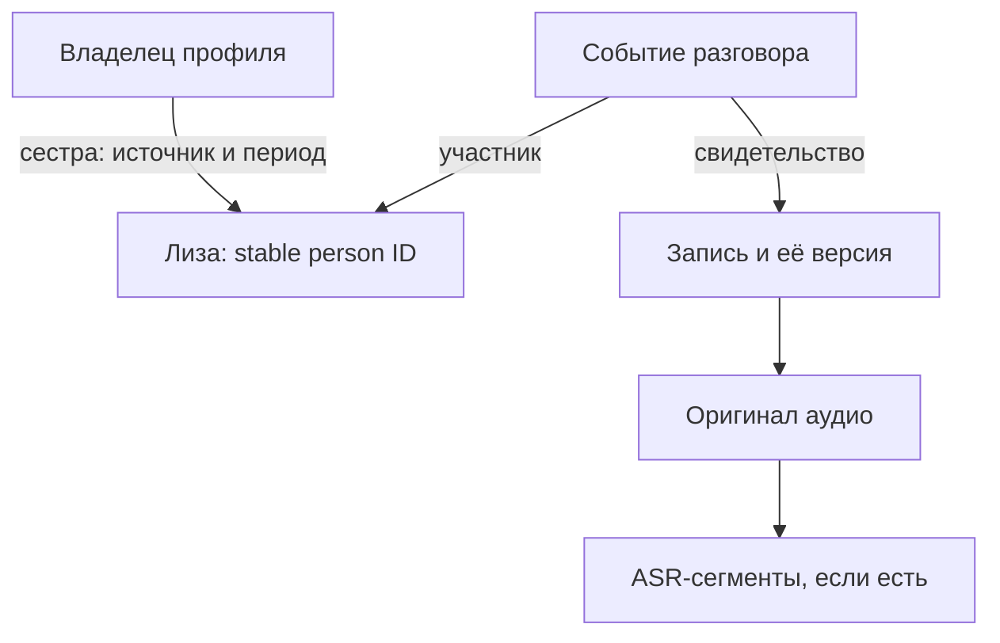

# №66: связи фактов, людей, событий и медиа — поиск по отношениям

26.10.2026 · дополнение к [аудиту архитектуры памяти](../docs/architecture/MEMORY_RETRIEVAL_AUDIT_2026-10-26.md) и [временной модели](TEMPORAL_MEMORY.md). **Статус: требование и проект поведения, не реализованная гарантия.** Не добавляет новую очередь/номер плана: работа относится к №66 и к поиску/исходникам №60/83/84. Данные остаются в локальной SQLCipher-базе, сервер/графовая СУБД не требуются.

**Ревизия 75:** пакет №66.4 и общая основа с №72/17/20/56/73 — [MEMORY_RELIABILITY.md](MEMORY_RELIABILITY.md). Источник/свидетельство/решение пользователя хранятся одинаково для времени и связей. `person:user` — stable ID владельца текущего профиля, не глобальный человек на все профили. Права и ключи профиля проверяются для каждого задания и перехода.

## Обязательный пользовательский сценарий

1. Пользователь сообщает «Моя сестра — Лиза». Это не строка-синоним «сестра», а факт о **отношении** пользователя и конкретного человека.
2. Отдельно хранится оригинал аудиозаписи «Разговор с Лизой» (другие варианты: транскрипция «вчера говорил с Лизой», вложение к заметке, импорт через Android Share).
3. Запрос «Найди разговор с моей сестрой» должен разрешать «моя» → владелец памяти, «сестра» → тип родственной связи, «Лиза» → идентичность человека, «разговор» → эпизод общения и аудио. Возвращаются подходящие **оригинальные записи** с датами, источниками и прямым открытием/воспроизведением, если оригинал существует; таймкоды только если извлечены.
4. Порядок поступления фактов не имеет значения: сначала родственница, затем запись; или сначала запись, затем родство. В обоих порядках результат должен быть одинаковым после доиндексации/разрешения идентичности.
5. Даже если постоянной связи ещё нет, запрос должен выполнить ограниченное соединение на лету через доказанные факты/псевдонимы/участников, а не только сравнение векторных эмбеддингов. Полезное разрешение может сохраниться как *кандидат* для следующих запросов; недоказанную связь не превращать в подтверждённое знание.

## Логическая модель (не требование новой графовой СУБД)

**Роль не является именем.** «Моя сестра» — отношение с точкой зрения user и возможным контекстом/периодом, а не универсальный псевдоним человека «Лиза». У пользователя может быть несколько сестёр, а у разных людей — одинаковые имена. Для идентичности использовать стабильный person_id, алиасы только при достаточном основании, а при неоднозначности предложить уточнение или несколько результатов.

Поддерживать типизированные отношения: kinship (sibling_of, parent_of, spouse_of с ролями/временем), participant_of, about, mentioned_in, has_source, has_attachment, equivalent_identity [только подтверждённое], correction/supersession/conflict — с направлением/обратным чтением, provenance, source_revision, статусом derived/confirmed/disputed и жизненным циклом. Факт родства и факт участия в беседе могут происходить из разных источников. Нет необходимости сразу переносить текущую память на RDF/Neo4j. Таблицы утверждений и связей/производные индексы в SQLCipher достаточны, если они умеют тип/контекст/проверку/инвалидацию.

## Предложение связей при сохранении: подтверждение человеком и накопление графа

**Принцип:** распознавание связей должно происходить не только по запросу, а **после каждого сохранения факта/заметки/распознанного медиа** (асинхронно при необходимости); найденные предположения показываются для утверждения, а подтверждённое знание переиспользуется во всех будущих поисках. Это не массовая повторная индексация и не обязанность отвечать на десятки вопросов, прежде чем заметка сохранится.

### Разделить три вида результата анализа

1. **Явная связь из слов пользователя** — «Лиза — моя сестра», «разговаривал с Лизой». Само высказывание сохраняется как факт с точным источником (кто заявил, запись, версия, цитата); при *однозначно определённой* персоне его допустимо использовать без второго вопроса о том же утверждении. Если непонятно, **какая именно Лиза**, не выбирать первую по имени — требуется разрешение личности.
2. **Достоверная производная связь** — уже подтверждены `user sibling_of person:liza` и `event participant person:liza`; вопрос «найди разговор с моей сестрой» выполняется цепочкой независимо от нового подтверждения пользователем. Сама транзитивная цепочка — вычисленный путь с доказательствами, не ещё один биографический факт. Детерминированную привязку вложения к его собственной заметке тоже можно строить автоматически, сохраняя provenance.
3. **Гипотеза модели/эвристики** — «Лиза» в заголовке может оказаться сестрой; «Елизавета» может быть той же персоной; упоминание в расшифровке может означать собеседника или третье лицо. Показывать `possible_link` с объяснением, не считать его подтверждённой идентичностью или участием. Сходство embedding, имени или голоса **не доказывает** личность.

### UX: одно компактное предложение вместо обязательных вопросов

- Источник сохраняется **сразу по обычному действию пользователя**; индексация/поиск кандидатов не блокируют запись и не теряют её при ошибке или блокировке телефона. После анализа — встроенная карточка «Возможные связи: 3» и/или незаметный счётчик в разделе памяти. Не показывать модальный диалог на каждый найденный факт; по умолчанию группировать кандидаты на одну новую запись.
- Каждая строка: тип («участник», «родственник», «о человеке», «похожий дубль», «исправляет»), связанная запись, короткое основание/цитата, и **уровень доказанности словами**, а не вводящим в заблуждение процентом ИИ. Для аудио источник/таймкод показывать лишь когда они доступны.
- Действия: **«Подтвердить выбранные»**, **«Это не тот человек / Не связывать»**, **«Позже»**, **«Изменить тип связи»**. При конфликте — отдельное предложение поправить период/отношение по TEMPORAL_MEMORY.md. Разрешать частичное подтверждение и отмену решения.
- **Не беспокоить повторно:** сохранять подтверждение, отклонение и отложенное состояние относительно точных пар IDs, типа, контекста и входных версий. После «Не связывать» повторное предложение допускается только при существенно новых доказательствах или явном запросе пересмотра. «Позже» остаётся в очереди без навязчивых повторных окон.
- Если пользователь говорит «Лиза — сестра», подтверждение самого родства не означает разрешение всех будущих неоднозначных упоминаний «Лизы»: для беседы «с Лизой» с ясной персоной автопривязка допустима; для нескольких Лиз или сомнительного ASR нужна отдельная проверка. **Одно подтверждение сущности/отношения может обеспечить множество последующих поисков без N одинаковых вопросов.**
- Просмотр вручную: у человека, заметки, события и вложения есть раздел **«Связи»** с направлениями, основаниями и возможностью «Добавить», «Изменить», «Удалить связь», «Почему связаны?». Отдельный список «На проверке» нужен только для нерешённых гипотез; не создавать вторую основную память.

### Где и как хранить

Сохранить **в той же шифрованной SQLCipher**-базе, используя текущие `memory_entities`, `memory_relations`, `memory_aliases`, `memory_revisions` как основу. Сегодня `memory_relations` хранит только `source_entity_id`, `target_entity_id`, `kind`, `source_kind/ref`, `created_at`; `linkEntities` не записывает статус подтверждения, доказательства, версии источников, уверенность и решение пользователя. Поэтому для планируемого поведения нужна миграция/добавочный слой `memory_relation_candidates` + расширение/нормализация `memory_relations` и журнал `memory_relation_decisions` (имена примерные, уточнить в OpenSpec). Не смешивать окончательные связи с гипотезами, не хранить только в prompt или embedding.

Минимальный **контракт кандидата и подтверждённой связи**:
`id`; `source_id/target_id` (стабильные IDs, а не совпавшие строки); `relation_kind` и направленность/роли; `subject_context`; `source_record_id/source_revision` + `attachment_id/segment/timecode` при наличии; `evidence_quote`; `derivation` (explicit_user/model/rule/import) + `model_version/input_hash`; `review_status` (proposed/confirmed/rejected/deferred/retracted); `decision_actor/decided_at`; `valid_from/valid_until` при временных отношениях; `created_at/updated_at`. При нескольких независимых источниках поддержать **несколько свидетельств одной логической связи** и не удалять её из-за изменения одного слабого источника, если остаются действительные подтверждения.

Эти `review_status` — названия состояний сценария, не отдельный несовместимый enum: в общей схеме различать **origin**, **decision_status pending/accepted/rejected/deferred** и **состояние свидетельства current/stale/withdrawn**; конфликт хранить явно. «Confirmed» означает принятое основание, а не математически доказанную истину. Отклонение привязано к смыслу пары/роли и доказательствам: технический updated_at или смена модели сами по себе не повод повторять вопрос. Несколько копий одного поста не независимые подтверждения.

Индексы по target/source + relation kind + status и отдельная очередь `dirty source IDs`: изменение источника, добавление алиаса, новый родственник или новая расшифровка запускают **адресный** повторный анализ ранее неразрешённых упоминаний; no O(N²) LLM-перебор всех пар. Гипотезы сгенерированы под sensitivity/ACL источников; не показывать названия скрытых записей и не посылать личные данные облачной модели без предусмотренных полномочий. При изменении версий перед подтверждением — повторная проверка/транзакция CAS и инвалидация старого кандидата. Подтверждения и отклонения попадают в экспорт/резервную копию и поддерживают undo.

### Приёмка предложения связей

| № | Сценарий | Ожидаемое поведение |
|---|---|---|
| C1 | Уже есть «Разговор с Лизой»; сохранить «Моя сестра Лиза» | Оригинал сохранён независимо от анализа; найдена возможность связать старую запись и лицо; однозначные факты используются, гипотезы предлагаются |
| C2 | Подтвердить предполагаемую связь и затем повторить поиск родственника | Подтверждённый путь повторно используется без LLM и второго согласования |
| C3 | Нажать «Не связывать» для тёзки | Отклонение хранится, ошибочная запись не выдается как подтверждённая; не предлагать снова без новой причины |
| C4 | Нажать «Позже», выйти и повторно открыть память | Факт сохранён, предложение находится в очереди; без блокирующих окон |
| C5 | Новая запись с очевидной уже подтверждённой идентичностью | Автопривязка без повторного вопроса; пользователь может посмотреть/исправить связь |
| C6 | Изменить или удалить исходный текст / исправить имя / выполнить merge | Отозвать недействительные производные свидетельства и кандидатов, перепроверить версии, сохранить журнал/undo |
| C7 | Секретная или защищённая запись о человеке | Нет метаданных о ней в обычном списке предложений и облачном запросе |
| C8 | В одной заметке 30 извлечённых упоминаний | Один компактный пакет с выбором и лимитами/постраничной выдачей, а не 30 модальных подтверждений |
| C9 | Один источник связи удалён, второй независимый остаётся | Только зависимое свидетельство отзывается; оставшаяся цепочка проверяется с собственными правами |
| C10 | Отклонённая связь, повтор индексации или новая модель без нового факта | Решение сохраняется, повторный вопрос не навязывается |

## Создание связей и «на лету»

**При сохранении:** извлечь имена и отношения из ручного текста, метаданных, названия, разрешённой расшифровки и других достоверных источников. Соединить с существующими person IDs, если идентичность однозначна. Сохранить исходную цитату и локацию; для ASR/OCR — конкретный attachment, версию извлечения, страницу/таймкод. Не создавать якобы подтверждённое участие только потому, что кто-то упомянут в тексте об ином разговоре. Само распознавание разных голосов (диаризация) не устанавливает личность говорящего.

**При добавлении нового факта:** адресно пересмотреть ранее неразрешённые упоминания «Лиза» и записи об общении, сформировать или обновить relation candidates. Процесс возобновляемый и инкрементальный (не полный LLM-перепросмотр всей памяти после каждой заметки). Если расшифровки нет и файл никак не подписан, нельзя утверждать, с кем говорили; приложение должно честно сообщить об отсутствии основания, показать кандидатов или предложить подписать/распознать запись.

**При запросе:** выделить намерение (найти медиа), отношения и ограничения → разрешить точку зрения «моя» → получить персону(ы) по родству → соединить conversation participant/связанные заметки и извлечения → найти исходное вложение → rerank с датами/типом медиа/доказательствами → показать результаты. При неполном графе выполнить bounded fallback: имя/псевдонимы/роль + FTS/векторы + сверка источника; не превращать похожесть текста в подтверждённое родство или одинаковую личность. Для «все разговоры» нужны полный постраничный list/filter, а не только top5.

**При изменении:** отозвать/перестроить derived relations при редактировании, удалении, объединении или исправлении источника, сохраняя историю и перенося ссылки при merge. Подтверждённые пользователем связи редактируются и отменяются явно; связи с изменившимся источником не продолжают считаться проверенными. Историческое родство, брак и периоды обрабатываются по TEMPORAL_MEMORY.md.

## Безопасность, производительность, UI

- Проверять доступ, sensitivity/ACL и актуальную версию **на каждом переходе** по графу и при чтении оригинала. Защищённый файл/имя не должны раскрываться через обычный индекс, результаты или контекст внешней модели. Поиск — преимущественно локальный; отправка личного ASR или медиа внешней LLM не включается скрыто.
- Ограничивать глубину обхода (для примера 2–4 типизированных перехода), число кандидатов, CPU/батарею; сначала направленные SQL-join/индексы по entity_id/relation_type, затем локальный rerank. Не делать произвольный транзитивный вывод «знакомый моей сестры = мой знакомый».
- В UI показать: «Разговор с Лизой · аудио · [дата если известна]», действия «Воспроизвести / Открыть заметку», при полезности «Почему найдено: Лиза — сестра; указана участницей». Отделить «связь подтверждена» от «возможное совпадение»; не показывать несуществующие таймкоды/аудио.

## Текущее состояние кодовой базы на момент спецификации

Уже есть `memory_relations`, `memory_aliases`, `MemoryRepository.linkEntities/relationsForEntity/entitiesByAlias`; `enrichEntity` может записать **about** к существующему person через извлечённое моделью имя. `searchMemory` может пройти от найденного person по входящим **about** (до 3 персон/8 связанных фактов на одну). Это полезный частичный механизм, **но не** разбор kinship «моя сестра», не participant_of беседы, не гарантированный поиск оригинала аудио, не ретроспективное связывание и не контролируемый полный графовый поиск. Поиск агента пока ограничен search_local_notes и коротким excerpt; чтение исходного вложения также требует нового search→read/attachment-контракта. См. M05/M07/M09/M10/M13/M15 аудита.

## Приёмка (тесты с источниками, не выдуманные данные)

| № | Сценарий | Ожидаемый результат |
|---|---|---|
| R1 | «Моя сестра Лиза» → сохранить разговор с Лизой → «найди разговор с моей сестрой» | Открывается исходное аудио; показаны цепочка связи и источник |
| R2 | Разговор с Лизой → позже «Лиза — моя сестра» → тот же запрос | Ранее созданное аудио находится после адресного связывания/поискового fallback |
| R3 | «Елизавета» как подтверждённый алиас Лизы, запись использует «Елизавета» | Та же персона, найден правильный разговор |
| R4 | Две Лизы, две сестры, спорная идентичность | Не смешивать лица; не подделывать уверенность; уточнить при необходимости |
| R5 | Неподписанное аудио без доступной расшифровки | Не утверждать, что это разговор с Лизой без основания |
| R6 | В беседе упомянули Лизу, но разговаривали с другим человеком | `mentioned_in` не подменяет `participant_of` |
| R7 | Отредактировали/удалили источник связи; merge; устаревшая модельная связь | Переоценка/инвалидация, отсутствие «призрачных» совпадений |
| R8 | Файл защищён, а запрос идёт через внешнюю модель | Не раскрывается никакая конфиденциальная связь/метаданные |
| R9 | Несколько разговоров, поиск «все» и «последний» | Полная постраничная выдача либо честное partial; события сортируются по дате события |
| R10 | В заголовке опечатка «Лзиой», две похожие персоны | Fuzzy/ASR даёт кандидатов; не записывает подтверждённый alias/участника только по сходству |
| R11 | Доступна заметка, но промежуточное родство или второе доказательство закрыто | Не показывать скрытое имя/роль через объяснение пути, count, кандидатов или внешний промпт |

Поисковый переход не сохраняет автоматически новые биографические отношения. `mentioned_in` и `participant_of` направлены и различны; обратное чтение разрешённого отношения не даёт права на произвольную транзитивность родства. Циклы/повторные рёбра ограничиваются visited IDs и бюджетом. Глубина 2–4 — исходная настройка для проверки, не универсальная гарантия полноты.

**Шаги:** (1) спецификация E2E+привязка sources/extractions к note/audio, (2) нормализованные отношения/идентичность и reverse lookups, (3) фоновое локальное разрешение и query-time fallback, (4) обновление search→read UI/агента, (5) тесты на Android и конфликтных/закрытых источниках. Приоритет: вместе с доработкой №66 до сложного мультимодального №83, а не отдельная новая очередь.

**27.10.2026 · R0 (#173 в main, required CI PASS; physical Android QA отдельно):** отдельный чистый контракт `relational-proof.ts` фильтрует путь has_sister→participant_of по stable IDs, confirmed+current evidence и версиям/ACL; mention_about не считается участием, тёзки не склеиваются. Это НЕ SQLCipher persistence, НЕ idempotent proposals, НЕ UI и НЕ поиск аудио: дальнейшие физическая схема общих claim/evidence/decision, сохранение доказательств, user review и reverse lookup обязательны. Не считать сценарий ID01 готовым. R1–R11 сохраняются без упрощения.

**28.10.2026 · M2/R1 граница identity при сохранении одобренной заметки (PR, CI pending):** `saveApprovedNote` больше не берёт `entitiesByAlias(...)[0]`: если несколько Марий/Максимов, связь не создаётся до уточнения, закрытая персона не может автоматически связаться с открытой заметкой, пользователь видит безопасную причину. Это защита существующего legacy `about`, НЕ готовый граф доказательных родственных/участнических связей; `about` нельзя трактовать как `participant_of`. Открыта атомарная source+identity/revision операция M1/M2.

**28.10.2026 · R1a SQLCipher v12 (PR, C1 pending):** первый физический слой доказательств `memory_relation_evidence` с FK на уже существующий `memory_relations`; несколько независимых цитат/версий на одну каноническую связь, user-only статус, без второго графа/автоутверждения старых links. Шифрованный backup format v3 и восстановление старого v11 v2. [Точный контракт](../openspec/changes/memory-relational-proof-v12/proposal.md). Следующий шаг R1b — явное transactional confirmation + source-revision CAS, затем R2 review/undo и R3 search→read; C2 physical NOT VERIFIED.

**28.10.2026 · R1b (stacked PR, C1 pending):** explicit user-only canonical `memory_relations` witness confirmation and current ACL+source-version proof read through existing profile-leased `MemoryRepository`, idempotent same source, two independent witnesses, strict person/participant typed role; [contract](../openspec/changes/memory-relational-user-proof-r1b/proposal.md). Legacy/model:auto relation alone is NEVER proof; no model-to-confirm mutation tool. R2 approval UI/history and R3 bounded graph search/audio original remain open.

**28.10.2026 · R1c (stacked PR, C1 pending):** один scoped proof traversal `MemoryRepository.confirmedRelativeConversationPaths` (родство/роль → конкретная персона → `participant_of` → заметка беседы) через тот же `memory_relations` и user witnesses. Stable ID и источник проверяются на каждом hop. Выдаёт ID и две ссылки на evidence, **не** аудиофайл, не таймкод, не статус нынешнего коллеги; дальнейший M3 search→read integration отдельным PR. [OpenSpec](../openspec/changes/memory-relational-conversation-r1c/proposal.md).