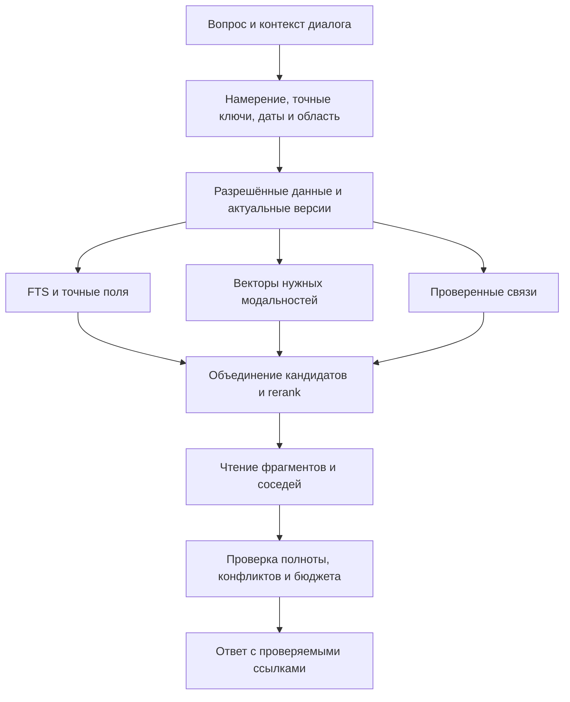

# Память PersAI: хранение, поиск и работа на годы

Дата: 26.10.2026. **Первичный аудит завершён; живой журнал для последующих исправлений.** Проверяемый код: main `b1a2b3b31aa4a2ece88e25705207914307fc4c14`, после #128. Изменений приложения этот документ не вносит. Предложения не означают реализованную функцию или измеренную производительность.

## Продолжение работы

Для продолжения реализации читать актуальную очередь [PLAN.md](../../PLAN.md), затем этот аудит и указанные исходники. Сверять HEAD/PR: другие диалоги могут менять проект. Дописывать находки сразу, различать **факт кода / воспроизведение / гипотезу / рекомендацию**. После исправления сохранять ID находки, ссылку на PR и доказательство. Публиковать контрольные точки в git, а не оставлять только в локальной копии. 26.10 автоматическая очистка среды удалила первый локальный checkpoint; этот файл восстановлен из зафиксированного контекста, исходный SHA main не изменился.

## Область и действующие ограничения

Хранение, импорт, индексы, поиск пользователя и агента, точность/полнота/цитирование, приватность, резервирование, большой объём разных данных. Не аудит оформления экранов.

Действующий контракт: память на телефоне; SQLCipher без plaintext fallback; доступ после общей разблокировки без повторной биометрии на каждом поиске; облаку только разрешённые данные; сохранение предложенных LLM фактов после действия пользователя; собственного обязательного сервера нет. Package ID `com.persai.app`, ключи и существующие данные сохраняются. Облачная синхронизация/сервер не утверждены к немедленному развёртыванию. Историческое «не менять память» для UI-PR не запрещает этот аудит и отдельные функциональные улучшения. Теги необязательны.

## Вывод для решения

Сохранить локальную SQLCipher-основу. Главные препятствия — неполная поисковая проекция, отсутствие дочитывания источника агентом, свежесть производных данных, полные сканирования и жизненный цикл накопленного архива. Смена embedding-модели помогает мультимодальности, но сама эти задачи не закрывает. Предлагается эволюция, без обязательного сервера.

| Срочность | Находки | Практический эффект |
|---|---|---|
| P1, ближайшие исправления | M10, M08 | Не сохранять устаревшие AI-terms; обеспечить путь backup/restore для поддерживаемого объёма |
| P1, точность/полнота | M02, M03, M05, M07, M12 | Находить события/файлы, дочитывать длинный источник, учитывать даты и давать проверяемые ссылки |
| P2, рост корпуса; до массовой индексации №83 | M04, M06, M09, M14, M16 | Очереди и native retrieval, provenance, снижение RAM/повторной работы |
| P2, годы использования | M13, M15, M17, M18, M19 | История, dedup, переносимость, repair и контролируемая диагностика |
| Сохранять и измерять | M01, M11 | Не потерять работающие гарантии; расширить eval вместо обещания максимальной точности |

## Находки

### M01 — структурированная основа уже есть

**Факт:** `mobile/src/local-memory/types.ts`, `storage.ts` описывают коллекции, сущности, наблюдения, связи, ревизии, sensitivity, статусы, valid_from/valid_until, aliases, index terms, chunks/vectors. SQLCipher schema v5; оригиналы медиа, FTS и чаты в той же защищённой базе. Не предлагать эти сущности как отсутствующие. Транзакции на одном разблокированном соединении, optimistic version checks, атомарные запись/индексирование и backup restore — полезная основа.

### M02 — поисковая проекция уже самого хранилища

**Факт:** `search-index.ts:memoryText` берёт только body/extracted_text/source_url. Другие payload-поля не входят в текст. `createObservation/reviseObservation` не обновляют FTS; UI сохраняет события как observation.payload.text. `chunkText` режет примерно по 700 символов, без overlap и координат источника. Заголовок, aliases, terms повторяются в каждом chunk. ID=entityId:ordinal, hash=FNV32+длина (не криптографический).

**Риск:** структурированные сведения и события не находятся; найденный текст нельзя точно связать со страницей/таймкодом; вставка в начало меняет много chunk IDs/векторов. **Предложение:** типизированные индексируемые поля, отдельные сегменты источников, token-aware chunking с ограниченным контекстом соседей, стабильная идентичность и версия. Не индексировать произвольный JSON целиком: технические поля/секреты должны проходить явную политику.

### M03 — ручные языковые эвристики и обрезка вопроса

**Факт:** `query.ts:searchSteps` использует первые 120 символов и до 6 слов; фраза/слова/префиксы, простое снятие окончаний. Некоторые слова времени исключены. «Что знаешь обо мне» становится выборкой последних записей. `context.ts` обрезает initial lookup ещё до семантической ветки. **Предложение:** сохранять полный смысл вопроса в допустимом бюджете; отдельно выделять имена, точные номера, даты/периоды, отрицания и фильтры. Не считать такой стеммер полноценной русской морфологией; подтверждать улучшения eval.

### M04 — линейный vector search и многократные полные проходы

**Факт:** `repository.ts:vectorMatches` читает все подходящие vectors/text/title в JS, сверяет hash, считает cosine и сортирует. Native/ANN индекса нет. `pendingVectorChunks` сначала загружает все active chunks, затем выбирает batch; `vectorStatus` повторно читает все chunks. `vector-runner.ts` повторяет это после пачки 16, до 2000 пачек. Для первоначального backfill риск порядка O(N²/16) чтений метаданных; это анализ алгоритма, не измерение Android.

**Предложение:** durable dirty-job queue с input version/hash, SQL LIMIT на выдачу пачки, инкрементальные счётчики, приоритет интерактивного поиска. Сравнить нативный exact search и ANN по Recall/latency/RAM. Сервер ради этого не обязателен.

### M05 — разные поиски и слишком раннее сокращение кандидатов

**Факт:** `searchMemory` берёт 8 записей на лексический шаг и 8 vector hits, RRF уже реализован. Лексический score — сумма ручных весов попаданий. Сохраняется один chunk записи; лексический chunk не заменяется векторным. Для 3 найденных person подмешиваются до 8 последних входящих about-фактов. Поиск: domain=notes, active; valid_from/valid_until не фильтруются. UI `searchNotes` — один FTS phrase без semantic ветки. `searchApprovedNotes` — top5, полная запись до 12 000 символов, общий бюджет 24 000; иначе выдержка до 900.

**Предложение:** общий retrieval service с режимами, фильтрами и evidence. Разделить отбор кандидатов, rerank, выбор нескольких полезных сегментов и packing. Для «все/сколько/за период» нужны list/count/filter с пагинацией, не увеличение top-K. Архив/история — явный режим, корзина не участвует в обычном поиске.

**Сценарий связей к M05/M07/M09/M15:** [№66: родственные связи, участники разговора и исходное аудио](../../Plans/RELATIONAL_MEMORY.md). Уже существующий переход `person → about` не гарантирует разрешение «моя сестра» → «Лиза» → conversation.participant → attachment, особенно когда аудио сохранено до факта родства. Нужны типизированные отношения с provenance, инкрементальное ретроспективное связывание и query-time fallback с проверками ACL/идентичности; `mentioned_in` не равно `participant_of`. Это дополнение к существующим находкам, не новая подтверждённая реализация и не изменение числа находок.

### M06 — версия модели и приоритеты inference недостаточны

**Факт:** MiniLM model ID — строка без fingerprint весов/tokenizer/preprocessing; dim хранится, но saveVectors принимает любой finite непустой vector. MIN_SIMILARITY=0.45 глобальный. `embedQuery` ждёт в общей очереди с background embedTexts и сдаётся через 3 секунды; Promise.race не отменяет native работу. Batch embedTexts не получает AbortSignal; при блокировке результат не записывается, но вычисление пачки может продолжиться. Durable retry/backoff отсутствует.

**Предложение:** model/index manifest, проверка dim/normalization, отменяемые небольшие пачки и интерактивный приоритет, модельные/задачные пороги, статус degraded/partial. FTS должен работать без загруженной модели.

### M07 — агент умеет найти, но не дочитать источник

**Факт:** `tool-catalog.ts` даёт search_local_notes(query), не read_note/read_chunk/read_attachment/list/filter/aggregate. Rewrite в `context.ts` только при пустом результате; плохое непустое совпадение обходится без rewrite. Длинную заметку prompt предлагает открыть человеку вручную. UsedNote=id/title/section/via без версии/offset/страницы. «Из памяти» содержит найденные записи, не доказанно использованные в конкретных утверждениях.

**Предложение:** search→read evidence с соседями, бюджетом и повторной ACL/version проверкой; claim→citation, отдельные found/read/cited. Не заявлять исчерпывающий поиск по top5; различать empty/partial/unindexed/unavailable/degraded без раскрытия защищённых названий.

### M08 — предел backup ниже возможного объёма памяти

**Факт:** `backup.ts` экспортирует всю БД, включая originals/indices/vectors. Максимум 2 GiB проверяется после создания/копирования. Restore также отказывает при >100 000 entities, createEntity такого глобального потолка не имеет. Restore требует отсутствия коллекций, перестраивает FTS в общей транзакции, векторы пересчитываются позже. memory_received_shares экспортируется вместе с БД, но явно не восстанавливается. Автоматического backup в этом пути нет.

**Следствие:** пользователь может накопить базу, для которой штатный backup/restore не работает. Пример арифметики: 26×80 MiB оригиналов=2080 MiB >2 GiB, ещё без индексов/истории. Это иллюстрация лимита, не замер.

**Предложение:** сначала согласовать write/export/restore budgets, preflight места, manifest, проверку копии и restore drills. Затем возобновляемые/инкрементальные зашифрованные архивы, версии и retention. Не просто повысить константу. Облачное место для зашифрованной копии не равно облачному retrieval/server.

### M09 — оригиналы сохраняются, происхождение извлечённого смысла теряется

**Факт:** `attachments.ts`: original bytes в SQLCipher по 256 KiB с SHA-256, до 10 файлов/80 MiB на запись, транзакционно. `batch-recognition.ts` склеивает успешные тексты с заголовками файлов в extracted_text, ошибки остаются в UI state. Нет сохранённого per-attachment extraction status/version/page/timecode/model. #125 append хранит originals без распознавания; содержание добавленного файла ещё не searchable. Видео: выборочные 5 кадров, отдельный звук; это не полное покрытие всех сцен. PDF сейчас можно приложить существующей заметке, но полноценного локального извлечения PDF нет.

**Предложение:** attachment→extraction revision→located segments; immutable OCR/ASR, LLM-описание и пользовательский текст раздельно. Статусы pending/partial/failed/not-supported, повторная обработка без перезаписи ручных исправлений. Поиск фото без описания — №83, не уже существующая функция.

### M10 — гонка enrichment и противоречие документации о внешних запросах

**Продолжение 26.10:** гонка исправлена в технической ветке №66.1, schema v6; [контракт](../../openspec/changes/memory-enrichment-snapshot/proposal.md), [результаты](MEMORY_TECHNICAL_PROGRESS_2026-10-26.md). Ниже сохранено исходное наблюдение. Видимая политика/квота №54а и reviewable relations №66.4 остаются открытыми.

**Факт кода, подтверждён probe:** `enrich.ts:enrichEntity` читает entity, ждёт LLM, вызывает setIndexTerms без expectedVersion/inputHash. Последний пишет created_at=now; staleIndexTerms сравнивает timestamp с entity.updated_at. Если entity изменён во время LLM, старые terms получат более новый timestamp и будут считаться свежими. Комментарий «next pass redoes it» этому не соответствует. Model about-связи не имеют provenance модели/версии и не очищаются после изменения источника.

Enrichment использует body[:3000], не extracted_text. enabled=true по умолчанию; запускается после сохранения/старта, обрабатывает только разрешённые обычные записи. На проверяемом SHA это расходилось с docs/MEMORY_AND_SECURITY.md «к провайдеру … только в момент запроса». В документационном PR #129 описание исправлено; выбор default-on режима/политика внешнего enrichment и отдельные бюджеты ещё требуют функционального решения. Это **не доказательство отправки secret-записей**.

### M11 — нынешний eval не доказывает качество native semantic retrieval

**Факт:** `mobile/eval/evaluate.ts`: production repository на настоящем Node SQLite FTS5, 25 notes/39 questions. Переданный repository отключает deviceEmbedder; withTerms использует заранее заданные ответы EVAL_MODEL_TERMS. Проверка успеха — хотя бы один ожидаемый id в top5. Нет полноты многочастного ответа/рангов/цитат/реальных embeddings/масштаба. Полезная регрессия, но не доказательство 100% смыслового поиска. Baseline и 7 дополнительных probes запущены; результаты ниже и в evidence-файле.

## Незакрытые измерения

Реальные embeddings/токенизатор на русском, Android нагрузка, крупный backup/restore и native vector-extension совместимость остаются непроверенными. Они не подменяются результатами Node SQLite. Статус реализаций предложений — pending.

## Дополнительные находки после воспроизведения

### M12 — даты существуют, но не задают актуальность знания

**Детализация по идее владельца 26.10:** [№66: события, текущие состояния и пересмотр фактов](../../Plans/TEMPORAL_MEMORY.md). Повторная замена свечей — новое событие; смена основного места работы/жительства — кандидат на завершение периода прежнего состояния. Отличать изменение жизни от исправления ошибки, совместительство/несколько адресов, приблизительные даты, планы и наблюдения. «Текущее» — отображаемый статус с периодом и датой подтверждения; ревизия адресная по субъекту/свойству/контексту, с предложением и undo, без удаления истории и без закрытия всей заметки. Пока спецификация, не реализация.

**Воспроизведено:** active запись с valid_until=2020-01-01 попадает в выдачу, временные поля не передаются в MemorySnippet. Это не означает, что все просроченные записи нужно скрыть: договор прошлого года нужен для исторического вопроса. Нужны два времени: когда событие/факт действовал и когда пользователь сообщил/исправил сведения; текущий режим и «на дату». Новая запись о месте работы не отменяет старую автоматически. Предложить связь supersedes/conflicts_with и подтверждение исправления, показывать противоречия, не выбирать просто последнее редактирование. Даты событий/дни рождения не равны valid_from; сейчас saveApprovedNote записывает proposal.date и в payload.date, и в valid_from.

### M13 — рост истории и чатов, merge и удаление

**Факт:** `conversations.ts:load` загружает все snapshot_json со всеми сообщениями/вложениями; save перезаписывает весь JSON диалога. Для нескольких лет это отдельная нагрузка на startup/RAM/WAL/backup, даже если поиск заметок исправлен. `memory_revisions` хранит before+after целиком; чтение revisions/observations без пагинации. `note-actions.ts:merge` копирует payload в merged_sources, оставляет superseded originals и историю, переносит вложения, но не remap связей/aliases к итоговой записи и не применяет лимит 10/80 MiB к совокупным вложениям. Последнее — несогласованность между append и merge, не доказательство потери файлов. Повторные merge могут размножать вложенные снимки payload.

**Предложение:** metadata-only список диалогов и ленивая загрузка сообщений, далее нормализованные messages/attachments с миграцией. История — checkpoints/deltas или сжатие после измерения; retention с понятной политикой, без тихого удаления пользовательских данных. Merge хранит ссылки на версии источников, canonical redirects, происхождение связей и единые ограничения. «Удалить запись» и «забыть факт во всех копиях, чате, backups» — разные обещания; второе требует отдельной политики, не может гарантироваться удалением одной строки.

### M14 — на уровне SQL можно улучшить без смены базы

**Факт:** `LocalMemoryScreen` уже использует FlatList, debounce 250 ms и страницы по 50; пагинация есть, но OFFSET и накапливание полных entity payload в JS. Схема имеет индексы collection/created_at, aliases, relations и др.; для обычного фильтра domain/status/collection + ORDER BY updated_at,id соответствующий составной индекс не объявлен. На каждый новый term заново запрашиваются collection counts. `withLocalMemoryDatabase` сериализует целую repository operation: большие import/export/rebuild/vector scans способны задержать интерактивное чтение. Это риск архитектуры, не измеренный ANR.

**Предложение:** EXPLAIN QUERY PLAN на реальных запросах и целевой сборке; подходящие compound/partial indexes, cursor pagination для хронологического списка, лёгкая проекция карточки, cache/invalidation counts. Для ранжированной выдачи — стабильная поисковая сессия/cursor, а не механическая замена OFFSET условием по дате. Не менять модель SQLCipher соединений без race/lock-тестов; сначала сократить операции, позже отдельно проверить keyed read connection/native worker.

### M15 — dedup и provenance частичные

**Факт:** fingerprint импорта учитывает файл/заголовок/текст/раздел; защита от повтора есть. Но то же содержание с другой формой/именем/импортом не обязательно распознаётся как дубликат. Поля source_kind/ref и merged_sources есть, но у source_ref часто значение device-import/android-share, не адрес конкретного исходного фрагмента. Receipt после restore теряется (M08). Модельные связи строятся по первому подходящему person alias: одинаковое имя не гарантирует одного человека.

**Предложение:** immutable source identity/version + нормализованный URL/внешний ID где доступен; криптографический content hash оригинала; exact dedup и отдельно «похожие записи» как предложение, не автоматический merge. Различать однофамильцев контекстом и ID, хранить авторство/метод/версию/уверенность связи. Semantic similarity не доказывает идентичность человека/машины/документа.

### M16 — постоянная очередь не равна работе при закрытом приложении

**Факт:** текущие runners — JS timers; SQLCipher операции требуют разблокированной сессии. WorkManager сам по себе не отменяет этот контракт. **Предложение:** durable очередь прежде всего восстанавливает прогресс после открытия; после lock — pause. Скачивание публичных весов и копирование уже зашифрованного архива могут иметь отдельные OS jobs. Распознавание личных данных при заблокированном приложении требует отдельного продуктового/безопасностного решения; не держать ключ/сессию незаметно ради throughput. Лимиты батареи/нагрева/RAM и foreground/background semantics уточнять на устройстве.

### M17 — поиск и память диалога не следует смешивать автоматически

**Факт:** чаты хранятся отдельно и не входят в memory_search_fts. Это не ошибка само по себе: ответы модели могут содержать предположения. **Предложение:** отдельный режим «поиск в истории диалогов» с ролями, датами и цитатой исходного сообщения. Сохранённый пользователем факт с provenance может входить в долговременную память; ответ ассистента не становится фактом только потому, что записан в истории. Компактный task state полезен для продолжения задачи, но не заменяет архив источников.

### M18 — долговременная ремонтопригодность и переносимость

Нужны: версия data/index/extractor/model отдельно; журнал миграций с resumable staging для производных данных; контроль места до больших операций (v4→v5 копирует attachment tables внутри SQLCipher); orphan/coverage/integrity checks, диагностический отчёт без содержания записей, безопасный rebuild конкретной модальности, восстановление на новом устройстве и чтение старых backups. Пользователю нужен понятный статус «сохранено / распознано / проиндексировано», размер данных/истории/индексов, дата проверенной копии. Возможный переносимый экспорт записей+оригиналов+связей — внутри зашифрованного контейнера по действию пользователя, с manifest и форматом, документированным независимо от UI/runtime. Не объявлять текущий SQLCipher backup отсутствующим; это его дальнейшее развитие.

## Результаты проверок

**7 дополнительных probes подтвердили M02/M03/M04/M05/M10**; вместе с существующим eval: 2 suites / 9 tests passed. Методика, точные примеры и ограничения: [MEMORY_AUDIT_EVIDENCE_2026-10-26.md](MEMORY_AUDIT_EVIDENCE_2026-10-26.md). Исходный [probe](memory-audit-20261026.probe.ts) сохранён вне обычного CI. Android/native inference/нагрузка/SQLCipher benchmark НЕ запускались.

На маленьком lexical baseline без model terms: synonyms 3/8, semantic-phrasing 4/6; с заранее подготовленными словами — все 39/39. Это подтверждает ценность расширения поисковых представлений, но не качество реальной LLM или MiniLM на телефоне. Гонка M10 воспроизведена: «библиотекарь» остаётся актуальным индексным словом после правки текста на «программист» во время ожидания ответа модели.

### M19 — содержимое диагностических логов имеет отдельный режим хранения

**Факт:** diagnostics.ts выключен по умолчанию; includeContent требует отдельной настройки. При её включении тексты/tool results могут попасть в JSONL в private app directory, вне SQLCipher. Есть маскирование токенов, лимит файлов и 7-дневный retention, но чистка запускается при следующей записи. Маскирование credentials не удаляет все личные факты. Это известная opt-in диагностика, не утверждение о скрытом сетевом экспорте: Share журнала выполняется пользователем.

**Предложение:** для долгого использования оставить metadata-only трассировку, зашифровать сохраняемые content traces либо ограничить их временной сессией и гарантированной очисткой при отключении/старте. Не включать личные тексты в performance/eval отчёты. Удаление заметки не должно создавать обещание удаления её ранее добровольно экспортированного диагностического журнала.

## Целевая структура: эволюция существующего хранилища

**Рекомендация:** оставить SQLCipher источником истины. Развести пользовательские данные, извлечения, индекс и состояние обработки; не заменять всё одной JSON-заметкой или графом. Перечисленные ниже названия — логические сущности, не приказ немедленно создать столько таблиц.

| Слой | Что хранить | Инвариант |
|---|---|---|
| Запись/сущность | Стабильный ID, ручной текст, тип, коллекция, ACL, статус, revision | Правка пользователя не перезаписывается фоновым AI |
| Источник/вложение | Original ID/hash, MIME/размер, URI внешнего источника где уместен, дата получения, внешний ID/version | Можно заново извлечь данные; оригинал не заменяется summary |
| Извлечение | Attachment ID + extractor/version + input hash; original OCR/ASR/описание; качество/статус/язык | Распознанный текст и догадка LLM различимы |
| Сегмент/фрагмент | Source revision, paragraph/heading, char offsets, page/bbox или time interval, token count | Цитата открывает конкретное место конкретной версии |
| Факт/наблюдение/связь | Subject ID, predicate/value, validity interval, recorded_at, provenance, correction/supersession | Противоречия не скрыты; inference не выдан за подтверждённый факт |
| Индекс | FTS projection, exact keys, embedding manifest/vector, indexed revision | Производный и полностью перестраиваемый, старые версии не смешиваются |
| Работа | idempotency key, input version, queued/running/retry/failed/done, cursor, attempts | Повтор/kill/lock не теряют прогресс и не применяют устаревшее |
| Восстановление | Archive version, snapshot/cursor, checksum manifest, stats, verification result | Любой поддерживаемый объём данных можно восстановить |

Коллекция остаётся удобной организацией и текущей границей доступа. Поисковые теги/персоны/типы/периоды — независимые измерения; не заставлять пользователя раскладывать всё по глубокому дереву для хорошего поиска. Smart collections — сохранённые фильтры, а не физические дубликаты. Небольшие typed fields для дат, людей, документов/сумм добавлять по реальным сценариям, без огромной обязательной анкеты.

## Поиск: от запроса к проверяемому ответу

1. Определить задачу: точное значение/номер, смысл, визуальная похожесть, список, сводка, сравнение, «на дату», продолжение о ранее найденной записи. Сохранять entity IDs из предыдущего ответа для «а у неё?»; не подмешивать бесконтрольно всю историю.
2. Применить доступ, коллекции, типы и статус до извлечения кандидатов. Для current/historical mode согласовать временную семантику. Перед передачей наружу снова проверить политику и версию; local retrieval не разрешает cloud upload.
3. Выполнить exact/FTS и доступные semantic запросы; RRF уже есть — улучшать его входы. Отдельно индексировать точные нормализованные номера/имена, не доверять cosine совпадению цифр. Morphology/typo/transliteration fallback только если полезен; исходная точная форма имеет приоритет.
4. Получать кандидатов больше итогового контекста: ориентир для эксперимента 30–100, не новая жёсткая константа. Недорогой rerank сначала по точным ограничениям/охвату вопроса; локальный cross-encoder — кандидат с измерением цены. Одинаковые copies/пересекающиеся chunks не занимают весь результат; разные источники и конфликтующие версии сохраняются.
5. Читать выбранные части, соседей/родительский раздел по необходимости. Budget считать токенами конкретной модели, не только символами; полные заметки отправлять только когда они нужны и помещаются. Не тратить несколько LLM вызовов, если deterministic list/count решает вопрос.
6. Проверять evidence: покрыты ли все части вопроса, не пропущена ли страница, соответствует ли номер, есть ли конфликт/просроченность. Если нет — расширить поиск/дочитать/уточнить ответ; отсутствие результата не доказывает отсутствие знания во всей базе.
7. Ответ содержит источник и место; показывать актуальную/историческую версию. Для чисел/цитат точность привязки проверяется отдельно; cosine/LLM confidence не выдаётся процентом достоверности.

### Инструменты обращения к памяти

Предлагаемый минимальный API, общий для local/cloud ассистента; у каждого вызова schema, лимит, отмена и единая policy:

| Операция | Зачем |
|---|---|
| `search_memory(query, scope, filters, mode, cursor)` | Единый гибридный поиск; IDs, короткое evidence, coverage/degraded/has_more |
| `read_memory(id, revision, segments, budget)` | Дочитать запись/несколько фрагментов; source location и проверка версии |
| `list_memory(filters, cursor)` / `count_memory(filters)` | «Все чеки за месяц», «сколько документов» без обещаний полноты top5 |
| `related_memory(id, relation_types, depth, limit)` | Контролируемые связи; depth/лимит, отсутствие произвольного обхода всех данных |
| `search_attachment(query_or_image, attachment_scope)` | №83: фото/кадры/OCR/ASR, конкретное вложение и место; local-only input по политике |
| `propose_memory_change(ids, expected_versions, patch, evidence)` | Исправление/связь/merge с предпросмотром и undo; не скрытая запись AI |

Начать с `read_memory` и общего search contract; остальные включать по сценарию, чтобы каталог не вырос сразу в десятки похожих tools. Запрос raw SQL от модели не нужен. История диалогов — отдельная область с обозначением роли автора, не автоматический источник фактов.

## Что оставить, упростить и не добавлять преждевременно

**Оставить:** SQLCipher, шифрованные originals, FTS/BM25, гибридное объединение, user approval в самом приложении для предложенной правки, версии/undo, офлайн fallback, отдельные Attach/Send/Save, минимальный обязательный Maestro.

**Упростить/заменить:** два расходящихся поисковых пути; timestamp-only свежесть AI terms; синхронные глобальные scans; использование названия коллекции/slug как единственного признака семантики; смешивание OCR, LLM-summary и текста человека; накопление полных JSON-снимков без стратегии роста. Эвристики не удалять одним PR: новый путь должен пройти старые и новые eval, старый остаётся временным fallback.

**Пока избыточно:** отдельный обязательный backend/vector service, графовая БД, полный GraphRAG по всему архиву, автосводка всех материалов внешней LLM, одна принудительная модель для OCR+ASR+поиска+ответов, бесконечная история в каждом prompt, произвольное auto-merge и автоудаление. Их стоимость/сложность должна оправдываться измеримым сценарием.

## Что ограничено проектом, а что можно улучшать уже сейчас

| Изменение | Реальное ограничение | Рекомендация |
|---|---|---|
| Лучше FTS, очередь, provenance, read tool, cursor pages | Запрета нет; нужно сохранить миграции/версии/приватность | Выполнять малыми функциональными PR |
| Дополнительные таблицы и нативный модуль | В некоторых прошлых UI-пакетах были локальные ограничения «без новой схемы»; это не пожизненный запрет. Android custom APK уже используется | Отдельный функциональный контракт и migration/native tests; Figma не требуется |
| Локальный доступ к личным документам для ответа | Текущий searchApprovedNotes рассчитан на cloud-standard scope; единая политика должна различать destination, не ослаблять облачный режим | Разработать local-only путь в LOCAL-1; существующий cloud не получает sensitive автоматически |
| Сервер для тяжёлого OCR/индексации, поиск по огромному архиву | Утверждён phone-first без обязательного backend; развёртывание сервера отложено | Рассматривать позже как добровольное расширение с минимальными данными/шифрованием; сейчас не разворачивать |
| Автообработка при закрытом/заблокированном приложении | Session gate и Android background limits | Durable jobs + pause/resume сейчас; изменение доступа в lock — отдельное решение |
| Автоматический cloud enrichment всех заметок | Private/secret не отправляются; файл требует явного разрешения. Default-on index terms требуют явной продуктовой политики (M10); описание текущего поведения уточнено | Сделать режим/провайдера/бюджет понятными и согласованными, локальное enrichment по возможности |
| Полностью автоматические изменения памяти | Предложения/сохранение после preview/действия пользователя; это правило UX приложения, не требование подтверждать каждый PR в чате | Автоматически обновлять только проверенные производные индексы; изменения фактов предлагать |
| Одна модель для всего | Это пожелание, не архитектурный запрет на специализированные OCR/ASR | Единый менеджер моделей/индексов, качество каждого канала проверяется отдельно |
| Вынести медиа из БД | Требуется та же защита originals/backup/undo; нельзя просто хранить plaintext files | Оставить текущие BLOB до benchmark; при доказанной необходимости encrypted object store с manifest/reference lifecycle и готовой проверенной криптобиблиотекой |
| Тяжёлые нагрузочные тесты в каждом PR | Пользователь просил быстрый минимальный CI; performance-подплан отложен | Малые retrieval fixtures в обычном CI; тяжёлые/native прогоны отдельно по изменениям индекса/runtime, без требования владельцу каждый раз подтверждать |

## Большой объём: какой инфраструктуры достаточно

На первом этапе достаточно SQLCipher + FTS + нативного вычисления расстояний/индекса + очереди обработки. База данных не обязана меняться из-за роста числа записей. Принимать решение по числу **фрагментов и медиа**, размеру bytes и рабочему набору, не только заметкам.

Для ориентира объёма (чистые float32 без строк/индексов/оригиналов): 100 000×384×4 = 153.6 MB (146.5 MiB); миллион×384×4 = 1.536 GB (1.43 GiB). Для 768d вдвое больше, для 256d — 102.4 MB на 100 000. Это арифметика, не расход RAM приложения: перенос всех rows в JS добавляет text/objects/копии и работу GC. Quantization/Matryoshka уменьшает размер, но требует измерения Recall и совместимого manifest.

Вынос больших оригиналов в отдельно зашифрованные объекты может облегчить incremental backup/перенос, но усложняет атомарность, orphan cleanup и восстановление. SQLite BLOB сам по себе не антипаттерн. Индексы/медиа должны шифроваться вместе с профилем; нельзя оставить ANN-файл с персональными embeddings открытым. SQLCipher-extension и sidecar-варианты сравнить в маленьком Android spike; compatibility с Expo/ABI не выводится из существования библиотеки.

## Измерения и критерии решения

1. **Корпус качества:** от 200 разнообразных вопросов, отдельный holdout; русские склонения/ё/опечатки, перефразирование, числа/ФИО, отрицания, одинаковые имена, хронология, конфликты, файлы без body, длинный документ, многосоставный вопрос, несколько файлов, источники с инструкциями, приватное/удалённое/архив. Синтетические данные по умолчанию; личные локальные примеры не выгружаются автоматически.
2. **Метрики:** Recall@5/10/50, MRR/nDCG, exact-ID false positives, полнота списка/многочастного ответа, корректность/полнота citations, частота отказа когда данных нет, stale-hit rate, утечки ACL (0 допустимых), число дополнительных LLM вызовов. Не смешивать hit-rate retrieval и correctness ответа.
3. **Масштабные профили:** например 1k/10k/100k заметок с разной длиной, до 1M chunks как эксперимент, включая бинарный корпус; это тестовые ступени, не обещанная поддержка такого объёма. Фиксировать модель/индекс/корпус/SHA/устройство, тёплый и холодный запуск. Ориентиры p95 FTS≤300ms и warm hybrid≤1s можно проверить как гипотезы, окончательные budgets — после baseline устройства.
4. **Рост и эксплуатация:** peak RAM, CPU/нагрев, startup, p50/p95 поиска, скорость пачки, размер DB/WAL/backup, время/место restore, однофайловая правка не пересчитывает весь корпус. Kill во время extraction/reindex/backup, disk-full, lock, удаление источника, смена модели, restore без скачанных весов. Старый индекс используется до атомарного переключения нового там, где политика/версия позволяет.
5. **Изоляция эффекта:** FTS baseline → FTS+terms → FTS+real vectors → fusion → rerank, одинаковый корпус/queries; native benchmark отдельно от mock-тестов. Не объявлять новый model выигрышем без ablation и offline fallback.

## Предлагаемая последовательность небольших PR

Историческая группировка рекомендаций аудита, не вторая очередь. Ревизия 75 перенесла все M01–M19 в конкретные пакеты [MEMORY_RELIABILITY.md](../../Plans/MEMORY_RELIABILITY.md) и единственный порядок [PLAN.md](../../PLAN.md); [полный разбор ревизии](ROADMAP_REVIEW_2026-10-26.md). Таблица ниже объясняет направления, не отменяет новые зависимости.

| Пакет | Приоритет/связь с планом | Содержание и признак готовности |
|---|---|---|
| A. Свежесть и видимость | P1; №56/66 | CAS/hash для terms и inferred relations; extracted_text; договорённый индекс observations/typed fields; тесты гонки/прав доступа; документирована внешняя обработка |
| B. Найти и дочитать | P1; №66 | Общий search contract, full query intent, read_memory, versioned evidence и фильтры; длинная заметка отвечает на вопрос по нескольким местам, UI/agent не расходятся без объяснения |
| C. Надёжность объёма | P1 для backup ceilings, P2 для оптимизаций; №63а/66 | Совместимость write/export/restore лимитов и preflight; queue/SQL-limited batches; metadata-only list, counts/cursors; нет глобального сканирования на каждый batch |
| D. Мультимодальность | №83 + уже выполненная многовложенность №84 | Source/extraction/segment модель, локальный OCR/PDF, text/image retrieval, затем audio/video с coverage/timecodes; на реальном runtime, существующие фото-gates сохранены |
| E. Долгая жизнь | P2; №63а/63б/65/66, расписание после №54/57 | Проверяемые backups, incremental archive исследование, история/дубликаты/конфликты, переносимость, воспроизводимые миграции и repair |
| F. Дополнительная инфраструктура | Позже, по данным профилей и отдельным решениям | Optional encrypted sync/remote offload, большие графовые обзоры, более тяжёлые модели; без обязательного сервера для обычного пользования |

Сначала закрыть доказанные M10 и M08; подготовка версии источников/очереди может идти частью №83. Не ждать всей большой архитектуры, чтобы доставить следующий полезный сценарий.

## Первичные источники, проверены 26.10.2026

- [SQLite FTS5](https://sqlite.org/fts5.html): BM25/column weights, phrase/prefix/tokenizer options. Porter рассчитан на английский и не является готовой русской морфологией. Наш вывод: оставить exact и добавить проверяемые языковые fallback.
- [SQLite row values: scrolling window](https://sqlite.org/rowvalue.html): OFFSET требует работы пропорционально пропущенной части; row-value cursor с подходящим индексом предназначен для эффективной прокрутки.
- [Sentence Transformers: Retrieve & Re-Rank](https://www.sbert.net/examples/sentence_transformer/applications/retrieve_rerank/README.html): двухэтапный отбор кандидатов/переранжирование. Применимость и цена cross-encoder на Android остаются гипотезой для измерения.
- [MiniLM multilingual model card](https://huggingface.co/sentence-transformers/paraphrase-multilingual-MiniLM-L12-v2): 384d, в исходной SentenceTransformer-конфигурации max_seq_length=128. Проверить фактический tokenizer/truncation ExecuTorch artifact: 700 символов в приложении не гарантируют отсутствие обрезки на русском. Это риск совместимости, не доказанный native дефект.
- [EmbeddingGemma 2 model card](https://ai.google.dev/gemma/docs/embeddinggemma/model_card_2): общий multimodal embedding space и несколько размерностей. Подтверждает направление №83, не доказывает качество на личном корпусе, работающий RN bridge или возможность заменить OCR/ASR/генерацию одной моделью.
- [Android persistent work](https://developer.android.com/develop/background-work/background-tasks/persistent) и [long-running workers](https://developer.android.com/develop/background-work/background-tasks/persistent/how-to/long-running): WorkManager сохраняет задачи через рестарт; Android 16 накладывает quotas и на long-running workers. Наш вывод: persistent jobs проектировать вместе с app-lock/ресурсами, не обещать бесконечный background inference.
- [sqlite-vec, документация автора](https://alexgarcia.xyz/sqlite-vec/): локальное SQL-расширение для vector retrieval без сервера — кандидат для spike. Не объявляется готовой интеграцией SQLCipher/Expo, стабильность выбранной версии и тип поиска проверяются отдельно.
- [SQLite: BLOB vs filesystem](https://sqlite.org/fasterthanfs.html): измерения зависят от размера/платформы; маленькие BLOB могут быть эффективны. Не переносить опубликованные цифры на SQLCipher и 80-MiB originals; это основание провести свой benchmark до выноса файлов.

## Состояние для следующего диалога

- Код просмотрен по состоянию b1a2b3b; M01–M19 зафиксированы. M02/03/04/05/10 дополнительно проверены синтетическими probes.
- Приложение, схема, текущие данные, настройки и CI workflow не менялись. Native performance, real embeddings, backup большого размера и Android acceptance NOT RUN.
- Отчёт содержит рекомендации, ограничения и порядок небольших пакетов; ничего из предложенной новой архитектуры ещё не реализовано.
- Временная модель M12 подробно проработана по следующим замечаниям владельца: [TEMPORAL_MEMORY.md](../../Plans/TEMPORAL_MEMORY.md), включая сценарии приёмки; код не менялся.
- Постоянная точка продолжения: этот файл + evidence + исторический probe; PR #129. Следующий технический шаг: контракт и regression tests для M10 (свежесть enrichment), затем согласованность backup limits M08; актуальную очередь сверять с PLAN.

### Актуализация плана, ред. 75

Все M01–M19 получили связанный пакет и критерий в MEMORY_RELIABILITY.md. №72 выделяет temporal claims; №66.4 — relation candidates/identity, обе ветки используют общую evidence/proposal/decision основу. №45.1/77.1 возвращены в раннюю очередь, №63а.1 — надёжность копий без возврата ручного restore-gate. Исходный аудит/7 probes остаются историческим доказательством на b1a2b3b; эта редакция не означает исправленный код или новый пройденный native тест.
