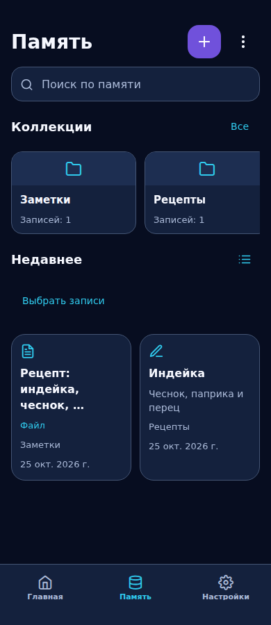
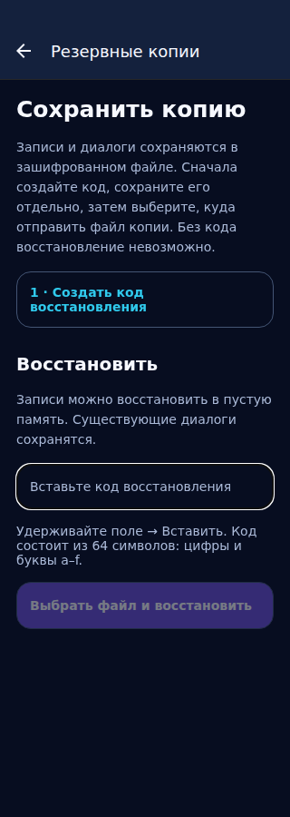

# Память: исправления видеоаудита — 25.10.2026

Продолжение объединённого PR #118. Основание — 24 замечания по пользовательскому
видео и отдельное наблюдение пустой главной страницы после возврата.
Это отчёт об изменениях и воспроизводимых проверках, не акт приёмки Android.

## Поведение

Одна кнопка добавления открывает текст/голос, фото, файл и ссылку. Текущая
коллекция переносится в импорт. Выбор фото не вызывает модель автоматически;
галерейный оригинал не удаляется, временные копии очищаются. «Все записи»
сбрасывает коллекцию, поиск и статус. Режим выбора начинается с нуля записей.

Карточки показывают полезный заголовок и текст без Markdown-разметки, сохраняя
исходные поля без переписывания. Счётчики учитывают все активные записи коллекции.
Страница чтения использует общий Markdown-компонент; действия находятся сразу
под содержимым. В редакторе сначала текст/голос, затем дополнительные поля.
Пустую заметку нельзя сохранить или отправить на редактирование ИИ.
Голосовая команда ИИ, предпросмотр и явное применение результата из #118 сохранены.

Обложки различают загрузку, отсутствие оригинала, большой файл и ошибку с повтором.
Временное скрытие не меняет высоту уже доступной обложки. Закрытая панель немедленно
удаляется до перехода на другой экран. Audio cleanup допускает уже освобождённый
проигрыватель. Home перемонтирует прежнюю сцену B+C при возвращении из background.

## Матрица замечаний

| № | Изменение и граница проверки |
| --- | --- |
| 1–2 | Явные состояния фото и повтор. Несохранённый оригинал восстановить невозможно. |
| 3 | Modal не занимает область navigation bar, содержимое прокручивается; реальный Android ещё проверить. |
| 4 | Оба входа «Все записи» сбрасывают поиск/коллекцию/архив; поведенческий тест. |
| 5 | Защита cleanup и ошибок управления аудио; причина выхода в видео не доказана. |
| 6 | Ширина коллекций учитывает fontScale, русские названия читаемее. |
| 7 | Отображаемый заголовок из текста вместо технического имени; сохранённое имя неизменно. |
| 8–9 | Меньше дублирования, три строки заголовка, отдельная дата/коллекция. |
| 10 | Компактные коллекции, семантические значки и реальные счётчики. |
| 11 | Явный режим выбора, ноль выбранных при входе, обычное нажатие переключает выбор. |
| 12 | Основные подписи карточек 13 px; системное масштабирование не отключено. |
| 13–15 | Иерархия коллекция/название/текст, Markdown, действия под короткой заметкой. |
| 16–17 | Различимые disabled Save и ИИ для пустого содержимого. |
| 18 | Текст и голос перед классификацией/дополнительными полями. |
| 19 | Единое добавление, галерея и передача коллекции в импорт. |
| 20–22 | Группировка меню, явный возврат к активным записям, отдельный текст пустого архива. |
| 23 | Контекстный источник импорта, вторичные действия, понятный заголовок этапа. |
| 24 | Шаги резервного копирования, подсказка вставки, проверка кода 64 hex. |
| Home | Lifecycle-тест background/remount без изменения графики. Нативная причина пустого экрана не подтверждена. |

## Проверки / приёмочный шаблон Nebula

| Проверка | Результат |
| --- | --- |
| Контракт | Nebula visual contract и утверждённая B+C; новые художественные ассеты не создавались. |
| Оригиналы REF-ICON-A/B | Проверка SHA через check-nebula-references; графика и иконки не изменены. |
| Компоненты/токены | Общие theme, MarkdownText, BottomSheet; существующие маршруты и модель данных. |
| TypeScript | PASS: npm --prefix mobile run typecheck. |
| Jest | PASS: 83 набора / 561 тест (--runInBand). Первый параллельный с браузером прогон: 560/561, один таймаут; отдельный импорт: 14/14. Jest сообщил о незакрытых async handles после прогона. |
| Browser UI | PASS: 320/360/390/430/768 px, CRUD, переходы, фильтры, disabled действия, backup validation. |
| Реальная клавиатура/system bars/TalkBack/масштаб 1.3–1.5 | NOT RUN на устройстве. Браузерная имитация insets не заменяет Android. |
| Reduce Motion/background | Browser reduced viewport + Jest lifecycle PASS; GPU/батарея/FPS на телефоне NOT RUN. |
| APK / Android smoke | Локально NOT RUN; CI конечного SHA проверяется отдельно. |
| Камера/Whisper/реальная LLM/восстановление backup | На устройстве NOT RUN; транспорт и формат данных не изменены. |
| Приёмка владельцем / U5 | Pending / OPEN. |

## Снимки

До: [библиотека PR #118](references/memory-20261024/browser/memory-390.png).
После: синтетические данные в production-компонентах browser harness, не Android.

## Оставшаяся телефонная проверка

1. Фото с сохранённым/отсутствующим оригиналом, повтор ошибки, блокировка во время загрузки.
2. Аудио play/pause → Back/переключение вкладки/background; снять native crash log при повторе.
3. Меню и backup при gesture/3-button navigation, клавиатуре и масштабе текста 1.5.
4. Фильтры/архив/корзина → все записи, выбор нескольких заметок и отмена.
5. Галерея/камера/голос/ИИ с подтверждением результата, отказом и сохранением черновика.
6. Home → фон → Home: прежняя B+C без пустого кадра; измерения GPU/FPS отдельно.

Новые функциональные пакеты (медиа в чате, вложения в существующую запись)
не заявлены завершёнными. SQLCipher, LLM transport и номера плана 1–91 сохранены.
