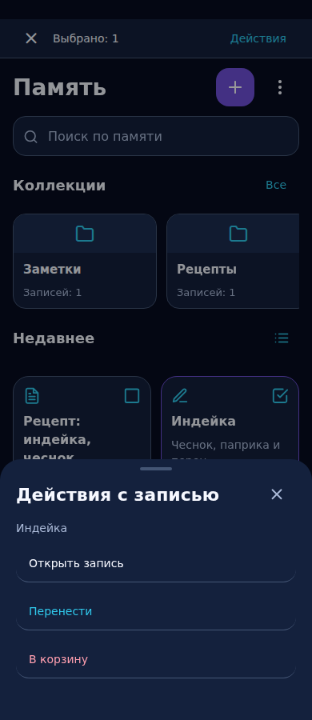
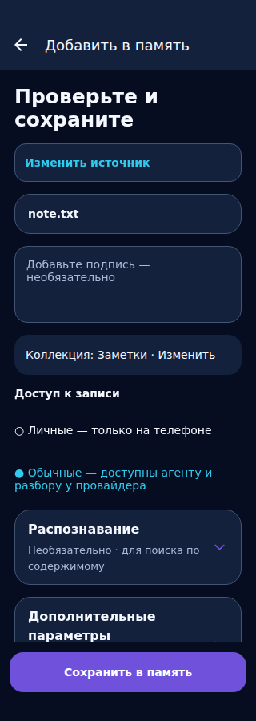

# Выбор записей, импорт и запуск микрофона — 25.10.2026

Основание: видео владельца 1000038986.mp4 (1:57), последующее согласие на исправления,
отдельные замечания о странном наборе действий при выборе и мигании «Защищено»
при запуске аудиозаписи. Продолжение объединённого PR #119; сфера B+C неизменна.
Видео/кадры с личными данными не публикуются. Снимки ниже — синтетический browser QA.

## Контракт

- Долгое нажатие или «Выбрать записи» включает выбор. Карточки получают checkbox
  и соответствующую подпись для accessibility. Закреплённая панель показывает
  количество, выход и кнопку «Действия»; с нулём выбранных она выключена.
- Одна запись: открыть, перенести, в корзину. Несколько активных: перенести,
  объединить с предпросмотром, в корзину. Корзина: открыть, восстановить,
  удалить навсегда с прежним подтверждением. Скрыты неподходящие операции.
- Успешная операция завершает выбор; отмена меню сохраняет выбор. Порядок объединения
  соответствует порядку выбора; максимум 100 записей. Ошибки видны в открытом меню.
- Карточки больше не растягиваются до высоты соседней фотографии.
- Импорт: источник/превью → необязательная подпись → коллекция и доступ.
  Коллекция выбирается в отдельной панели; распознавание и дополнительные поля
  свёрнуты. Сохранение вне ScrollView, над системной областью/клавиатурой.
- Без оригинала и без текста сохранить нельзя: disabled и объяснение.
  Выбор файла и раскрытие параметров не отправляют его модели. Явное распознавание,
  варианты «вместе/по очереди», исходные поля и шифрованное хранение сохранены.
- Карточки, подтверждения и новые ссылки на память используют одну функцию названия.
  Шаблонный OCR-заголовок пропускается; камера без подписи показывается как «Фото без подписи».
  Сохранённые названия, оригинальные имена файлов и старые ответы не переписываются.
- Только целые приветствия/благодарности/прощания обходят memory/rewrite/web prefetch.
  «Привет, найди рецепт» остаётся запросом с обычным поиском. Модель получает явную
  инструкцию не предлагать посторонние личные записи на приветствие.
- Системная диктовка и Whisper сначала проверяют уже выданное разрешение.
  Только окно запроса разрешения регистрируется как известное окно приложения,
  чтобы Android blur не включал «Защищено». inactive/background всегда скрывает
  содержимое; session timeout, обычный notification shade и биометрия сохранены.
  Исключение освобождается в finally, включая отказ/ошибку.
- Микрофон нельзя заново включить во время ответа LLM; отправка по-прежнему завершает
  текущую диктовку. Обработка LLM не прекращается при переходе по вкладкам.

## Приёмка

| Проверка | Статус |
| --- | --- |
| Nebula contract / artwork | Прежний контракт и B+C; графика и иконки не изменены. |
| Reuse | BottomSheet, NoteEditorSection, theme, существующие операции хранения и разрешения. |
| TypeScript | PASS. |
| Jest | PASS: 83 набора / 575 тестов. Jest предупреждает о незакрытых async handles при завершении worker. Регрессии выбора, compact import, greetings, permissions/AppLock и Whisper. |
| Browser | PASS: 320/360/390/430/768, insets 0/24/48, уменьшенная высота, сохранение импорта, меню выбора и существующие CRUD/чат/настройки. Дополнительно 320/390 с проверкой геометрии меню после завершения анимации. |
| SHA оригиналов / roadmap | PASS: check-nebula-references и check-roadmap-integrity (91 ID). |
| Реальный Android / клавиатура / TalkBack / текст ×1.3–1.5 | NOT RUN локально. |
| Микрофон на телефоне / пропадание мигания | NOT RUN на устройстве; проверены сценарии разрешений/blur/background в Jest. |
| APK / эмулятор | CI конечного SHA отдельно; минимальный Maestro не расширен. |
| FPS / батарея / новая художественная приёмка | NOT RUN; сфера не изменялась. |
| U5 / приёмка владельцем | OPEN / pending. |

## Сравнение

До: [аудит #119](MEMORY_AUDIT_FOLLOWUP_2026-10-25.md) и предоставленное владельцем видео.
После (browser, не Android):

## Проверить на телефоне

1. Долгое нажатие → одна/две записи → действия → отмена/перенос/объединение/корзина.
2. Импорт фото: подпись, коллекция, сохранить с клавиатурой и без; system 3-button/gesture.
3. Сохранение без оригинала: пустой текст блокирует Save, подпись разрешает.
4. Приветствие не вытаскивает постороннюю заметку; запрос рецепта находит нужную.
5. Микрофон с выданным разрешением, первый запрос разрешения, отказ, фон во время запроса;
   повторить для Whisper. «Защищено» должно появляться при уходе в фон, но не на blur
   известного окна разрешения. Реальный native trace нужен, если мигание повторится.
