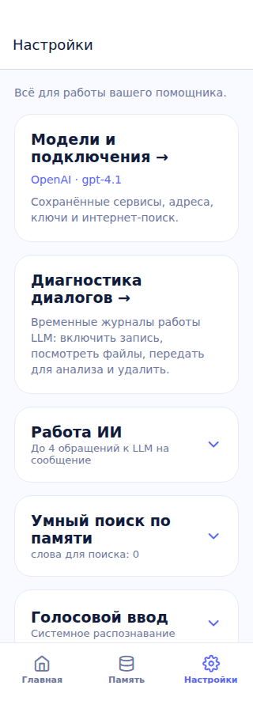
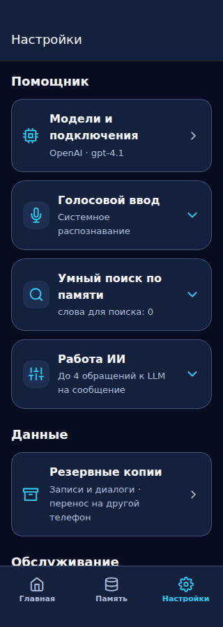
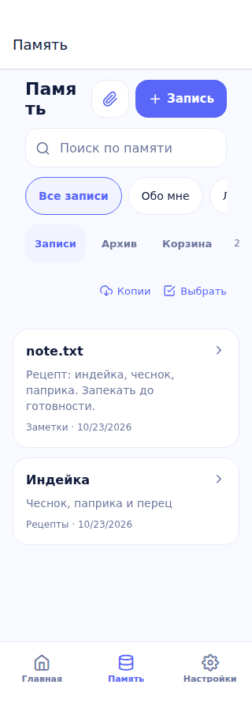
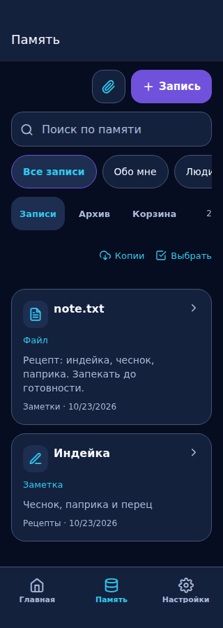

# Nebula: coherent working screens, orb frozen

23 October 2026 · U1/U2/U4, roadmap 88–90. Owner requested a separate PR after opening and comparing REF-UI-C. All three canonical references verified against SHA-256.

## Scope and scenarios

- Migrate working screens to the semantic dark Nebula palette through the existing theme adapter. Preserve exact Home scene colors, shader, artwork, status, scroll and IME behavior. Keep light tokens available for a future explicit app-wide theme selection; no stored theme setting exists to overwrite. Scope the provider inside RootNavigator so AppLock and profile selection keep their exact legacy OS-driven colors.
- Settings: compact icon/title/current-summary categories, Assistant → Data → Maintenance. Existing expandable forms retain saved expanded state, values, loading/errors and handlers. Diagnostics moves below daily settings. This is a shell improvement; full nested settings forms remain U4.
- Memory: type icon and text label, filename, full-width readable preview. Derive metadata from existing fields without new database queries, decrypting files or fetching remote images. Encrypted photo thumbnails require a separately bounded cache/lifecycle change and remain U3.
- Existing import/editor/backup forms inherit the common theme; no schema, transport, permissions or security changes. PR #107 editor remains separate.

## Acceptance

1. Switch Home / Memory / Settings on light and dark OS themes: working screens keep the approved dark brand, with no white flash; Home artwork and colors unchanged.
2. Open model connections / backups / diagnostics; expand voice, search and limits; save a limit and switch tabs / reload. Values persist, running chat is not interrupted.
3. Open/select notes with image/audio/video/file/link/plain metadata, long Cyrillic title and filename; keep selection, edit, archive and trash behavior.
4. Narrow width 320/360/390/430, font 1.5x: no horizontal overflow, rows grow; settings actions remain reachable. Native keyboard and TalkBack require APK acceptance.
5. Compare each changed screen with REF-UI-C during its delivery, not only at U5. U5 remains cross-screen acceptance.

## Verification

- PASS: TypeScript; full Jest 70 suites / 495 tests before final provider scoping; targeted theme, lock and viewport tests repeated after scoping.
- PASS: browser production-screen scenarios at 320/360/390/430/768px, light and dark OS appearances; synthetic 0/24/48px system insets, memory CRUD/import, voice/limit persistence, ongoing chat across tabs. Browser uses local Chromium 153 (CI installs its pinned Playwright browser).
- PASS: roadmap 91 IDs, ZIP and original image hashes; icon derivation check. Generated test icon files discarded; all icon assets unchanged in this PR.
- Before/after images below are real browser fixtures with synthetic data, not Android screenshots or a pixel-accurate native orb rendering. No claim of 1.5x native font/TalkBack/Gboard/performance acceptance.
- Android CI/build and physical-device acceptance remain separate and pending. Sphere shader, phases, artwork, Home layout/viewport and exact scene colors unchanged.

## Before / after (320px browser fixtures)

| Settings before | Settings after |
| --- | --- |
|  |  |

| Memory before | Memory after |
| --- | --- |
|  |  |

The narrow-screen review caught a duplicate Memory heading wrapping inside a word. It was removed and the list header aligned with the cards. Text actions now use the bright cyan role rather than the purple primary-button fill. Original filenames are shown only when distinct from the note title.

