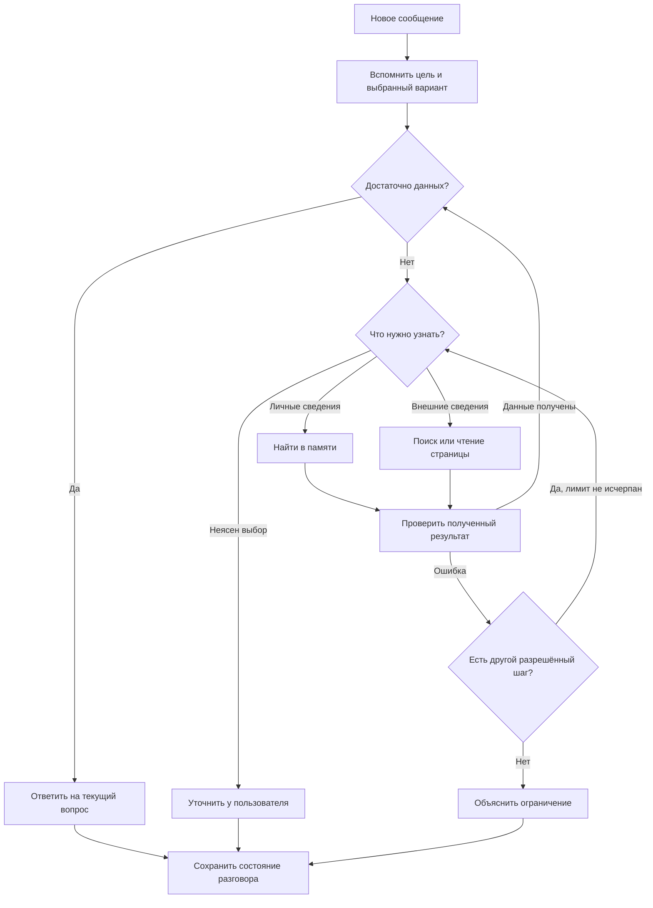

# Как помощник продолжает разговор

Цель, выбранный вариант и оставшиеся вопросы относятся к конкретному разговору.
Они переживают закрытие приложения и сокращение истории, но не становятся фактами
личной памяти. Модель уточняет их отдельным действием. Проверки на настоящих моделях
должны показать, достаточно ли надёжно она делает это при смене темы.

Приложение отдельно хранит наблюдения: ссылка найдена, страница прочитана, поиск пуст,
действие не удалось, запись предложена, сохранена или отклонена. Только успешная
запись в хранилище после подтверждения пользователя даёт отметку «сохранено».
Поздний ответ модели не может заменить её на «ждёт подтверждения».

## Как подключать инструменты

| Что описать | Пример | Кто отвечает |
| --- | --- | --- |
| Назначение | Найти личные заметки | Разработчик инструмента |
| Условия доступа | Интернет разрешён в настройках и разговоре | Приложение |
| Какие данные нужны | Слова для поиска или адрес страницы | Модель выбирает, приложение проверяет |
| Что инструмент делает | Читает информацию или предлагает изменение | Разработчик инструмента |
| Что означает результат | Найдено, прочитано, пусто, ошибка | Приложение проверяет фактический ответ |
| Как избежать повторов | Не создавать одинаковый ожидающий черновик | Приложение |

Один каталог используется для всех трёх протоколов подключения моделей. Новые
инструменты подключаются в этом месте; изменения не надо повторять в каждом
адаптере. Это интерфейс разработчика, а не установка произвольного исполняемого кода
из чата. Для будущих календаря и напоминаний сначала нужны реальные подключения и
правила подтверждения; наличие каталога само по себе их не добавляет.

## Границы текущего этапа

- До 10 последних наблюдений, ограниченная длина цели, выбора и выдержек.
- Состояние хранится в существующем зашифрованном снимке диалога, без новой схемы БД.
- Старые диалоги без состояния продолжают открываться; неизвестная версия состояния игнорируется.
- Запрет сети сохраняется отдельно от обрезаемой истории. Распознавание формулировок
  запрета/разрешения пока использует существующие языковые шаблоны и требует живой приёмки.
- Встроенный поиск Responses фиксирует найденные источники, а не прочтение страницы.
- Сохраняется предел 4 запросов основной модели. Дополнительного постоянного критика нет.
- Полное чтение заметок, полезный частичный ответ при исчерпании шагов и измерение
  качества настоящих моделей остаются отдельными пунктами плана.
